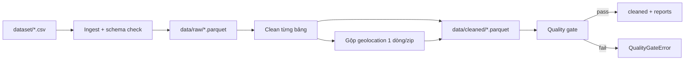

# Business Logic Model — U1 Data Foundation

## 1. Tổng quan

U1 chuyển 9 CSV thô thành 8 bảng sạch + 1 bảng geolocation gộp, kèm báo cáo chất lượng.



## 2. Ingest

### 2.1 Bảng nguồn và khóa

| Bảng | File | Số dòng | Khóa |
|---|---|---|---|
| orders | `olist_orders_dataset.csv` | 99.441 | `order_id` |
| customers | `olist_customers_dataset.csv` | 99.441 | `customer_id` |
| order_items | `olist_order_items_dataset.csv` | 112.650 | `(order_id, order_item_id)` |
| payments | `olist_order_payments_dataset.csv` | 103.886 | `(order_id, payment_sequential)` |
| reviews | `olist_order_reviews_dataset.csv` | 99.224 | `(review_id, order_id)` |
| products | `olist_products_dataset.csv` | 32.951 | `product_id` |
| sellers | `olist_sellers_dataset.csv` | 3.095 | `seller_id` |
| geolocation | `olist_geolocation_dataset.csv` | 1.000.163 | không (nhiều dòng/zip) |
| translation | `product_category_name_translation.csv` | 71 | `product_category_name` |

### 2.2 Luồng ingest

1. `load_config()` kiểm tra `dataset/` và tạo thư mục output.
2. Với mỗi bảng:
   - Đọc CSV UTF-8, không BOM.
   - So khớp danh sách cột với `TableSpec` (đúng tên, đúng thứ tự).
   - Đếm số dòng; so với `expected_rows` ở chế độ full batch.
   - Tính SHA-256 của tệp.
   - Ghi `data/raw/{table}.parquet`.
3. Ghi `ingest-report.json`: tệp, số dòng, số cột, hash, thời điểm.
4. Nếu thiếu tệp/cột/sai encoding → `SchemaError`, dừng ngay.
5. Không mở tệp nguồn ở chế độ ghi.

## 3. Cleaning

### 3.1 Quy trình chung

1. Đọc raw Parquet.
2. Chuẩn hóa kiểu dữ liệu (số, datetime, boolean).
3. Chuẩn hóa chuỗi (trim, lowercase) vào cột `*_normalized`, giữ cột gốc.
4. Tạo cờ chất lượng; **không xóa dòng** trừ geolocation theo quy tắc riêng.
5. Ghi `data/cleaned/{table}.parquet`.
6. Ghi `cleaning-report.json`: số dòng vào/ra, số null, số cờ, số bất thường.

### 3.2 Thứ tự cleaning

1. `customers`, `sellers` — chuẩn hóa city/state.
2. `products` — dịch category, gắn cờ thiếu.
3. `orders` — parse timestamp, `is_delivered`, cờ timestamp lỗi.
4. `order_items` — parse `shipping_limit_date`, kiểm tra giá, gắn cờ ngoại lai.
5. `payments` — kiểu số, giữ nguyên grain.
6. `reviews` — parse ngày, gắn cờ nhiều review/đơn.
7. `geolocation` — gộp zip (bước riêng, phức tạp nhất).

### 3.3 Thuật toán gộp geolocation

```text
1. Đọc 1.000.163 dòng.
2. Loại bỏ dòng trùng hoàn toàn (giữ dòng đầu): còn 738.332 dòng.
3. Đánh dấu valid_coord nếu lat ∈ [-34.0, 6.0] và lng ∈ [-74.0, -34.0].
4. Với các dòng valid_coord:
   - lat_median = median(lat)
   - lng_median = median(lng)
   - valid_coord_count = count
5. Với tất cả các dòng (kể cả tọa độ lỗi):
   - city_mode = mode(city) sau chuẩn hóa; hòa → alphabet
   - state_mode = mode(state); hòa → alphabet
   - city_variant_count = số biến thể city
   - row_count = số dòng của zip sau khi loại trùng hoàn toàn
6. Tập zip chuẩn = tất cả 19.015 zip xuất hiện trong geolocation gốc.
7. Left join tập zip với kết quả bước 4:
   - 19.010 zip có tọa độ.
   - 5 zip chỉ có tọa độ ngoài khung → lat/lng = null.
8. Ghi bảng `geolocation_zip` 19.015 dòng.
```

**Vì sao giữ 5 zip không có tọa độ hợp lệ**: để không mất zip khỏi dimension địa lý và giữ cam kết 19.015 dòng; tọa độ null được xử lý ở tầng phân tích.

### 3.4 Kết quả mong đợi

| Chỉ số | Giá trị |
|---|---|
| Geolocation raw | 1.000.163 |
| Dòng trùng hoàn toàn bị loại | 261.831 |
| Dòng ngoài khung Brazil | 42 |
| Zip sau gộp | 19.015 |
| Zip không có tọa độ hợp lệ | 5 |
| Zip có nhiều biến thể city (sau chuẩn hóa) | 8.555 |
| Price outlier IQR 1.5 | 8.427 |

## 4. Quality gate

### 4.1 Kiểm tra cấu trúc

- Đúng schema sau cleaning.
- Khóa chính duy nhất:
  - `orders.order_id`
  - `customers.customer_id`
  - `(order_id, order_item_id)`
  - `(order_id, payment_sequential)`
  - `(review_id, order_id)`
  - `products.product_id`
  - `sellers.seller_id`
  - `translation.product_category_name`
  - `geolocation_zip.zip_code_prefix`
- Foreign key:
  - items.order_id → orders
  - items.product_id → products
  - items.seller_id → sellers
  - payments.order_id → orders
  - reviews.order_id → orders
  - orders.customer_id → customers
- Không orphan; không null ở khóa chính.
- Miền giá trị: `review_score` 1-5; `price ≥ 0`; `freight_value ≥ 0`; `payment_installments ≥ 0`; `order_status` thuộc 8 giá trị.

### 4.2 Allowlist bất thường đã biết (full batch)

| Mã | Kiểm tra | Giá trị baseline | Hành vi |
|---|---|---|---|
| Q-01 | Đơn không có item | 775 | Cho phép đúng 775 |
| Q-02 | Đơn không có payment | 1 | Cho phép đúng 1 |
| Q-03 | Customer zip thiếu geo | 278 | Cho phép đúng 278 |
| Q-04 | Seller zip thiếu geo | 7 | Cho phép đúng 7 |
| Q-05 | Sản phẩm thiếu category | 610 | Cho phép đúng 610 |
| Q-06 | Đơn nhiều review | 547 | Cho phép đúng 547 |
| Q-07 | Geo trùng hoàn toàn | 261.831 | Cho phép đúng |
| Q-08 | Geo ngoài khung | 42 | Cho phép đúng |
| Q-09 | Zip không có tọa độ hợp lệ | 5 | Cho phép đúng |
| Q-10 | Price outlier IQR 1.5 | 8.427 | Cho phép đúng |
| Q-11 | Lệch payment vs item | 378 đơn | **Warning**, không fail |

### 4.3 Chế độ incremental (micro-batch)

- Không dùng số tuyệt đối; kiểm tra cấu trúc + tỷ lệ.
- Không fail vì tổng số dòng tăng.
- Vẫn fail nếu: sai schema, khóa trùng trong batch, orphan, null khóa chính, giá trị ngoài miền.
- Ghi rõ `mode = full|incremental` trong quality report.

### 4.4 Hành vi khi fail

1. Ghi `quality-report.json` với check fail.
2. Ném `QualityGateError`.
3. Không ghi đè `data/cleaned/` / mart cũ.
4. CLI trả mã 1.

## 5. Đầu ra

| Artifact | Nội dung |
|---|---|
| `data/raw/*.parquet` | 9 bảng raw |
| `data/cleaned/*.parquet` | 8 bảng sạch + `geolocation_zip` |
| `ingest-report.json` | hash, số dòng, thời điểm |
| `cleaning-report.json` | số dòng vào/ra, null, cờ |
| `quality-report.json` | checks, allowlist, pass/fail |

## 6. Xử lý lỗi

| Tình huống | Exception | Hành vi |
|---|---|---|
| Thiếu tệp/cột | `SchemaError` | Dừng ingest |
| Sai encoding | `SchemaError` | Dừng ingest |
| Khóa trùng | `QualityGateError` | Dừng sau cleaning |
| Orphan | `QualityGateError` | Dừng |
| Bất thường vượt allowlist | `QualityGateError` | Dừng |
| Thiếu geolocation cho zip | Không lỗi | Giữ null + báo cáo |
| Category thiếu | Không lỗi | `unknown` + cờ |
