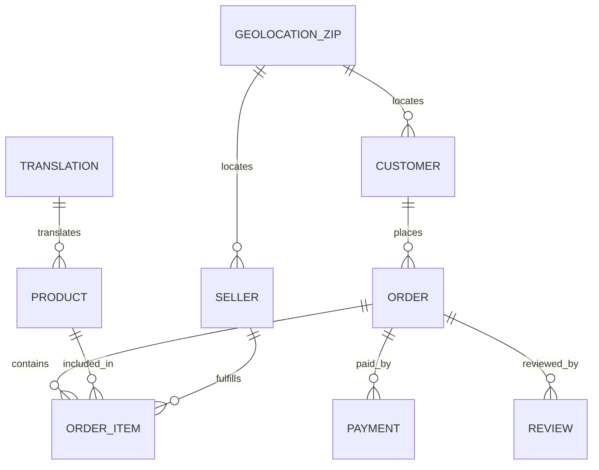

# Domain Entities — U1 Data Foundation

## 1. Sơ đồ quan hệ

## 2. Entity: Customer

**Bảng**: `data/cleaned/customers.parquet`
**Grain**: một dòng / `customer_id` (theo đơn).

| Trường | Kiểu | Ràng buộc |
|---|---|---|
| `customer_id` | string | PK, unique, not null |
| `customer_unique_id` | string | not null; không unique (96.096 giá trị) |
| `customer_zip_code_prefix` | int | 5 chữ số |
| `customer_city` | string | giữ nguyên |
| `customer_city_normalized` | string | trim/lowercase/NFC |
| `customer_state` | string | 2 ký tự, uppercase |

**Quan hệ**: 1 customer_id → 1 order; 1 customer_unique_id → nhiều order.

## 3. Entity: Seller

**Bảng**: `data/cleaned/sellers.parquet`
**Grain**: một dòng / `seller_id`.

| Trường | Kiểu | Ràng buộc |
|---|---|---|
| `seller_id` | string | PK, unique, not null |
| `seller_zip_code_prefix` | int | 5 chữ số |
| `seller_city` | string | giữ nguyên |
| `seller_city_normalized` | string | trim/lowercase/NFC |
| `seller_state` | string | uppercase |

## 4. Entity: Product

**Bảng**: `data/cleaned/products.parquet`
**Grain**: một dòng / `product_id`.

| Trường | Kiểu | Ràng buộc |
|---|---|---|
| `product_id` | string | PK, unique, not null |
| `product_category_name` | string | `unknown` nếu null |
| `product_category_name_english` | string | tên dịch hoặc tên gốc |
| `category_missing` | bool | true cho 610 sản phẩm |
| `translation_missing` | bool | true cho 13 sản phẩm thuộc 2 danh mục thiếu bản dịch |
| `product_name_lenght` | float | giữ tên cột gốc |
| `product_description_lenght` | float | |
| `product_photos_qty` | float | |
| `product_weight_g` | float | null 2 |
| `product_length_cm` | float | null 2 |
| `product_height_cm` | float | null 2 |
| `product_width_cm` | float | null 2 |

## 5. Entity: Order

**Bảng**: `data/cleaned/orders.parquet`
**Grain**: một dòng / `order_id`.

| Trường | Kiểu | Ràng buộc |
|---|---|---|
| `order_id` | string | PK, unique, not null |
| `customer_id` | string | FK → Customer, not null |
| `order_status` | string | 8 giá trị hợp lệ |
| `order_purchase_timestamp` | datetime | not null |
| `order_approved_at` | datetime | null 160 |
| `order_delivered_carrier_date` | datetime | null 1.783 |
| `order_delivered_customer_date` | datetime | null 2.965 |
| `order_estimated_delivery_date` | datetime | not null |
| `is_delivered` | bool | `order_status == "delivered"` |
| `has_invalid_timestamp` | bool | true nếu có timestamp nguồn không parse được |

**Quan hệ**: 1 order → nhiều item/payment/review.

## 6. Entity: OrderItem

**Bảng**: `data/cleaned/order_items.parquet`
**Grain**: một dòng / `(order_id, order_item_id)`.

| Trường | Kiểu | Ràng buộc |
|---|---|---|
| `order_id` | string | FK → Order, not null |
| `order_item_id` | int | not null |
| `product_id` | string | FK → Product, not null |
| `seller_id` | string | FK → Seller, not null |
| `shipping_limit_date` | datetime | parse từ chuỗi |
| `price` | float | ≥ 0 |
| `freight_value` | float | ≥ 0 |
| `price_outlier` | bool | IQR 1.5 trên `price` |

**Khóa**: composite `(order_id, order_item_id)` unique.

## 7. Entity: Payment

**Bảng**: `data/cleaned/payments.parquet`
**Grain**: một dòng / `(order_id, payment_sequential)`.

| Trường | Kiểu | Ràng buộc |
|---|---|---|
| `order_id` | string | FK → Order, not null |
| `payment_sequential` | int | not null |
| `payment_type` | string | credit_card, boleto, voucher, debit_card, not_defined |
| `payment_installments` | int | ≥ 0 |
| `payment_value` | float | ≥ 0 |

**Không** aggregate; 99.440 đơn có payment, 1 đơn không.

## 8. Entity: Review

**Bảng**: `data/cleaned/reviews.parquet`
**Grain**: một dòng / `(review_id, order_id)`.

| Trường | Kiểu | Ràng buộc |
|---|---|---|
| `review_id` | string | không unique một mình (814 trùng) |
| `order_id` | string | FK → Order, not null |
| `review_score` | int | 1-5 |
| `review_comment_title` | string | null 87.656 |
| `review_comment_message` | string | null 58.247 |
| `review_creation_date` | datetime | |
| `review_answer_timestamp` | datetime | |
| `multiple_reviews_per_order` | bool | true cho 547 đơn (1.098 dòng review) |

**Khóa**: composite `(review_id, order_id)` unique.

## 9. Entity: GeolocationZip

**Bảng**: `data/cleaned/geolocation_zip.parquet`
**Grain**: một dòng / `zip_code_prefix`.

| Trường | Kiểu | Ràng buộc |
|---|---|---|
| `zip_code_prefix` | int | PK, unique, not null |
| `lat_median` | float | null cho 5 zip không có tọa độ hợp lệ |
| `lng_median` | float | null cho 5 zip |
| `city_mode` | string | mode, tie alphabet |
| `state_mode` | string | mode, tie alphabet |
| `row_count` | int | số dòng của zip sau khi loại trùng hoàn toàn |
| `valid_coord_count` | int | số dòng tọa độ hợp lệ |
| `city_variant_count` | int | số biến thể city |

**Quan hệ**: 1 zip → nhiều customer/seller.

## 10. Entity: Translation

**Bảng**: `data/cleaned/category_translation.parquet`
**Grain**: một dòng / `product_category_name`.

| Trường | Kiểu | Ràng buộc |
|---|---|---|
| `product_category_name` | string | PK, unique |
| `product_category_name_english` | string | not null |

71 dòng; 2 danh mục trong products không có ở bảng này.

## 11. Entity báo cáo

### IngestReport
- `run_id`, `files[]` (path, rows, columns, sha256, read_at), `passed`.

### CleaningReport
- `run_id`, `tables[]` (name, rows_in, rows_out, null_counts, flag_counts), `geolocation` (raw, deduped, outside_bbox, zips, zips_without_coord).

### QualityReport
- `run_id`, `mode` (full/incremental), `checks[]` (id, name, passed, expected, actual, details), `passed`.

### ReconciliationReport
- `run_id`, `orders_compared`, `mismatch_count`, `max_abs_diff`, `examples[]`.

## 12. Bất biến dữ liệu

- Không null ở tất cả khóa chính.
- `orders.order_id`, `customers.customer_id`, `products.product_id`, `sellers.seller_id` unique.
- `(order_id, order_item_id)`, `(order_id, payment_sequential)`, `(review_id, order_id)` unique.
- `geolocation_zip.zip_code_prefix` unique.
- `review_score ∈ [1,5]`.
- `price ≥ 0`, `freight_value ≥ 0`, `payment_installments ≥ 0`.
- `is_delivered` chỉ true khi status `delivered`.
- 8 bảng cleaned (trừ geolocation) giữ nguyên số dòng raw.
- `dataset/` không bị thay đổi.
