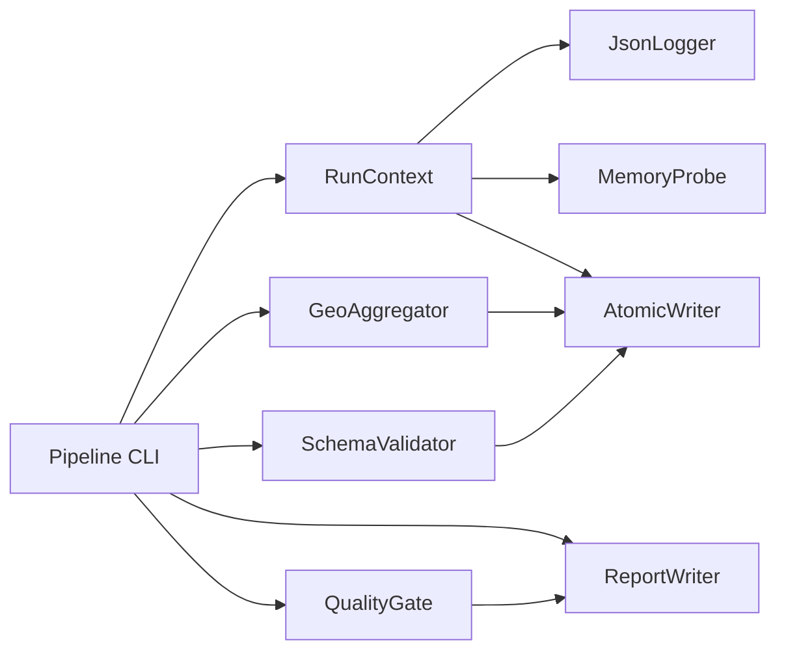

# Logical Components — U1 Data Foundation

## 1. Sơ đồ tương tác



## 2. RunContext

**Trách nhiệm**: Mang `run_id`, stage, thời điểm, logger, config.

**Interface**
```python
@dataclass(frozen=True)
class RunContext:
    run_id: str
    stage: str
    started_at: datetime
    temp_dir: Path
    log_path: Path
```

**NFR**: U1-04, U1-05.

## 3. JsonLogger

**Trách nhiệm**: Ghi JSON lines + console summary.

**Interface**
```python
class JsonLogger:
    def info(self, event: str, **fields) -> None: ...
    def warning(self, event: str, **fields) -> None: ...
    def error(self, event: str, error_code: str, **fields) -> None: ...
```

**Trường bắt buộc**: timestamp, level, run_id, stage, message.
**Không** log dữ liệu từng dòng.

**NFR**: U1-04.

## 4. AtomicWriter

**Trách nhiệm**: Ghi Parquet/JSON atomic, xác minh sau ghi.

**Interface**
```python
class AtomicWriter:
    def write_parquet(self, df: pd.DataFrame, path: Path) -> None: ...
    def write_json(self, payload: dict, path: Path) -> None: ...
    def cleanup_temp(self) -> None: ...
```

**Hành vi**
- Tạo tệp tạm trong `data/.tmp/{run_id}/`.
- `os.replace` sau khi đọc lại thành công.
- Lỗi → giữ tệp tạm, log đường dẫn.

**NFR**: U1-03, U1-10.

## 5. SchemaValidator

**Trách nhiệm**: So khớp cột/thứ tự/kiểu với `TableSpec`.

**Interface**
```python
class SchemaValidator:
    def validate(self, df: pd.DataFrame, spec: TableSpec) -> None: ...
```

**Hành vi**
- Thiếu/thừa cột → `SchemaError`.
- Sai kiểu nghiêm trọng (ví dụ ngày không parse) → `SchemaError`.
- Ghi log số cột, tên cột.

**NFR**: U1-03, U1-05.

## 6. GeoAggregator

**Trách nhiệm**: Dedupe, lọc bbox, median tọa độ, mode city/state, bảo toàn đủ zip.

**Interface**
```python
class GeoAggregator:
    def aggregate(self, df: pd.DataFrame) -> pd.DataFrame: ...
```

**Hành vi**
- `drop_duplicates` toàn bộ 5 cột.
- `valid_coord` vectorized.
- Groupby median cho lat/lng.
- Groupby size + sort để chọn mode.
- Left join với tất cả zip.
- Log các con số: raw, deduped, outside_bbox, zips, zips_without_coord.

**NFR**: U1-01, U1-02, U1-05.

## 7. QualityGate

**Trách nhiệm**: Chạy check cấu trúc + allowlist; full/incremental mode.

**Interface**
```python
class QualityGate:
    def run(self, datasets: dict[str, pd.DataFrame], mode: Literal["full", "incremental"]) -> QualityReport: ...
```

**Hành vi**
- Unique/FK/row count/domain checks.
- Full: so baseline Q-01 → Q-10.
- Incremental: bỏ qua số tuyệt đối.
- Fail → `QualityGateError`.

**NFR**: U1-03, U1-09.

## 8. ReportWriter

**Trách nhiệm**: Ghi 4 báo cáo JSON.

**Interface**
```python
class ReportWriter:
    def write_ingest(self, report: IngestReport) -> None: ...
    def write_cleaning(self, report: CleaningReport) -> None: ...
    def write_quality(self, report: QualityReport) -> None: ...
    def write_reconciliation(self, report: ReconciliationReport) -> None: ...
```

**NFR**: U1-04, U1-05.

## 9. MemoryProbe

**Trách nhiệm**: Đo peak allocation, log, cảnh báo.

**Interface**
```python
class MemoryProbe:
    def start(self) -> None: ...
    def reset_peak(self) -> None: ...
    def snapshot(self, label: str) -> float: ...  # peak MB
```

**Hành vi**
- Dùng `tracemalloc`.
- Log `peak_mb`.
- Warning > 1536 MB; fail cấu hình > 2048 MB.

**NFR**: U1-02.

## 10. TestFixtures

**Trách nhiệm**: Cung cấp dữ liệu nhỏ tổng hợp và marker `slow`.

**Interface**
```python
# tests/conftest.py
@pytest.fixture
def small_orders() -> pd.DataFrame: ...
@pytest.fixture
def small_geo() -> pd.DataFrame: ...
@pytest.fixture
def real_dataset() -> Path: ...  # đánh dấu slow
```

**Hành vi**
- Unit test không đọc `dataset/`.
- Integration test đọc CSV thật, có thể skip bằng `-m "not slow"`.

**NFR**: U1-07.

## 11. Cấu hình logical component

| Tham số | Giá trị mặc định | Nguồn |
|---|---|---|
| `parquet_compression` | `snappy` | config.yaml |
| `memory_warn_mb` | 1536 | config.yaml |
| `memory_fail_mb` | 2048 | config.yaml |
| `geo_bbox_lat` | `[-34.0, 6.0]` | config.yaml |
| `geo_bbox_lng` | `[-74.0, -34.0]` | config.yaml |
| `iqr_multiplier` | 1.5 | config.yaml |
| `quality_mode` | `full` | CLI |
| `log_dir` | `logs/` | config.yaml |

## 12. Ranh giới

- Logical component nằm trong `src/common`, `src/ingest`, `src/clean`, `src/quality`.
- Không component nào đọc CSV trực tiếp ngoài `ingest`.
- `GeoAggregator` không ghi file; `AtomicWriter` chịu trách nhiệm ghi.
- `QualityGate` không sửa dữ liệu.
- `ReportWriter` không tính toán, chỉ serialize.
