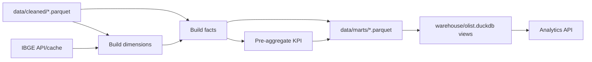

# Business Logic Model — U2 Integration & Analytics

## 1. Tổng quan

U2 nhận cleaned Parquet từ U1, bổ sung IBGE, xây star schema và lớp analytics.

## 2. Dữ liệu IBGE

### 2.1 Nguồn

- API chính thức: `https://servicodados.ibge.gov.br/api/v1/localidades/estados`
- API municipality: `https://servicodados.ibge.gov.br/api/v1/localidades/municipios`
- Cache tại `dataset/external/ibge/`:
  - `estados.json`
  - `municipios.json`
  - `metadata.json` (URL, fetched_at, sha256, row counts)

### 2.2 Quy trình

1. Nếu cache hợp lệ (27 estados, 5 vùng) → dùng cache, log `cache_hit`.
2. Nếu không có cache:
   - Gọi API estados; kiểm tra 27 bản ghi.
   - Gọi API municipios; lưu cache (không bắt buộc dùng cho KPI).
   - Ghi metadata + hash.
3. Nếu mất mạng và không có cache → `ExternalSourceError`, dừng.
4. Chuẩn hóa:
   - `sigla` → uppercase (2 ký tự).
   - `regiao.nome` giữ tên chính thức (Norte, Nordeste, Centro-Oeste, Sudeste, Sul).
5. Tạo `region_map`: 27 dòng `(state, region)`.

### 2.3 Kiểm tra

- 27 state, unique.
- 5 region, không null.
- Mọi state trong customers/sellers phải map được; nếu không → `ExternalSourceError` hoặc quality check fail.

## 3. Dimensions

### 3.1 `dim_date`

- Phạm vi: 2016-09-04 → 2018-10-17, **774 ngày**.
- `date_key` = `YYYY-MM-DD` (natural key).
- `is_sparse_period = (year == 2016)`.
- Thuộc tính: year, quarter, month, day, weekday.

### 3.2 `dim_customer`

- Grain: `customer_id` (99.441 dòng).
- Thuộc tính: `customer_unique_id` (96.096 unique), zip, city, state, region.
- Mua lặp lại dùng `customer_unique_id`, không dùng `customer_id`.

### 3.3 `dim_product`

- Grain: `product_id` (32.951).
- Giữ `category_missing`, `translation_missing`.
- `category` = unknown cho 610 sản phẩm; `category_english` fallback tên gốc.

### 3.4 `dim_seller`

- Grain: `seller_id` (3.095).
- Zip, city, state, region.

### 3.5 `dim_geography`

- Grain: `zip_code_prefix` (19.015).
- `lat_median`, `lng_median`, `city_mode`, `state_mode`, region.
- 5 zip có tọa độ null; vẫn giữ dòng.

## 4. Facts

### 4.1 `fact_order_items`

- Grain: `(order_id, order_item_id)` — **112.650** dòng.
- Khóa: order_id, order_item_id, customer_id, product_id, seller_id, date_key.
- Đo: price, freight_value, item_total = price + freight_value.
- Thuộc tính degenerate: order_status, is_delivered, price_outlier.

### 4.2 `fact_orders`

- Grain: `order_id` — **99.441** dòng.
- Khóa: customer_id, date_key.
- Thuộc tính: status, is_delivered, delivered_customer_date, estimated_delivery_date.
- Đo/thuộc tính: delivery_days, is_late, has_items, has_payment, has_review.
- `is_late` chỉ true khi delivered và delivered_customer_date > estimated_delivery_date.

### 4.3 `fact_payments`

- Grain: `(order_id, payment_sequential)` — **103.886** dòng.
- `date_key` lấy từ ngày mua của order.
- Đo: payment_value; thuộc tính: payment_type, payment_installments.

### 4.4 `fact_reviews`

- Grain: `(review_id, order_id)` — **99.224** dòng.
- `date_key` từ `review_creation_date`.
- Thuộc tính: review_score, multiple_reviews_per_order.

## 5. Pre-aggregation

### 5.1 `agg_sales_daily`

- Grain: `(date_key, state, region, category)`.
- Đo: revenue (item_total), orders (distinct order_id), items, freight.
- `is_sparse_period` kế thừa từ dim_date.
- Dùng cho dashboard lọc theo ngày/bang/vùng/danh mục.

### 5.2 `agg_delivery_daily`

- Grain: `(date_key, state, region, category)`.
- Đo: delivered_orders, late_orders, delivery_days_sum.
- `is_sparse_period`.

## 6. DuckDB catalog

`warehouse/olist.duckdb` tạo view:

- `v_dim_customer`, `v_dim_product`, `v_dim_seller`, `v_dim_geography`, `v_dim_date`
- `v_fact_order_items`, `v_fact_orders`, `v_fact_payments`, `v_fact_reviews`
- `v_agg_sales_daily`, `v_agg_delivery_daily`

View dùng `read_parquet('data/marts/{table}.parquet')`; không copy dữ liệu, không đọc CSV.

## 7. Analytics API

### `kpi_summary(filters)`
- revenue, orders, aov, late_rate, avg_review_score.
- Mặc định `order_status = delivered`.

### `revenue_by_period(filters, granularity)`
- month/quarter/year; revenue, orders, aov, is_sparse_period.

### `revenue_by_dimension(filters, dimension)`
- category/region/state; revenue, orders, aov, freight_share.

### `top_entities(filters, entity, limit)`
- product/seller; delivered revenue; tie-break ID.

### `delivery_kpis(filters, group_by)`
- state/category/month; delivered_orders, late_orders, late_rate, avg_delivery_days.

## 8. KPI baseline

| KPI | Giá trị |
|---|---|
| Doanh thu delivered (`price + freight`) | **15.419.773,75 BRL** |
| Số đơn delivered | **96.478** |
| AOV delivered | **159,83 BRL** |
| Đơn giao trễ | **7.826** |
| Tỷ lệ giao trễ | **8,11%** |
| Tổng doanh thu all-status | 15.843.553,24 BRL |

## 9. Kiểm tra sau integrate

- `dim_customer` 99.441; `dim_product` 32.951; `dim_seller` 3.095; `dim_geography` 19.015; `dim_date` 774.
- `fact_order_items` 112.650; `fact_orders` 99.441; `fact_payments` 103.886; `fact_reviews` 99.224.
- Join `fact_order_items` × dims không nhân bản.
- KPI khớp baseline.
- 27 state → 5 region.
- 2016 có `is_sparse_period = true`.

## 10. Xử lý lỗi

| Tình huống | Exception | Hành vi |
|---|---|---|
| IBGE API lỗi, không cache | `ExternalSourceError` | Dừng |
| State không map được | `ExternalSourceError` | Dừng, nêu state |
| Fact/dim sai grain | `QualityGateError` | Dừng |
| DuckDB không mở được | `PipelineError` | Dừng |
| 2016 thiếu dữ liệu | Không lỗi | Cờ sparse |
