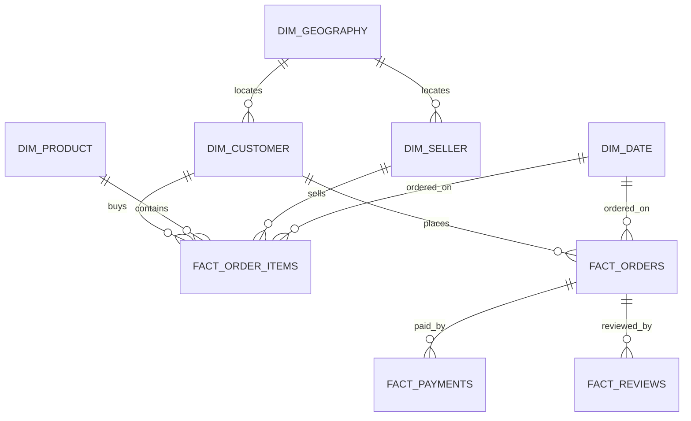

# Domain Entities — U2 Integration & Analytics

## 1. Sơ đồ quan hệ

## 2. `dim_customer`

**Grain**: một dòng / `customer_id` (99.441).

| Trường | Kiểu | Ràng buộc |
|---|---|---|
| `customer_id` | string | PK, unique |
| `customer_unique_id` | string | not null; 96.096 unique |
| `zip_code_prefix` | int | FK → dim_geography |
| `city` | string | |
| `city_normalized` | string | |
| `state` | string | 2 ký tự |
| `region` | string | 1 trong 5 vùng IBGE |

**Quan hệ**: 1 customer_id → nhiều fact_order_items/fact_orders.

## 3. `dim_product`

**Grain**: một dòng / `product_id` (32.951).

| Trường | Kiểu | Ràng buộc |
|---|---|---|
| `product_id` | string | PK, unique |
| `category` | string | `unknown` nếu thiếu |
| `category_english` | string | fallback tên gốc |
| `category_missing` | bool | 610 true |
| `translation_missing` | bool | 13 sản phẩm / 2 danh mục |

## 4. `dim_seller`

**Grain**: một dòng / `seller_id` (3.095).

| Trường | Kiểu | Ràng buộc |
|---|---|---|
| `seller_id` | string | PK, unique |
| `zip_code_prefix` | int | FK → dim_geography |
| `city` | string | |
| `city_normalized` | string | |
| `state` | string | |
| `region` | string | 5 vùng IBGE |

## 5. `dim_geography`

**Grain**: một dòng / `zip_code_prefix` (19.015).

| Trường | Kiểu | Ràng buộc |
|---|---|---|
| `zip_code_prefix` | int | PK, unique |
| `lat_median` | float | null cho 5 zip |
| `lng_median` | float | null cho 5 zip |
| `city_mode` | string | mode |
| `state_mode` | string | mode |
| `region` | string | 5 vùng |

## 6. `dim_date`

**Grain**: một dòng / ngày (774).

| Trường | Kiểu | Ràng buộc |
|---|---|---|
| `date_key` | string | PK, `YYYY-MM-DD` |
| `date` | date | |
| `year` | int | 2016-2018 |
| `quarter` | int | 1-4 |
| `month` | int | 1-12 |
| `day` | int | 1-31 |
| `weekday` | int | 0-6 |
| `is_sparse_period` | bool | true nếu year = 2016 |

## 7. `fact_order_items`

**Grain**: `(order_id, order_item_id)` — 112.650.

| Trường | Kiểu | Ràng buộc |
|---|---|---|
| `order_id` | string | FK → fact_orders |
| `order_item_id` | int | composite PK |
| `customer_id` | string | FK → dim_customer |
| `product_id` | string | FK → dim_product |
| `seller_id` | string | FK → dim_seller |
| `date_key` | string | FK → dim_date |
| `price` | float | ≥ 0 |
| `freight_value` | float | ≥ 0 |
| `item_total` | float | price + freight |
| `price_outlier` | bool | |
| `order_status` | string | degenerate |
| `is_delivered` | bool | degenerate |

**Khóa**: `(order_id, order_item_id)` unique.

## 8. `fact_orders`

**Grain**: `order_id` — 99.441.

| Trường | Kiểu | Ràng buộc |
|---|---|---|
| `order_id` | string | PK |
| `customer_id` | string | FK → dim_customer |
| `date_key` | string | FK → dim_date |
| `order_status` | string | 8 giá trị |
| `is_delivered` | bool | |
| `delivered_customer_date` | datetime | null 2.965 |
| `estimated_delivery_date` | datetime | not null |
| `delivery_days` | float | null nếu chưa giao |
| `is_late` | bool | chỉ delivered |
| `has_items` | bool | |
| `has_payment` | bool | |
| `has_review` | bool | |

## 9. `fact_payments`

**Grain**: `(order_id, payment_sequential)` — 103.886.

| Trường | Kiểu | Ràng buộc |
|---|---|---|
| `order_id` | string | FK → fact_orders |
| `payment_sequential` | int | composite PK |
| `date_key` | string | FK → dim_date |
| `payment_type` | string | |
| `payment_installments` | int | ≥ 0 |
| `payment_value` | float | ≥ 0 |

## 10. `fact_reviews`

**Grain**: `(review_id, order_id)` — 99.224.

| Trường | Kiểu | Ràng buộc |
|---|---|---|
| `review_id` | string | composite PK |
| `order_id` | string | FK → fact_orders |
| `date_key` | string | FK → dim_date |
| `review_score` | int | 1-5 |
| `multiple_reviews_per_order` | bool | |

## 11. `agg_sales_daily`

**Grain**: `(date_key, state, region, category)`.

| Trường | Kiểu | Ràng buộc |
|---|---|---|
| `date_key` | string | FK → dim_date |
| `state` | string | |
| `region` | string | |
| `category` | string | |
| `revenue` | float | sum item_total delivered |
| `orders` | int | distinct order_id |
| `items` | int | count item rows |
| `freight` | float | sum freight |
| `is_sparse_period` | bool | year 2016 |

## 12. `agg_delivery_daily`

**Grain**: `(date_key, state, region, category)`.

| Trường | Kiểu | Ràng buộc |
|---|---|---|
| `date_key` | string | FK → dim_date |
| `state` | string | |
| `region` | string | |
| `category` | string | |
| `delivered_orders` | int | |
| `late_orders` | int | |
| `delivery_days_sum` | float | |
| `is_sparse_period` | bool | |

## 13. Bất biến dữ liệu

- Natural keys, không surrogate.
- Row counts: dim_customer 99.441; dim_product 32.951; dim_seller 3.095; dim_geography 19.015; dim_date 774.
- Fact counts: items 112.650; orders 99.441; payments 103.886; reviews 99.224.
- `fact_order_items` join dims không nhân bản.
- `fact_payments`/`fact_reviews` không join trực tiếp vào fact_order_items.
- `is_late` chỉ true khi `is_delivered = true`.
- `delivery_days` null với đơn chưa giao.
- `dim_date.is_sparse_period = true` cho 2016.
- `region` không null sau khi map IBGE.
- KPI baseline: revenue delivered 15.419.773,75; orders 96.478; AOV 159,83; late 7.826/96.478 = 8,11%.
