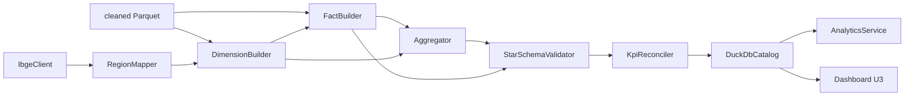

# Logical Components — U2 Integration & Analytics

## 1. Sơ đồ tương tác



## 2. IbgeClient

**Trách nhiệm**: Fetch/cache estados & municipios; retry; metadata.

**Interface**
```python
class IbgeClient:
    def fetch_states(self, refresh: bool = False) -> pd.DataFrame: ...
    def fetch_municipalities(self, refresh: bool = False) -> pd.DataFrame: ...
    def load_region_map(self, refresh: bool = False) -> pd.DataFrame: ...
```

**Hành vi**
- Cache valid nếu 27 states.
- Timeout 10s, retry 2.
- Metadata SHA-256.
- Lỗi → `ExternalSourceError`.

**NFR**: U2-04, U2-08.

## 3. RegionMapper

**Trách nhiệm**: Chuẩn hóa state, map region, validate.

**Interface**
```python
class RegionMapper:
    def build(self, states: pd.DataFrame) -> pd.DataFrame: ...
    def validate(self, region_map: pd.DataFrame, states_in_data: set[str]) -> None: ...
```

**Hành vi**
- 27 state → 5 region.
- State uppercase.
- State lạ → `ExternalSourceError`.

**NFR**: U2-04, U2-06.

## 4. DimensionBuilder

**Trách nhiệm**: Tạo 5 dimension.

**Interface**
```python
class DimensionBuilder:
    def build_customer(self, customers, region_map) -> pd.DataFrame: ...
    def build_product(self, products) -> pd.DataFrame: ...
    def build_seller(self, sellers, region_map) -> pd.DataFrame: ...
    def build_geography(self, geo, region_map) -> pd.DataFrame: ...
    def build_date(self, min_date, max_date) -> pd.DataFrame: ...
    def build_all(self, cleaned, region_map) -> dict[str, pd.DataFrame]: ...
```

**Hành vi**
- Natural keys.
- `dim_date` 774 ngày.
- `is_sparse_period` cho 2016.
- Region không null.

**NFR**: U2-01, U2-07.

## 5. FactBuilder

**Trách nhiệm**: Tạo 4 fact.

**Interface**
```python
class FactBuilder:
    def build_order_items(self, cleaned, dims) -> pd.DataFrame: ...
    def build_orders(self, cleaned, dims) -> pd.DataFrame: ...
    def build_payments(self, cleaned, dims) -> pd.DataFrame: ...
    def build_reviews(self, cleaned, dims) -> pd.DataFrame: ...
    def build_all(self, cleaned, dims) -> dict[str, pd.DataFrame]: ...
```

**Hành vi**
- Giữ đúng grain.
- `item_total`, `delivery_days`, `is_late`.
- Cờ `has_*`.
- Không join payment/review vào item.

**NFR**: U2-01, U2-06.

## 6. Aggregator

**Trách nhiệm**: Tạo `agg_sales_daily`, `agg_delivery_daily`.

**Interface**
```python
class Aggregator:
    def build_sales(self, fact_items, fact_orders, dims) -> pd.DataFrame: ...
    def build_delivery(self, fact_orders, dims) -> pd.DataFrame: ...
```

**Hành vi**
- Grain `(date_key, state, region, category)`.
- Full rebuild.
- `is_sparse_period`.

**NFR**: U2-01, U2-02.

## 7. StarSchemaValidator

**Trách nhiệm**: Kiểm tra row counts, unique, FK, fanout.

**Interface**
```python
class StarSchemaValidator:
    def validate(self, dims, facts) -> ValidationReport: ...
```

**Hành vi**
- Counts baseline.
- Unique natural keys.
- Join item × dims = 112.650.
- Region không null.

**NFR**: U2-06.

## 8. KpiReconciler

**Trách nhiệm**: So KPI từ DataFrame mới với baseline.

**Interface**
```python
class KpiReconciler:
    def reconcile(self, dims, facts) -> ReconciliationReport: ...
    def enforce(self, report) -> None: ...
```

**Hành vi**
- Revenue delivered 15.419.773,75.
- Orders 96.478.
- AOV 159,83.
- Late 7.826 / 8,11%.
- Sai > 0,01 → `QualityGateError`.

**NFR**: U2-06, U2-07.

## 9. DuckDbCatalog

**Trách nhiệm**: Tạo view `v_*` trên Parquet, cấu hình memory.

**Interface**
```python
class DuckDbCatalog:
    def create(self, config) -> None: ...
    def list_views(self) -> list[str]: ...
```

**Hành vi**
- `PRAGMA memory_limit='1GB'`, `threads=4`.
- View đọc `data/marts/*.parquet`.
- Không copy dữ liệu.

**NFR**: U2-02, U2-03.

## 10. ConnectionFactory

**Trách nhiệm**: Cấp connection read-only/write.

**Interface**
```python
class ConnectionFactory:
    def read_only(self) -> duckdb.DuckDBPyConnection: ...
    def write(self) -> duckdb.DuckDBPyConnection: ...
```

**Hành vi**
- Dashboard dùng read-only dùng chung.
- Pipeline dùng write riêng.
- Không dùng chung connection cho cả hai.

**NFR**: U2-05.

## 11. AnalyticsService

**Trách nhiệm**: Truy vấn KPI.

**Interface**
```python
class AnalyticsService:
    def kpi_summary(self, filters: KpiFilters) -> dict: ...
    def revenue_by_period(self, filters, granularity) -> pd.DataFrame: ...
    def revenue_by_dimension(self, filters, dimension) -> pd.DataFrame: ...
    def top_entities(self, filters, entity, limit) -> pd.DataFrame: ...
    def delivery_kpis(self, filters, group_by) -> pd.DataFrame: ...
```

**Hành vi**
- Chỉ SELECT.
- Không cache.
- Mặc định delivered.
- 2016 trả `is_sparse_period`.

**NFR**: U2-02, U2-09.

## 12. Cấu hình logical component

| Tham số | Giá trị | Nguồn |
|---|---|---|
| `duckdb_memory_limit` | `1GB` | config |
| `duckdb_threads` | 4 | config |
| `ibge_timeout_seconds` | 10 | config |
| `ibge_retries` | 2 | config |
| `kpi_revenue_tolerance` | 0.01 | config |
| `marts_dir` | `data/marts` | config |
| `duckdb_path` | `warehouse/olist.duckdb` | config |

## 13. Ranh giới

- `IbgeClient` chỉ component gọi mạng.
- `DimensionBuilder`/`FactBuilder` không ghi file.
- `DuckDbCatalog` không tính KPI.
- `AnalyticsService` không ghi mart.
- `KpiReconciler` không sửa dữ liệu.
- Dashboard U3 chỉ phụ thuộc `AnalyticsService` + `ConnectionFactory`.
