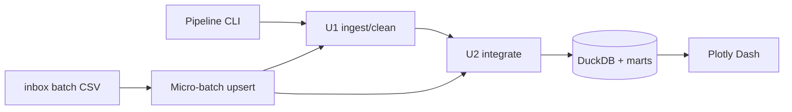

# Business Logic Model — U3 Dashboard & Operations

## 1. Tổng quan

U3 là lớp sản phẩm và vận hành trên U1/U2:

- Dashboard Plotly Dash 3 tab tiếng Việt.
- CLI orchestration một lệnh.
- Micro-batch từ `inbox/` với upsert theo natural key.
- Tài liệu, test end-to-end.
- ML dự báo giao trễ: **trì hoãn** (story Could).



## 2. Dashboard

### 2.1 Bố cục

Một trang, **3 tab**:

1. **Tổng quan**
   - 4 KPI card: doanh thu, số đơn, AOV, tỷ lệ giao trễ.
   - Biểu đồ đường doanh thu theo tháng.
   - Thanh xếp hạng top danh mục.
2. **Danh mục**
   - Bar chart doanh thu theo danh mục.
   - Bảng top sản phẩm.
   - Tỷ trọng freight theo danh mục.
3. **Giao vận**
   - Tỷ lệ giao trễ theo bang.
   - Tỷ lệ giao trễ theo danh mục.
   - Thời gian giao trung bình theo tháng.

### 2.2 Bộ lọc

- Khoảng ngày (mặc định toàn bộ).
- Bang.
- Vùng.
- Danh mục.
- Trạng thái đơn (mặc định `delivered`).

Bộ lọc áp dụng cho cả 3 tab; tab Giao vận chỉ dùng đơn delivered.

### 2.3 Nguồn dữ liệu

- KPI card: `AnalyticsService.kpi_summary`.
- Xu hướng/danh mục/vùng: `agg_sales_daily` qua `AnalyticsService`.
- Top sản phẩm: `AnalyticsService.top_entities`.
- Giao vận: `agg_delivery_daily` + `AnalyticsService.delivery_kpis`.
- Không đọc CSV; không ghi dữ liệu.

### 2.4 Định hướng thị giác

- Phong cách “market ledger”: nền giấy ấm, chữ đậm, đường kẻ mảnh, điểm nhấn vàng đất.
- Palette: `#0B1F1A` (ink), `#F6F7F2` (paper), `#DCE8E0` (mist), `#D9A441` (ochre), `#B5532F` (clay).
- Typography: `Georgia` cho tiêu đề/số lớn; `Segoe UI` cho nhãn/body; `Consolas` cho số liệu nhỏ.
- Layout: filter bar trên cùng, KPI strip 4 cột, biểu đồ 2 cột; không dùng card bo tròn đồng loạt.
- Nhãn tiếng Việt, tiền BRL, ngày dd/mm/yyyy.

### 2.5 Trạng thái

- Loading: skeleton nhẹ.
- Empty: “Không có dữ liệu với bộ lọc hiện tại.”
- Error: “Không đọc được dữ liệu. Kiểm tra pipeline/DuckDB.” kèm chi tiết ngắn.
- 2016: badge “Dữ liệu 2016 chưa đầy đủ”.

## 3. CLI

### 3.1 Lệnh

```text
python -m src.pipeline run --stage all
python -m src.pipeline run --stage ingest|clean|integrate|analyze
python -m src.pipeline micro-batch --inbox inbox
python -m src.pipeline replay --batches 5
python -m src.dashboard
```

### 3.2 Hành vi

- `run --stage all`: ingest → clean → quality → integrate → analyze smoke.
- `--refresh-ibge`: truyền xuống U2.
- Mỗi lần chạy có `run_id`, log JSON, summary console.
- Exit code 0 nếu thành công; 1 nếu lỗi.
- Không có side effect ngoài workspace.

## 4. Micro-batch

### 4.1 Cấu trúc inbox

```text
inbox/
  batch-001/
    orders.csv
    order_items.csv
  batch-002/
    payments.csv
  manifest.json
```

- Mỗi thư mục batch chứa một hoặc nhiều CSV cùng schema 9 bảng nguồn.
- Tên tệp = tên bảng (`orders.csv`, `order_items.csv`, ...).

### 4.2 Luồng xử lý

1. Quét batch dirs theo thứ tự tên.
2. Với mỗi tệp: kiểm tra schema/encoding; tính SHA-256.
3. Nếu hash đã có trong manifest → bỏ qua (idempotent).
4. Copy cleaned hiện tại sang `data/.tmp/{run_id}/cleaned`.
5. Clean batch bằng hàm U1.
6. Upsert vào bản cleaned tạm theo natural key.
7. Validate quality gate trên bản tạm.
8. Promote cleaned tạm → `data/cleaned`.
9. Chạy U2 integrate full rebuild từ cleaned.
10. Ghi manifest + run summary.
11. Nếu lỗi: không promote; đánh dấu batch failed; mart cũ giữ nguyên.

### 4.3 Natural key upsert

| Bảng | Khóa |
|---|---|
| orders | `order_id` |
| customers | `customer_id` |
| sellers | `seller_id` |
| products | `product_id` |
| order_items | `(order_id, order_item_id)` |
| payments | `(order_id, payment_sequential)` |
| reviews | `(review_id, order_id)` |
| translation | `product_category_name` |
| geolocation_zip | `zip_code_prefix` |

### 4.4 Manifest

`inbox/manifest.json`:

```json
{
  "batches": [
    {
      "batch_id": "batch-001",
      "files": [{"table": "orders", "sha256": "...", "status": "success"}],
      "processed_at": "2026-10-23T03:00:00Z",
      "status": "success"
    }
  ]
}
```

### 4.5 Replay

- `replay --batches N`: tạo N batch lịch sử từ cleaned orders theo tháng (orders/items/payments/reviews), ghi vào `inbox/replay/`, rồi xử lý tuần tự.
- Mục đích: minh họa velocity/3V.
- Idempotent theo hash.

## 5. Tài liệu

- `README.md`: cài đặt, chạy pipeline, dashboard, micro-batch, troubleshooting.
- `docs/data-dictionary.md`: mô tả dim/fact/agg.
- `docs/runbook.md`: lỗi thường gặp (IBGE, DuckDB lock, schema batch).
- `docs/3v.md`: volume/variety/velocity.

## 6. ML (trì hoãn)

- Story US-22 vẫn là Could, không triển khai trong MVP.
- Khi làm sau: logistic regression dự báo `is_late` từ khoảng cách, freight, category, seller, tháng; split theo thời gian.
- Không ảnh hưởng KPI/dashboard hiện tại.

## 7. Kiểm thử

- Unit: filter state, formatting, manifest idempotency, upsert key.
- Integration: CLI `run --stage all` trên dữ liệu thật; dashboard callback smoke.
- Dashboard: khởi động app, gọi callback với filter mặc định, không lỗi.
- Không chạy browser test bắt buộc; có thể dùng Dash test client.
