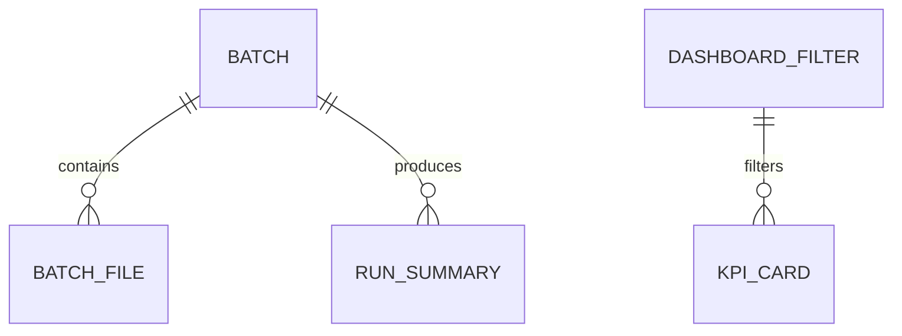

# Domain Entities — U3 Dashboard & Operations

## 1. Sơ đồ quan hệ

## 2. `DashboardFilter`

**Mục đích**: Trạng thái bộ lọc toàn cục của dashboard.

| Trường | Kiểu | Ràng buộc |
|---|---|---|
| `start_date` | date/string | null = toàn bộ |
| `end_date` | date/string | null = toàn bộ |
| `state` | string | null = tất cả |
| `region` | string | null = tất cả |
| `category` | string | null = tất cả |
| `order_status` | string | mặc định `delivered` |

**Bất biến**: `start_date <= end_date`; state/region/category phải tồn tại hoặc trả empty state.

## 3. `KpiCard`

| Trường | Kiểu | Ràng buộc |
|---|---|---|
| `key` | string | revenue/orders/aov/late_rate |
| `label` | string | tiếng Việt |
| `value` | float | |
| `formatted` | string | BRL/percent/số |
| `delta` | float | null nếu không so sánh |
| `sparse_warning` | bool | true nếu 2016 |

## 4. `ChartSpec`

| Trường | Kiểu | Ràng buộc |
|---|---|---|
| `chart_id` | string | unique trong app |
| `tab` | string | overview/category/delivery |
| `chart_type` | string | line/bar/table/map |
| `source` | string | agg_sales_daily/agg_delivery_daily/analytics |
| `title` | string | tiếng Việt |

## 5. `BatchManifest`

**Lưu tại**: `inbox/manifest.json`.

| Trường | Kiểu | Ràng buộc |
|---|---|---|
| `batches` | list[BatchEntry] | |

### `BatchEntry`

| Trường | Kiểu | Ràng buộc |
|---|---|---|
| `batch_id` | string | unique |
| `files` | list[BatchFile] | |
| `processed_at` | datetime | ISO |
| `status` | string | success/partial/failed/skipped |

### `BatchFile`

| Trường | Kiểu | Ràng buộc |
|---|---|---|
| `table` | string | 9 bảng nguồn |
| `file` | string | đường dẫn tương đối |
| `sha256` | string | unique theo batch |
| `rows` | int | |
| `status` | string | success/failed |
| `error` | string | null nếu success |

## 6. `BatchResult`

| Trường | Kiểu | Ràng buộc |
|---|---|---|
| `batch_id` | string | |
| `status` | string | success/partial/failed/skipped |
| `tables` | list[str] | bảng đã xử lý |
| `rows_upserted` | int | |
| `duration_seconds` | float | |
| `run_id` | string | |

## 7. `RunSummary`

| Trường | Kiểu | Ràng buộc |
|---|---|---|
| `run_id` | string | unique |
| `command` | string | run/micro-batch/replay |
| `stages` | list[StageResult] | |
| `started_at` | datetime | |
| `finished_at` | datetime | |
| `success` | bool | |

### `StageResult`

| Trường | Kiểu | Ràng buộc |
|---|---|---|
| `stage` | string | ingest/clean/integrate/analyze |
| `status` | string | success/failed/skipped |
| `rows_in` | int | |
| `rows_out` | int | |
| `duration_seconds` | float | |

## 8. `ReplaySpec`

| Trường | Kiểu | Ràng buộc |
|---|---|---|
| `batches` | int | ≥ 1 |
| `source` | string | cleaned orders |
| `target_dir` | path | `inbox/replay/` |
| `order` | string | theo tháng tăng dần |

## 9. `DocSet`

| Tài liệu | Nội dung |
|---|---|
| `README.md` | cài đặt, chạy, dashboard, micro-batch |
| `docs/data-dictionary.md` | dim/fact/agg |
| `docs/runbook.md` | lỗi thường gặp |
| `docs/3v.md` | volume/variety/velocity |

## 10. Bất biến

- Dashboard chỉ đọc DuckDB; không ghi.
- Filter mặc định `order_status = delivered`.
- Tab Giao vận chỉ dùng đơn delivered.
- Manifest hash unique; batch success không xử lý lại.
- Upsert natural key; không tạo bản ghi trùng.
- Batch lỗi không promote cleaned/mart.
- Không có ML trong MVP.
- Dashboard host mặc định `127.0.0.1`.
