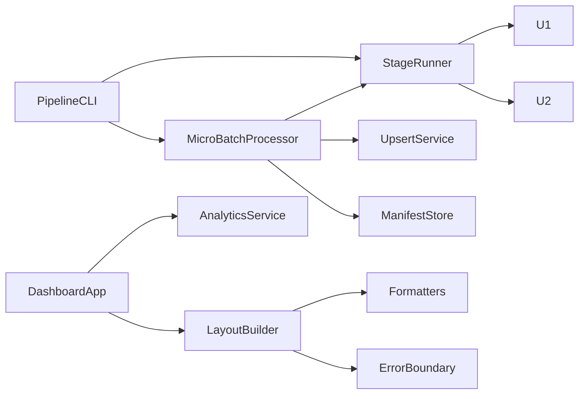

# Logical Components — U3 Dashboard & Operations

## 1. Sơ đồ tương tác



## 2. DashboardApp

**Trách nhiệm**: Tạo Dash app, layout, callback, chạy localhost.

**Interface**
```python
def create_app(config) -> Dash: ...
def build_layout(config) -> html.Div: ...
def register_callbacks(app, config) -> None: ...
```

**Hành vi**
- 3 tab; filter store.
- Gọi AnalyticsService.
- ErrorBoundary.
- host 127.0.0.1.

**NFR**: U3-01, U3-02, U3-05, U3-09.

## 3. LayoutBuilder

**Trách nhiệm**: Dựng filter bar, KPI cards, chart containers, tab layout.

**Interface**
```python
def filter_bar() -> html.Div: ...
def kpi_cards() -> html.Div: ...
def overview_tab() -> html.Div: ...
def category_tab() -> html.Div: ...
def delivery_tab() -> html.Div: ...
```

**NFR**: U3-01, U3-06.

## 4. Formatters

**Trách nhiệm**: Định dạng BRL/ngày/số.

**Interface**
```python
def format_brl(value: float) -> str: ...
def format_date(value) -> str: ...
def format_number(value: float, decimals: int = 0) -> str: ...
```

**NFR**: U3-06.

## 5. ErrorBoundary

**Trách nhiệm**: Banner lỗi/empty, nút thử lại.

**Interface**
```python
def error_banner(message: str) -> html.Div: ...
def empty_state(message: str) -> html.Div: ...
```

**NFR**: U3-06, U3-08.

## 6. PipelineCLI

**Trách nhiệm**: Parse lệnh, gọi StageRunner/MicroBatchProcessor/Replay.

**Interface**
```python
def main(argv: list[str] | None = None) -> int: ...
```

**Hành vi**
- `run --stage ...`
- `micro-batch --inbox ...`
- `replay --batches N`
- exit code.

**NFR**: U3-03, U3-07.

## 7. StageRunner

**Trách nhiệm**: Chạy stage U1/U2, tổng hợp RunSummary.

**Interface**
```python
def run_stage(stage: str, config, refresh_ibge: bool = False) -> StageResult: ...
def run_all(config, refresh_ibge: bool = False) -> RunSummary: ...
```

**Hành vi**
- ingest → clean → quality → integrate → analyze.
- Dừng khi lỗi.
- Log.

**NFR**: U3-03, U3-07.

## 8. MicroBatchProcessor

**Trách nhiệm**: Xử lý batch inbox transaction.

**Interface**
```python
def process_inbox(config, inbox_dir: Path) -> list[BatchResult]: ...
```

**Hành vi**
- Scan batch dirs.
- Manifest idempotency.
- Temp cleaned + upsert + quality.
- Promote + U2 rebuild.
- Lỗi → failed.

**NFR**: U3-04, U3-08.

## 9. UpsertService

**Trách nhiệm**: Upsert natural key.

**Interface**
```python
def upsert(existing: pd.DataFrame, new: pd.DataFrame, keys: list[str]) -> pd.DataFrame: ...
```

**Hành vi**
- Xóa key cũ, append mới, sort.
- Không duplicate.

**NFR**: U3-04.

## 10. ManifestStore

**Trách nhiệm**: Đọc/ghi manifest, kiểm tra hash.

**Interface**
```python
class ManifestStore:
    def has_success(self, file_hash: str) -> bool: ...
    def record(self, entry: dict) -> None: ...
    def load(self) -> dict: ...
```

**NFR**: U3-04.

## 11. ReplayGenerator

**Trách nhiệm**: Tạo batch lịch sử theo tháng.

**Interface**
```python
def generate(config, batches: int, target_dir: Path) -> list[Path]: ...
```

**Hành vi**
- Chia cleaned orders theo tháng.
- Ghi 4 bảng subset.
- Trả danh sách batch dirs.

**NFR**: U3-04.

## 12. RunSummaryWriter

**Trách nhiệm**: Ghi run summary JSON + log.

**Interface**
```python
def write(summary: RunSummary, reports_dir: Path) -> None: ...
```

**NFR**: U3-07.

## 13. Cấu hình

| Tham số | Giá trị |
|---|---|
| `dashboard_host` | `127.0.0.1` |
| `dashboard_port` | 8050 |
| `inbox_dir` | `inbox/` |
| `max_batch_rows` | 10.000 |
| `batch_timeout_seconds` | 30 |
| `manifest_path` | `inbox/manifest.json` |

## 14. Ranh giới

- Dashboard chỉ gọi AnalyticsService; không đọc CSV/ghi.
- CLI là composition root.
- MicroBatchProcessor không sửa trực tiếp mart; gọi U2.
- ReplayGenerator chỉ tạo file inbox.
- Không có ML trong U3.
