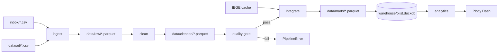
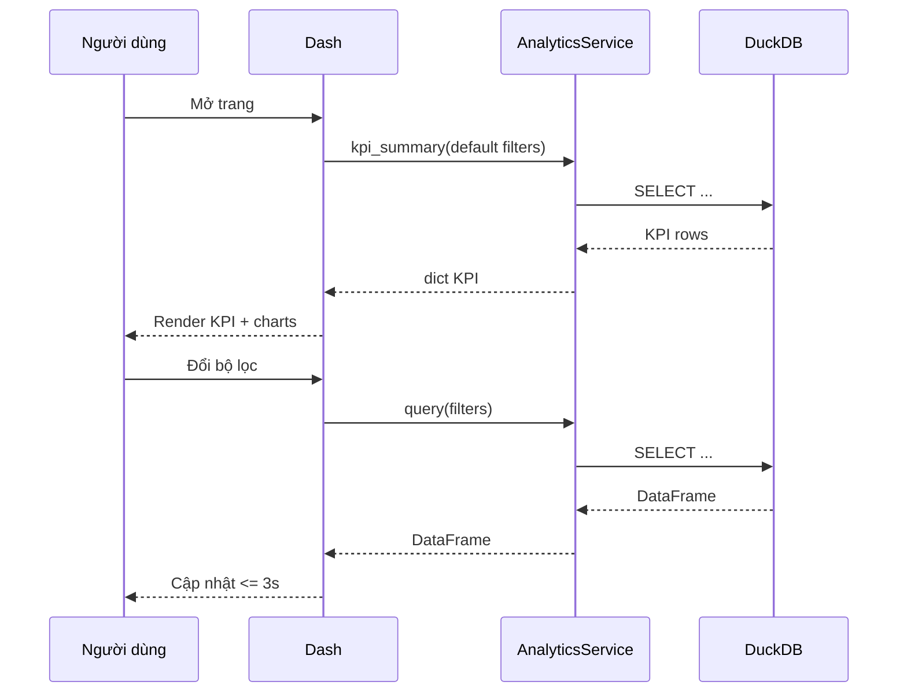

# Phụ thuộc component (Component Dependency)

## 1. Ma trận phụ thuộc

Ký hiệu: ● = phụ thuộc trực tiếp.

| Component | config | common | ingest | quality | clean | external | integrate | analytics | dashboard | pipeline |
|---|---|---|---|---|---|---|---|---|---|---|
| config | — | | | | | | | | | |
| common | ● | — | | | | | | | | |
| ingest | ● | ● | — | | | | | | | |
| quality | ● | ● | | — | | | | | | |
| clean | ● | ● | | | — | | | | | |
| external | ● | ● | | | | — | | | | |
| integrate | ● | ● | | | ● | ● | — | | | |
| analytics | ● | ● | | | | | ● | — | | |
| dashboard | ● | ● | | | | | | ● | — | |
| pipeline | ● | ● | ● | ● | ● | ● | ● | ● | ● | — |
| tests | ● | ● | ● | ● | ● | ● | ● | ● | ● | ● |

## 2. Quy tắc phụ thuộc

- Phụ thuộc một chiều, không có vòng:
  `config → common → ingest → clean → integrate → analytics → dashboard`
- `pipeline` là composition root, được phép phụ thuộc mọi component runtime.
- `dashboard` **không** import `ingest`, `clean`, `pipeline`.
- `analytics` **không** ghi dữ liệu và **không** import `dashboard`.
- `tests` được phép phụ thuộc tất cả, nhưng không được dùng trong runtime.
- Không component nào đọc trực tiếp `dataset/` ngoài `ingest`.

## 3. Hình thức giao tiếp

| Cặp | Hình thức | Ghi chú |
|---|---|---|
| pipeline → ingest/clean/quality/external/integrate/analytics | Gọi hàm Python trong tiến trình | Không RPC |
| ingest → clean | Parquet tại `data/raw/` | Ranh giới stage |
| clean → integrate | Parquet tại `data/cleaned/` | Ranh giới stage |
| integrate → analytics | DuckDB view/table trên Parquet | Chỉ đọc |
| analytics → dashboard | Gọi hàm Python + DataFrame/dict | Cùng tiến trình |
| external → IBGE | HTTP GET | Chỉ khi tải/cập nhật |
| dashboard → người dùng | HTTP localhost | Plotly Dash |

## 4. Luồng dữ liệu

## 5. Hợp đồng dữ liệu tại ranh giới

| Ranh giới | Định dạng | Bảo đảm |
|---|---|---|
| `dataset/` → ingest | CSV UTF-8 | Không sửa nguồn; kiểm tra schema + hash |
| ingest → clean | Parquet | Đúng cột, đúng số dòng raw |
| clean → integrate | Parquet | Có cờ chất lượng, không mất dòng hợp lệ |
| integrate → analytics | Parquet + DuckDB | Đúng grain, có khóa |
| analytics → dashboard | DataFrame/dict | Chỉ đọc, không side effect |
| inbox → pipeline | CSV | Manifest idempotent theo hash |

## 6. Điểm rủi ro phụ thuộc

| Rủi ro | Ảnh hưởng | Kiểm soát |
|---|---|---|
| `clean` thay đổi schema ngầm | `integrate` lỗi | Test schema + data dictionary |
| `dashboard` gọi thẳng CSV | Vi phạm kiến trúc, chậm | Review import + test cấm đọc CSV |
| `analytics` lặp công thức KPI | Số liệu lệch | Một nguồn công thức trong analytics |
| `external` phụ thuộc mạng | Pipeline dừng | Cache + fail-fast + log |
| `pipeline` phình logic | Khó test | Chỉ orchestration, logic nằm ở component |

## 7. Luồng khởi động dashboard

