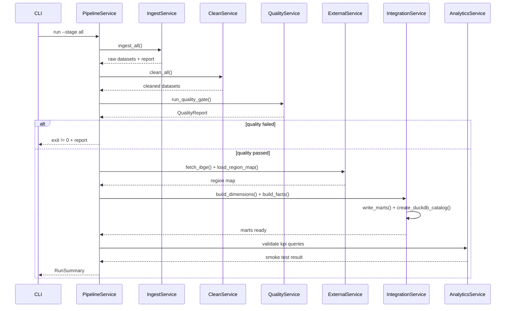
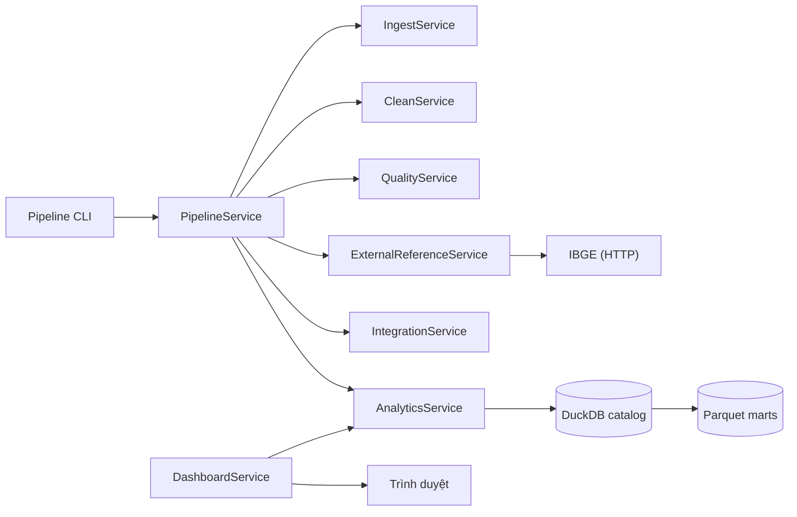

# Dịch vụ và điều phối (Services)

## 1. PipelineService

**Trách nhiệm**: Điều phối các stage batch, micro-batch và replay; tạo run summary; dừng khi quality gate thất bại.

**Interface**: `run_stage`, `run_all`, `run_micro_batch`, `replay`.

**Luồng batch**

**Luồng micro-batch**

1. Quét `inbox/*.csv`.
2. Tính hash; bỏ qua tệp đã có trong manifest.
3. Ingest + clean + append/merge vào mart theo khóa.
4. Ghi manifest và run summary.
5. Tệp lỗi schema bị đánh dấu failed; không chặn tệp hợp lệ.

**Replay**: phát lại N lô lịch sử theo thứ tự thời gian để minh họa velocity; kết quả cuối phải khớp batch đầy đủ.

## 2. QualityService

**Trách nhiệm**: Chạy bộ kiểm tra unique, foreign key, row count, null bắt buộc, miền giá trị; trả `QualityReport`; ném `QualityGateError` nếu fail.

**Điểm gọi**: sau cleaning, trước integration; cũng chạy trong test.

**Quy tắc**:
- Không tự sửa dữ liệu.
- Mọi check ghi tên, trạng thái, chi tiết.
- Check thất bại không được ghi đè mart cũ.

## 3. ExternalReferenceService

**Trách nhiệm**: Tải IBGE, lưu cache, kiểm tra hash, cung cấp region map.

**Điểm gọi**: trước `build_dimensions`; có thể gọi riêng qua `--stage external`.

**Chính sách**:
- Có cache hợp lệ → dùng cache, log `cache_hit`.
- Không có cache + có mạng → tải, lưu metadata.
- Không có cache + mất mạng → `ExternalSourceError`, dừng pipeline.

## 4. IntegrationService

**Trách nhiệm**: Xây dimension/fact từ cleaned data + region map; ghi Parquet; tạo DuckDB catalog.

**Điểm gọi**: sau quality gate và external.

**Chính sách**:
- Ghi atomically: ghi thư mục tạm rồi đổi tên/ghi đè có kiểm soát.
- Tạo view DuckDB trỏ tới Parquet, không copy dữ liệu.
- Không đọc CSV.

## 5. AnalyticsService

**Trách nhiệm**: Truy vấn KPI qua DuckDB; trả DataFrame/dict cho dashboard và báo cáo.

**Điểm gọi**: dashboard callback, test KPI, CLI `--stage analyze`.

**Chính sách**:
- Chỉ đọc; không ghi mart.
- Mọi truy vấn nhận `KpiFilters`.
- Định nghĩa doanh thu mặc định nằm trong một nơi duy nhất (module analytics), không lặp công thức ở dashboard.

## 6. DashboardService

**Trách nhiệm**: Khởi tạo Dash app, layout, callback, định dạng tiếng Việt, xử lý lỗi/rỗng.

**Điểm gọi**: `python -m src.dashboard` hoặc entrypoint riêng.

**Chính sách**:
- Không đọc CSV; chỉ gọi AnalyticsService.
- Nếu DuckDB/Parquet lỗi → hiển thị thông báo tiếng Việt, không crash trắng.
- Bộ lọc mặc định: toàn bộ thời gian, trạng thái `delivered`.

## 7. Tương tác giữa các service

## 8. Xử lý lỗi và quan sát

- Mỗi service nhận `RunContext` và logger.
- Lỗi dùng exception chuyên biệt: `SchemaError`, `QualityGateError`, `ExternalSourceError`, `ConfigurationError`.
- CLI trả mã 0/1; run summary ghi trạng thái từng stage.
- Không nuốt exception; mọi lỗi phải xuất hiện trong log và summary.
