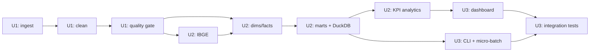

# Phụ thuộc đơn vị công việc (Unit Dependency)

## 1. Ma trận phụ thuộc

Ký hiệu: ● = phụ thuộc; — = không.

| Unit | U1 | U2 | U3 | Phụ thuộc ngoài |
|---|---|---|---|---|
| U1 — Data Foundation | — | | | `dataset/*.csv` |
| U2 — Integration & Analytics | ● | — | | IBGE (HTTP/cache) |
| U3 — Dashboard & Operations | ● | ● | — | Trình duyệt (localhost) |

## 2. Loại phụ thuộc

### U2 phụ thuộc U1
- **Loại**: Data contract + code contract.
- **Lý do**: U2 cần cleaned Parquet, cờ chất lượng, `customer_unique_id`, geolocation đã gộp và category fallback từ U1.
- **Điểm kiểm tra**: row count, schema, unique key, không orphan.
- **Nếu U1 thay đổi schema**: U2 phải cập nhật builder và test.

### U3 phụ thuộc U2
- **Loại**: Data contract + runtime.
- **Lý do**: Dashboard và CLI đọc marts/DuckDB do U2 tạo.
- **Điểm kiểm tra**: catalog mở được; KPI baseline khớp; view trỏ đúng Parquet.

### U3 phụ thuộc U1 (gián tiếp)
- **Loại**: Test fixture.
- **Lý do**: Test tích hợp cần cleaned data và quality report để kiểm chứng end-to-end.
- **Điểm kiểm tra**: test chạy từ raw CSV, không dùng output cũ.

## 3. Hợp đồng dữ liệu giữa unit

| Từ → Đến | Artifact | Bảo đảm |
|---|---|---|
| U1 → U2 | `data/cleaned/*.parquet` | Đúng schema, có cờ `category_missing`, `translation_missing`, `price_outlier`, `multiple_reviews_per_order` |
| U1 → U2 | `quality-report.json` | `passed = true`; có số dòng/khóa |
| U2 → U3 | `data/marts/*.parquet` | Đúng grain; fact/dimension đầy đủ |
| U2 → U3 | `warehouse/olist.duckdb` | View/table mở được; trỏ tới Parquet |
| U2 → U3 | Analytics API | Hàm KPI nhận `KpiFilters`, trả DataFrame/dict |
| U1/U2 → U3 | Test fixtures | Không phụ thuộc output cũ; tái tạo từ raw |

## 4. Đường găng (critical path)

- **Đường găng**: ingest → clean → quality → integrate → marts → dashboard/test.
- **Không có unit chạy song song** vì phụ thuộc dữ liệu; trong mỗi unit có thể song song nội bộ (ví dụ cleaning từng bảng).
- **Điểm chặn**: quality gate; nếu fail, U2/U3 không chạy.

## 5. Chiến lược tích hợp

- **Tuần tự**, mỗi unit kết thúc bằng kiểm tra đầu ra trước khi chuyển unit.
- **Contract-first**: schema Parquet được khóa trong `ingest/schemas.py` và data dictionary.
- **Test hồi quy**: sau U2, lưu KPI baseline; U3 test so sánh lại.
- **Không big-bang**: dashboard chỉ làm sau khi marts ổn định.

## 6. Rollback

| Tình huống | Hành động |
|---|---|
| U1 lỗi cleaning | Xóa `data/cleaned/` và chạy lại từ raw; raw vẫn còn |
| U2 lỗi schema | Giữ cleaned; xóa `data/marts/` + DuckDB; chạy lại integrate |
| U3 lỗi dashboard | Marts vẫn dùng được; khởi động lại app |
| KPI sai sau thay đổi | Chạy test baseline; so sánh với số liệu đã xác minh |

## 7. Rủi ro phụ thuộc

| Rủi ro | Ảnh hưởng | Kiểm soát |
|---|---|---|
| U1 đổi tên cột | U2 vỡ | Schema contract + test |
| Geolocation gộp sai | U2 sai địa lý, dashboard sai | Test join 99.441 dòng |
| IBGE đổi định dạng | U2 không map vùng | Validate 27 bang/5 vùng, cache |
| DuckDB khóa file | Dashboard/CLI lỗi | Chế độ read-only cho dashboard |
| U3 dashboard đọc CSV | Vi phạm kiến trúc | Review import + test cấm |
| Test tích hợp phụ thuộc output cũ | Kết quả giả | Test tạo dữ liệu từ raw trong thư mục tạm |
