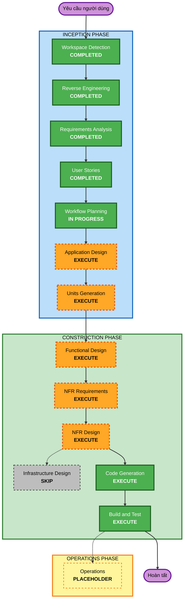

# Kế hoạch thực thi (Execution Plan)

## 1. Tóm tắt phân tích chi tiết

### Bối cảnh

- **Loại dự án**: Greenfield — chưa có mã nguồn, database, pipeline hay dashboard.
- **Nguồn**: 9 CSV Olist (1.550.922 dòng), 8 PDF học thuật, dữ liệu IBGE bổ sung.
- **Yêu cầu**: 11 FR, 10 NFR, 22 user story trong 7 epic.
- **Ràng buộc**: Python 3.13, pandas + DuckDB + Parquet, Plotly Dash, chạy cục bộ trên Windows; không Spark/Kafka/cloud/SQLite/PostgreSQL.

### Đánh giá tác động

| Khu vực | Tác động |
|---|---|
| Người dùng | Có — dashboard cho P1, tài liệu/tái lập cho P2 |
| Cấu trúc | Có — tạo mới toàn bộ pipeline nhiều module |
| Mô hình dữ liệu | Có — star schema, dimension, fact, cờ chất lượng |
| API | Không có API public; hợp đồng dữ liệu CSV và interface nội bộ |
| NFR | Có — hiệu năng dashboard, batch ≤ 10 phút, tái lập, log, test |
| Hạ tầng | Không — chỉ filesystem cục bộ, không cloud |

### Đánh giá rủi ro

- **Mức rủi ro**: Trung bình.
- **Khôi phục**: Dễ — xóa `data/`, `warehouse/` và chạy lại từ CSV gốc; không ảnh hưởng nguồn.
- **Kiểm thử**: Trung bình — cần test dữ liệu, test KPI và kiểm tra dashboard thủ công.
- **Rủi ro chính**: join sai grain, IBGE đổi định dạng, cài DuckDB/PyArrow trên Windows, dashboard chậm.

### Đề xuất đơn vị công việc

| Unit | Phạm vi | Phụ thuộc |
|---|---|---|
| U1 — Data Foundation | Ingestion, cleaning, quality gate, raw/cleaned Parquet | Không |
| U2 — Integration & Analytics | IBGE, star schema, KPI marts, analytics | U1 |
| U3 — Dashboard & Operations | Plotly Dash, micro-batch, CLI, docs, test tổng hợp | U1, U2 |

Thứ tự đề xuất: **U1 → U2 → U3** (tuần tự vì dùng chung mart và định nghĩa KPI).

## 2. Trực quan hóa workflow

## 3. Các giai đoạn thực thi

### INCEPTION

- [x] Workspace Detection — hoàn tất.
- [x] Reverse Engineering — hoàn tất theo yêu cầu người dùng.
- [x] Requirements Analysis — hoàn tất, 11 FR + 10 NFR.
- [x] User Stories — hoàn tất, 2 persona + 22 story.
- [x] Workflow Planning — hoàn tất.
- [ ] **Application Design — EXECUTE**
  - **Lý do**: Cần chốt module, interface nội bộ và luồng dữ liệu trước khi chia unit. Có nhiều thành phần mới: ingestion, cleaning, integration, analytics, dashboard, external, CLI.
  - **Artifact**: `components.md`, `component-methods.md`, `services.md`, `component-dependency.md`.
- [ ] **Units Generation — EXECUTE**
  - **Lý do**: Dự án có 3 nhóm công việc phụ thuộc nhau; cần unit-of-work, dependency và story map để triển khai tuần tự.
  - **Artifact**: `unit-of-work.md`, `unit-of-work-dependency.md`, `unit-of-work-story-map.md`.

### CONSTRUCTION

- [ ] **Functional Design — EXECUTE (theo từng unit)**
  - **Lý do**: Cần định nghĩa schema chi tiết, quy tắc làm sạch, grain của fact/dimension, công thức KPI và hợp đồng dữ liệu.
  - **Artifact mỗi unit**: `functional-design.md`.
- [ ] **NFR Requirements — EXECUTE**
  - **Lý do**: Có mục tiêu hiệu năng cụ thể (batch ≤ 10 phút, dashboard ≤ 3 giây), yêu cầu log, tái lập và test.
  - **Artifact**: `nfr-requirements.md`.
- [ ] **NFR Design — EXECUTE**
  - **Lý do**: Cần thiết kế pre-aggregation/caching cho dashboard, logging có run_id, fail-fast và chiến lược test dữ liệu.
  - **Artifact**: `nfr-design.md`.
- [ ] **Infrastructure Design — SKIP**
  - **Lý do**: Không có cloud, container bắt buộc, VPC, database server hay CDK/Terraform. Hạ tầng chỉ là filesystem cục bộ; chi tiết đã nằm trong requirements và NFR design.
- [ ] **Code Generation — EXECUTE (theo từng unit)**
  - **Lý do**: Cần triển khai toàn bộ pipeline, dashboard, test và tài liệu.
  - **Cách làm**: Part 1 lập kế hoạch code có checkbox; Part 2 sinh code theo unit.
- [ ] **Build and Test — EXECUTE**
  - **Lý do**: Cần chạy pipeline end-to-end, test dữ liệu, test KPI, kiểm tra dashboard và viết hướng dẫn build/test.

### OPERATIONS

- [ ] Operations — PLACEHOLDER.
  - **Lý do**: Chưa có nhu cầu deploy/monitoring production.

## 4. Trình tự thực thi

1. Application Design — chốt module và interface.
2. Units Generation — chốt 3 unit, dependency, story map.
3. Unit U1: Functional Design → NFR Requirements → NFR Design → Code Generation.
4. Unit U2: Functional Design → NFR Requirements → NFR Design → Code Generation.
5. Unit U3: Functional Design → NFR Requirements → NFR Design → Code Generation.
6. Build and Test — chạy toàn bộ, kiểm tra acceptance criteria.
7. Operations — bỏ qua (placeholder).

**Ghi chú**: NFR Requirements/Design có thể gộp nội dung giữa các unit nhưng vẫn tạo artifact cho từng unit theo quy trình. Infrastructure Design bỏ qua.

## 5. Thời lượng ước tính

- **Số stage thực thi**: 8 (Application Design, Units Generation, 3 × Functional/NFR/Code, Build & Test).
- **Số unit**: 3.
- **Thời lượng**: không đặt deadline; thực thi tuần tự trong các phiên tiếp theo. Ước lượng thô 6-10 phiên làm việc có kiểm chứng.

## 6. Tiêu chí thành công

- **Mục tiêu chính**: Pipeline chạy end-to-end từ 9 CSV + IBGE, tạo star schema DuckDB/Parquet và dashboard Plotly Dash tiếng Việt.
- **Deliverable chính**:
  - Mã pipeline trong `src/`.
  - Mart Parquet + `warehouse/olist.duckdb`.
  - Dashboard Dash.
  - Test tự động.
  - README + data dictionary.
- **Quality gate**:
  - 9/9 tệp ingest; số dòng khớp.
  - Join geolocation không bùng nổ.
  - 0 orphan/khóa trùng sau làm sạch.
  - Tỷ lệ giao trễ 8,11% khớp baseline.
  - Dashboard phản hồi ≤ 3 giây.
  - `pytest` pass.
  - Chạy lại từ đầu trong ≤ 15 phút sau khi cài dependency.

## 7. Ghi chú adaptive depth

- Application Design: mức chi tiết vừa — module, trách nhiệm, interface, luồng dữ liệu; không thiết kế từng hàm.
- Functional Design: chi tiết — schema, grain, quy tắc làm sạch, công thức KPI.
- NFR: chi tiết vừa — mục tiêu đo được, pattern caching/logging/fail-fast.
- Code Generation: đầy đủ code + test theo unit.
