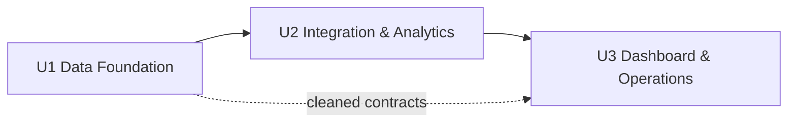

# Kế hoạch phân rã đơn vị công việc (Unit of Work Plan)

**Dự án**: Olist E-commerce Data Pipeline
**Giai đoạn**: INCEPTION - Units Generation (Part 1: Planning)

## 1. Bối cảnh

- Đây là **một ứng dụng cục bộ**, không phải microservices; "unit" là nhóm công việc logic, không phải service deploy độc lập.
- Có 22 story, 7 epic, 11 component.
- Thứ tự phụ thuộc dữ liệu: raw → cleaned → marts → dashboard.

## 2. Phương án phân rã đề xuất

### U1 — Data Foundation
- **Phạm vi**: ingestion, schema contract, quality gate, cleaning toàn bộ bảng.
- **Story**: US-01 → US-07.
- **Đầu ra**: `data/raw/*.parquet`, `data/cleaned/*.parquet`, cleaning report, quality report.
- **Giá trị**: dữ liệu sạch, kiểm chứng được, không còn bẫy geolocation/category/grain.

### U2 — Integration & Analytics
- **Phạm vi**: IBGE, star schema, KPI analytics.
- **Story**: US-08, US-09, US-10, US-11, US-12, US-13, US-14, US-19.
- **Đầu ra**: `data/marts/*.parquet`, `warehouse/olist.duckdb`, module analytics.
- **Giá trị**: mô hình phân tích ổn định và KPI khớp baseline.

### U3 — Dashboard & Operations
- **Phạm vi**: Plotly Dash, micro-batch, CLI, tài liệu, test tổng hợp, ML tùy chọn.
- **Story**: US-15, US-16, US-17, US-18, US-20, US-21, US-22.
- **Đầu ra**: dashboard, CLI hoàn chỉnh, manifest micro-batch, README, test suite.
- **Giá trị**: sản phẩm bàn giao và khả năng tái lập.

## 3. Phụ thuộc dự kiến



- U2 cần cleaned Parquet + cờ chất lượng từ U1.
- U3 cần marts/DuckDB từ U2.
- U3 là nơi chạy test tích hợp end-to-end.
- Không có phụ thuộc vòng.

## 4. Chiến lược tổ chức mã (greenfield)

```
olist-pipeline/
  config.yaml
  requirements.txt
  README.md
  src/
    config.py
    common/
    ingest/
    quality/
    clean/
    external/
    integrate/
    analytics/
    dashboard/
    pipeline/
  tests/
    unit/
    data_quality/
    integration/
  data/
  warehouse/
  inbox/
```

- Một package `src/` duy nhất, không tách microservice.
- Entrypoint: `python -m src.pipeline` và `python -m src.dashboard`.
- Test chia theo unit + data quality + integration.

## 5. Câu hỏi cần trả lời

Vui lòng điền chữ cái sau mỗi `[Answer]:`. Khi hoàn tất, trả lời `done`.

### Câu 1 — Cách nhóm unit
Chọn cách chia unit:

A) 3 unit như đề xuất: Data Foundation / Integration & Analytics / Dashboard & Operations (khuyến nghị)
B) 2 unit: Pipeline dữ liệu và Dashboard
C) 4 unit: tách External/IBGE và Operations thành unit riêng
X) Khác (vui lòng mô tả sau thẻ [Answer]:)

[Answer]: A

### Câu 2 — Thứ tự phát triển
Thứ tự thực hiện các unit:

A) Tuần tự U1 → U2 → U3 (khuyến nghị)
B) U1 → U3 (dashboard skeleton trước) → U2
C) Làm song song U2 và U3 sau khi U1 xong
X) Khác (vui lòng mô tả sau thẻ [Answer]:)

[Answer]: A

### Câu 3 — Tổ chức mã
Cấu trúc mã nguồn:

A) Một package `src/` + `tests/` trong repo hiện tại (khuyến nghị)
B) Nhiều package dưới `packages/` cho từng unit
C) Script phẳng ở thư mục gốc, không package
X) Khác (vui lòng mô tả sau thẻ [Answer]:)

[Answer]: A

### Câu 4 — Nơi đặt test
Cách tổ chức kiểm thử:

A) Test theo từng unit + test tích hợp end-to-end ở U3 (khuyến nghị)
B) Dồn toàn bộ test vào U3
C) Tạo unit riêng cho kiểm thử
X) Khác (vui lòng mô tả sau thẻ [Answer]:)

[Answer]: A

## 6. Quyết định đã chốt

| Hạng mục | Quyết định |
|---|---|
| Nhóm unit | 3 unit: U1 Data Foundation, U2 Integration & Analytics, U3 Dashboard & Operations |
| Thứ tự | Tuần tự U1 → U2 → U3 |
| Tổ chức mã | Một package `src/` + `tests/` trong repo hiện tại |
| Kiểm thử | Test theo unit + test tích hợp end-to-end ở U3 |

**Phân bổ story**

| Unit | Story | Số lượng |
|---|---|---|
| U1 | US-01 → US-07 | 7 |
| U2 | US-08 → US-14, US-19 | 8 |
| U3 | US-15 → US-18, US-20 → US-22 | 7 |
| **Tổng** | | **22** |

## 7. Checklist thực hiện

### Planning
- [x] Đọc requirements, stories, application design
- [x] Đề xuất unit, dependency, tổ chức mã
- [x] Tạo kế hoạch và câu hỏi
- [x] Thu thập câu trả lời
- [x] Phân tích mơ hồ/mâu thuẫn
- [x] Chốt kế hoạch và được phê duyệt

### Generation
- [x] Tạo `unit-of-work.md`
- [x] Tạo `unit-of-work-dependency.md`
- [x] Tạo `unit-of-work-story-map.md`
- [x] Gán đủ 22 story cho unit
- [x] Kiểm tra boundary và dependency
- [x] Cập nhật `aidlc-state.md`
- [ ] Trình bày để phê duyệt
