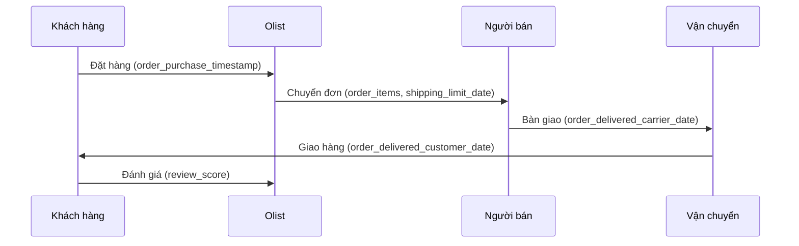

# Kiến trúc hệ thống (System Architecture)

> **Trạng thái thực tế**: Không có ứng dụng, service, database hay pipeline nào trong workspace. Đây là kiến trúc **as-is của tài sản dữ liệu**, kèm các khoảng trống cần xây dựng.

## Tổng quan hệ thống

Workspace hiện là một tập hợp tệp tĩnh:

- `dataset/` chứa 9 CSV gốc của Olist.
- `doc/` chứa đề bài và slide bài giảng.
- `aidlc-wf/` chứa bộ quy tắc AI-DLC.
- Không có mã ingest, không có kho dữ liệu, không có tầng biến đổi, không có dashboard.

## Sơ đồ kiến trúc as-is

```mermaid
flowchart LR
    subgraph Sources["Nguồn dữ liệu tĩnh"]
        ORD["olist_orders"]
        CUS["olist_customers"]
        ITM["olist_order_items"]
        PAY["olist_order_payments"]
        REV["olist_order_reviews"]
        PRD["olist_products"]
        SEL["olist_sellers"]
        GEO["olist_geolocation"]
        TRN["product_category_translation"]
    end
    subgraph Gap["Khoảng trống kiến trúc"]
        ING["Chưa có ingestion"]
        STO["Chưa có storage layer"]
        TRF["Chưa có cleaning / integration"]
        SRV["Chưa có serving / dashboard"]
    end
    Sources --> ING --> STO --> TRF --> SRV
```

## Mô tả thành phần

### `dataset/`
- **Mục đích**: Nguồn dữ liệu gốc, bất biến.
- **Trách nhiệm**: Cung cấp dữ liệu giao dịch Olist.
- **Phụ thuộc**: Không.
- **Loại**: Data source.

### `doc/`
- **Mục đích**: Tài liệu học thuật và yêu cầu đồ án.
- **Trách nhiệm**: Đề bài (`Projects.pdf`), slide về schema alignment, record linkage, query processing, source selection.
- **Phụ thuộc**: Không.
- **Loại**: Documentation.

### `aidlc-wf/`
- **Mục đích**: Bộ quy tắc quy trình AI-DLC được vendor vào repo.
- **Trách nhiệm**: Hướng dẫn workflow, không phải mã ứng dụng.
- **Phụ thuộc**: Không.
- **Loại**: Workflow rules / documentation.

### `aidlc-docs/`
- **Mục đích**: Đầu ra tài liệu của quy trình AI-DLC.
- **Trách nhiệm**: State, audit, requirements, reverse engineering.
- **Phụ thuộc**: Không.
- **Loại**: Documentation.

## Luồng dữ liệu nghiệp vụ (khái niệm)

## Điểm tích hợp

- **API ngoài**: Không có.
- **Database**: Không có.
- **Dịch vụ bên thứ ba**: Không có.
- **Nguồn dữ liệu**: 9 tệp CSV, quan hệ qua các khóa `order_id`, `customer_id`, `product_id`, `seller_id`, `zip_code_prefix`.

## Thành phần hạ tầng

- **CDK/Terraform/CloudFormation**: Không có.
- **Mô hình triển khai**: Chưa có; dự kiến chạy cục bộ trên Windows.
- **Networking**: Không có.
- **Môi trường**: Python 3.13.5, pandas 2.2.3; chưa có Spark, DuckDB, PyArrow, scikit-learn.

## Khoảng trống cần thiết kế

1. Tầng ingestion có kiểm tra schema và encoding.
2. Tầng lưu trữ (Parquet/SQLite/PostgreSQL) với mô hình dữ liệu rõ ràng.
3. Tầng làm sạch và tích hợp, xử lý các bẫy dữ liệu đã phát hiện.
4. Tầng phân tích và dashboard.
5. Kiểm thử dữ liệu (uniqueness, referential integrity, row-count reconciliation).
