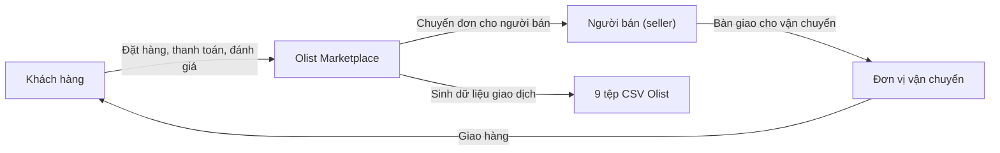

# Tổng quan nghiệp vụ (Business Overview)

> **Lưu ý phạm vi**: Workspace không có mã nguồn ứng dụng. Tài liệu này là kết quả reverse engineering **tài sản dữ liệu và bối cảnh nghiệp vụ** của bộ dữ liệu Olist, không phải reverse engineering một hệ thống đang chạy.

## Sơ đồ bối cảnh nghiệp vụ

## Mô tả nghiệp vụ

- **Bối cảnh**: Olist là sàn thương mại điện tử Brazil, kết nối khách hàng với nhiều người bán. Bộ dữ liệu ghi lại vòng đời đơn hàng, thanh toán, giao vận, đánh giá, danh mục sản phẩm và vị trí địa lý.
- **Quy mô dữ liệu**: 99.441 đơn hàng, 112.650 dòng hàng, 103.886 giao dịch thanh toán, 99.224 đánh giá, 32.951 sản phẩm, 3.095 người bán, 1.000.163 dòng geolocation.
- **Khoảng thời gian**: 2016-09-04 đến 2018-10-17; phần lớn dữ liệu tập trung năm 2017 (45.101 đơn) và 2018 (54.011 đơn).
- **Trạng thái đơn**: 96.478 `delivered` (97,0%), 1.107 `shipped`, 625 `canceled`, 609 `unavailable`, 314 `invoiced`, 301 `processing`, 5 `created`, 2 `approved`.

## Giao dịch nghiệp vụ chính

| Mã | Giao dịch | Dữ liệu liên quan | Kết quả nghiệp vụ |
|---|---|---|---|
| BT-01 | Đặt hàng | `orders`, `customers` | Tạo đơn với thời điểm mua, khách hàng, trạng thái |
| BT-02 | Mua hàng nhiều dòng | `order_items`, `products`, `sellers` | Xác định sản phẩm, người bán, giá, phí vận chuyển |
| BT-03 | Thanh toán | `order_payments` | Ghi nhận phương thức, số kỳ trả góp, giá trị thanh toán |
| BT-04 | Giao vận | `orders`, `order_items` | Theo dõi mốc duyệt đơn, giao cho carrier, giao cho khách, hạn giao |
| BT-05 | Đánh giá | `order_reviews` | Điểm 1-5, tiêu đề/nội dung bình luận, thời điểm phản hồi |
| BT-06 | Quản lý danh mục | `products`, `product_category_name_translation` | Phân loại sản phẩm theo danh mục Bồ Đào Nha/Anh |
| BT-07 | Định vị địa lý | `geolocation`, `customers`, `sellers` | Ánh xạ mã bưu chính sang tọa độ và bang/thành phố |

## Từ điển nghiệp vụ

| Thuật ngữ | Ý nghĩa |
|---|---|
| `order_id` | Mã đơn hàng; một đơn có thể có nhiều dòng hàng, nhiều thanh toán, nhiều đánh giá |
| `customer_id` | Định danh khách hàng **theo từng đơn**; không dùng để đếm khách hàng duy nhất |
| `customer_unique_id` | Định danh khách hàng thật; dùng cho phân tích mua lặp lại/RFM |
| `order_item_id` | Thứ tự dòng hàng trong một đơn |
| `payment_sequential` | Thứ tự giao dịch thanh toán trong một đơn |
| `review_score` | Điểm đánh giá 1-5 (trung bình xấp xỉ 4,09) |
| `delivered` | Trạng thái giao hàng thành công |
| `late delivery` | Giao sau `order_estimated_delivery_date`; 7.826/96.478 đơn delivered (8,11%) |
| GMV (quy ước) | Tổng `price + freight_value` của các dòng hàng, hoặc tổng `payment_value`; hai cách lệch nhau ở 378 đơn |

## Mô tả nghiệp vụ theo thành phần dữ liệu

### Nhóm bán hàng
- **Mục đích**: Ghi nhận đơn, dòng hàng, sản phẩm, người bán.
- **Trách nhiệm**: Xác định doanh thu, khối lượng bán, danh mục, quan hệ khách-seller.

### Nhóm thanh toán
- **Mục đích**: Ghi nhận phương thức và giá trị thanh toán.
- **Trách nhiệm**: Đối soát doanh thu, phân tích trả góp, cơ cấu phương thức thanh toán.

### Nhóm giao vận
- **Mục đích**: Đo lường hiệu quả giao hàng.
- **Trách nhiệm**: Tính thời gian giao, tỷ lệ trễ hạn, so sánh theo vùng/người bán.

### Nhóm tương tác khách hàng
- **Mục đích**: Đo mức độ hài lòng.
- **Trách nhiệm**: Phân tích điểm đánh giá, nội dung phản hồi, quan hệ với giao hàng trễ.

### Nhóm địa lý
- **Mục đích**: Phân tích theo khu vực.
- **Trách nhiệm**: Ánh xạ zip code sang tọa độ; lưu ý dữ liệu trùng và ngoại lai.
