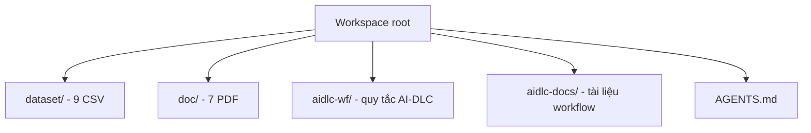

# Cấu trúc mã nguồn (Code Structure)

## Hệ thống build

- **Loại**: Không có.
- **Cấu hình**: Không có `package.json`, `pom.xml`, `build.gradle`, `pyproject.toml`, `requirements.txt`, `Makefile`, CI workflow hay pre-commit config.
- **Hệ quả**: Không thể chạy build/test/lint. Mọi mã pipeline sẽ là mã mới.

## Lớp/module chính

Không có mã nguồn. Cấu trúc hiện tại chỉ gồm tài sản dữ liệu và tài liệu:

## Kiểm kê tệp hiện có

| Đường dẫn | Vai trò |
|---|---|
| `dataset/olist_customers_dataset.csv` | Danh tính khách hàng theo đơn và `customer_unique_id` |
| `dataset/olist_geolocation_dataset.csv` | Tọa độ theo tiền tố zip code |
| `dataset/olist_order_items_dataset.csv` | Dòng hàng, giá, phí vận chuyển, seller, hạn giao |
| `dataset/olist_order_payments_dataset.csv` | Giao dịch thanh toán theo đơn |
| `dataset/olist_order_reviews_dataset.csv` | Điểm và nội dung đánh giá |
| `dataset/olist_orders_dataset.csv` | Trạng thái và các mốc thời gian đơn hàng |
| `dataset/olist_products_dataset.csv` | Thuộc tính sản phẩm và danh mục |
| `dataset/olist_sellers_dataset.csv` | Thông tin người bán |
| `dataset/product_category_name_translation.csv` | Từ điển danh mục Bồ Đào Nha → Anh |
| `doc/Projects.pdf` | Đề bài đồ án |
| `doc/BT.pdf` | Slide bài tập (chỉ có hình ảnh) |
| `doc/1. Introduction.pdf` | Slide giới thiệu tích hợp dữ liệu |
| `doc/2_SchemaAlignment.pdf` | Slide căn chỉnh schema |
| `doc/2_mediationquery.pdf` | Slide truy vấn qua trung gian |
| `doc/3_RecordLinkage_ER.pdf` | Slide record linkage / entity resolution |
| `doc/4_QueryProcessing.pdf` | Slide xử lý truy vấn |
| `doc/5_SourcesSelection.pdf` | Slide lựa chọn nguồn |
| `AGENTS.md` | Hướng dẫn cho agent làm việc trong repo |
| `aidlc-docs/aidlc-state.md` | Trạng thái workflow |
| `aidlc-docs/audit.md` | Audit trail |
| `aidlc-wf/steering/*.md` | Steering của AI-DLC |
| `aidlc-wf/aws-aidlc-rule-details/**/*.md` | Quy tắc chi tiết AI-DLC |

## Design patterns

Không có mã nguồn nên không có pattern triển khai. Các pattern **dữ liệu** cần áp dụng ở giai đoạn sau:

- **Star schema**: bảng fact đơn hàng/dòng hàng, dimension khách hàng, sản phẩm, seller, thời gian, địa lý.
- **Mediator/wrapper**: chuẩn hóa 9 nguồn CSV về một schema tích hợp.
- **Entity resolution**: hợp nhất `customer_id` về `customer_unique_id`, chuẩn hóa tên thành phố/zip.
- **Data quality gates**: kiểm tra khóa duy nhất, referential integrity, reconciliation trước khi serving.

## Phụ thuộc quan trọng

Không có dependency nội bộ. Phụ thuộc môi trường xem `technology-stack.md` và `dependencies.md`.
