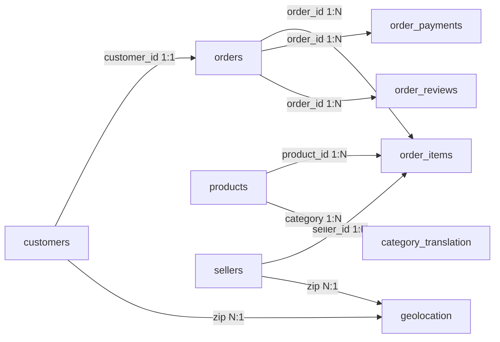

# Phụ thuộc (Dependencies)

## Phụ thuộc nội bộ

Không có package nội bộ. Phụ thuộc dữ liệu giữa các CSV:

### `orders` phụ thuộc `customers`
- **Loại**: Runtime/referential.
- **Lý do**: Mỗi đơn thuộc một `customer_id`; không có orphan.

### `order_items` phụ thuộc `orders`, `products`, `sellers`
- **Loại**: Runtime/referential.
- **Lý do**: Dòng hàng tham chiếu đơn, sản phẩm, người bán; tất cả `product_id`/`seller_id` đều resolve.
- **Ngoại lệ**: 775 đơn không có dòng hàng (đơn canceled/unavailable/created...).

### `order_payments` phụ thuộc `orders`
- **Loại**: Runtime/referential.
- **Lý do**: Thanh toán gắn với đơn; 1 đơn không có thanh toán.

### `order_reviews` phụ thuộc `orders`
- **Loại**: Runtime/referential.
- **Lý do**: Đánh giá gắn với đơn; 547 đơn có nhiều đánh giá (551 dòng review dư).

### `customers` / `sellers` phụ thuộc `geolocation`
- **Loại**: Runtime/analytical (không bắt buộc).
- **Lý do**: Ánh xạ zip → tọa độ/bang.
- **Ngoại lệ**: 278 customer zip và 7 seller zip không có trong geolocation.

### `products` phụ thuộc `product_category_name_translation`
- **Loại**: Runtime/analytical.
- **Lý do**: Dịch tên danh mục sang tiếng Anh.
- **Ngoại lệ**: 2 danh mục không có bản dịch.

## Phụ thuộc bên ngoài

| Phụ thuộc | Phiên bản | Mục đích | Giấy phép |
|---|---|---|---|
| Python | 3.13.5 | Runtime | PSF |
| pandas | 2.2.3 | Xử lý dữ liệu | BSD-3-Clause |
| numpy | Đã cài | Tính toán | BSD-3-Clause |
| matplotlib | Đã cài | Trực quan hóa | PSF-based |
| seaborn | Đã cài | Trực quan hóa | BSD-3-Clause |
| SQLAlchemy | Đã cài | ORM/SQL | MIT |
| openpyxl | Đã cài | Excel | MIT |
| pdfplumber | Đã cài | Đọc PDF | MIT |

## Rủi ro phụ thuộc

- Không có lockfile → tái lập môi trường không đảm bảo.
- Không có Spark/DuckDB/PyArrow → nếu chọn kiến trúc big data phải cài đặt thêm.
- Không có scikit-learn → mô hình ML cần cài thêm.
