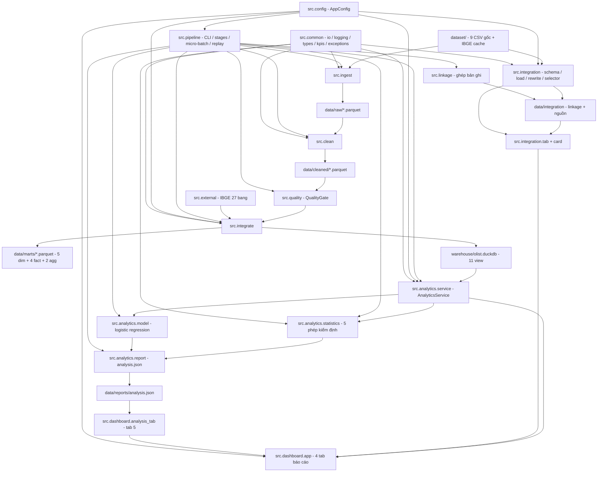
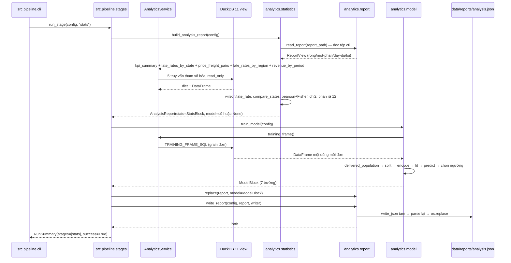
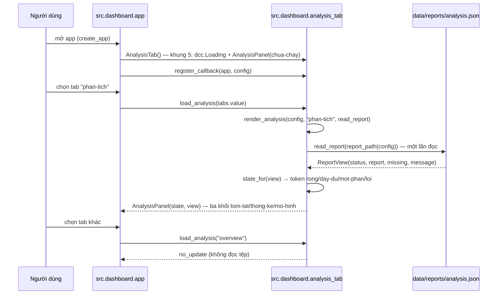
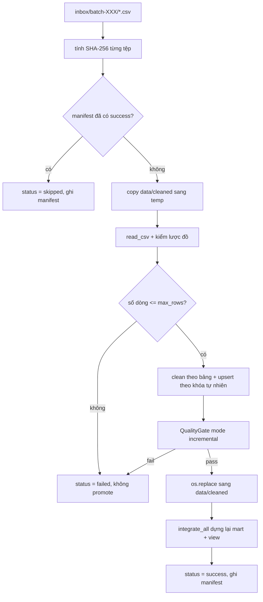
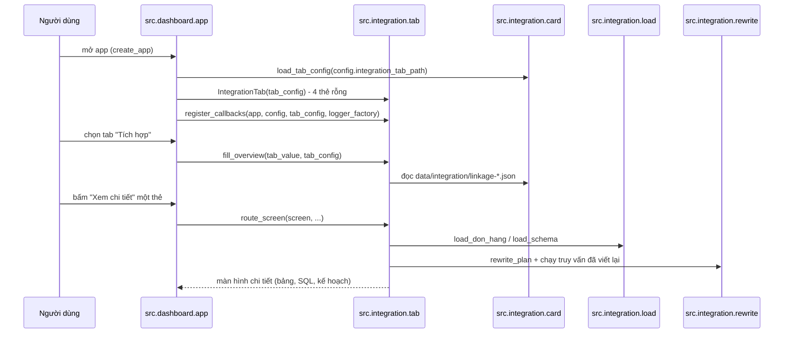

# Kiến trúc hệ thống — Olist E-commerce Data Pipeline

> Lần quét **tập trung** 2026-11-11 tại commit `ea77bdf88d1431de11c36e1b739972bd594063f0` cập nhật kiến trúc
> ở vùng `src/analytics/`, `src/integrate/`, `src/dashboard/`, `src/pipeline/` (cộng ảnh hưởng của `tests/`);
> các tầng `src/ingest`, `src/clean`, `src/quality`, `src/external`, `src/integration`, `src/linkage` giữ
> nguyên từ lần quét trước và **chưa đọc lại từng dòng**.
> Chi tiết thành phần xem `component-inventory.md`; chi tiết tệp/dòng xem `code-structure.md`;
> bề mặt gọi xem `api-documentation.md`.

## 1. Tổng quan hệ thống

Hệ thống là **một ứng dụng Python đơn khối, kiểu batch, chia tầng theo hướng dữ liệu**:

```
dataset/ (9 CSV, bất biến)
   → data/raw/*.parquet            (src.ingest)
   → data/cleaned/*.parquet        (src.clean + src.quality)
   → data/marts/*.parquet          (src.integrate: 5 dim + 4 fact + 2 agg)
   → warehouse/olist.duckdb        (11 view read_parquet)
   → src.analytics (service → statistics → report, service → model)
   → data/reports/analysis.json
   → src.dashboard (Dash, 5 tab)

nhánh thứ hai (đợt nâng cấp trước, cùng tiến trình):
config/mediated-schema.yaml + dataset/*.csv
   → src.integration (schema, load, rewrite, query, selector)
   → data/integration/*.json       (kết quả ghép bản ghi, hồ sơ nguồn)
   → tab "Tích hợp"                (src.integration.tab + card, gắn vào src.dashboard.app)
```

Điều phối nằm ở `src.pipeline`: CLI (`argparse`), chạy tầng, micro-batch, replay. Cấu hình đọc một lần từ
`config.yaml` thành `AppConfig` bất biến (`src/config.py`, 34 trường).

**Thay đổi lớn so với lần quét trước**: `src.analytics` từ 3 tệp/289 dòng thành **6 tệp/1.578 dòng** —
thêm `statistics.py` (năm phép kiểm định, dùng `scipy`), `report.py` (khung báo cáo phiên bản 2, ghi nguyên
tử, đọc bốn trạng thái) và `model.py` (huấn luyện hồi quy logistic, dùng `scikit-learn`); `service.py` thêm
bốn phương thức đọc phục vụ tầng `stats`. `src.dashboard` thêm `analysis_tab.py` (566 dòng) thành **tab thứ
năm**; `app.py` lên **5 tab / 9 callback**. `src.pipeline.stages.STAGES` lên **5 tên** (thêm `stats`).

## 2. Phong cách kiến trúc

**Kết luận: monolith theo tầng (layered monolith) cho batch ETL, cộng mô hình
"read-model" chỉ đọc cho phục vụ phân tích, cộng một nhánh suy luận chạy trong cùng tiến trình và ghi tệp
báo cáo.** Không có service mạng nào ngoài dashboard.

Bằng chứng:

- Một tiến trình, một gói Python (`src/`), không có HTTP API nội bộ, không message broker.
- Ranh giới tầng thể hiện bằng **thư mục gói** và **hướng import một chiều**:
  `ingest → clean → quality → integrate → analytics → dashboard`, dùng chung `config`, `common`, `external`.
- Truyền dữ liệu giữa tầng bằng **Parquet trên đĩa** (không phải đối tượng trong RAM xuyên suốt),
  riêng lần chạy `--stage all` giữ DataFrame trong RAM để tránh đọc lại.
- **Suy luận không nằm trong tầng truy vấn**: `src/analytics/statistics.py` và `src/analytics/model.py` là
  hai mô-đun **thuần hàm trên khung dữ liệu**; `service.py` vẫn là nơi **duy nhất** mở kết nối DuckDB
  (`_connect` → `ConnectionFactory.read_only()`). `report.py` là nơi **duy nhất** ghi/đọc
  `data/reports/analysis.json`. Đây là ranh giới quan trọng: `pipeline/stages.py` là **người ghép** ba mô-đun
  đó, không phải `AnalyticsService`.
- Mô hình dữ liệu đích là **star schema** (Kimball) với bảng ngày tách riêng.
- **Nhánh "tích hợp" là một mặt cắt ngang, không phải tầng tuần tự**: `src.integration` đọc thẳng CSV nguồn
  (qua lược đồ trung gian) và được `src.dashboard` gọi trong callback, độc lập với đường Parquet→DuckDB.
  Bằng chứng: `src/dashboard/app.py:31-38` import `src.integration.card`/`tab`; `src/pipeline/stages.py:20-21`
  import `src.linkage` để chạy như một tầng phụ.

### Phương án đã cân nhắc và bị loại

| Quyết định | Phương án chọn | Phương án bị loại | Lý do loại |
|---|---|---|---|
| Công cụ xử lý | pandas + Parquet cục bộ | Spark (local) | Không cần cụm; 1,55 triệu dòng vừa RAM; môi trường không có `pyspark` |
| Kho dữ liệu | DuckDB view trên Parquet | PostgreSQL/SQLite | Không cần server; DuckDB đọc trực tiếp Parquet, cài bằng pip |
| Phục vụ BI | Plotly Dash tự viết | Power BI / Superset | Yêu cầu chạy cục bộ, tiếng Việt, không phụ thuộc dịch vụ ngoài |
| Điều phối | CLI + `stages.py` | Airflow/Prefect | Đồ án một máy; thêm scheduler là chi phí không cần thiết |
| Kiểu ghi tệp | Ghi nguyên tử (temp → `os.replace`) | Ghi trực tiếp | Tránh tệp dở khi lỗi giữa chừng |
| Cấu hình tab | YAML `config/integration-tab.yaml` → `TabConfig` | Id cứng trong mã | Id ổn định, thêm thẻ không phải sửa layout; test đọc chính hợp đồng đó |
| Callback tab mới | `register_callbacks(app, config, tab_config, logger_factory)` | Nhồi vào hai callback báo cáo | Tab hỏng không làm hỏng ba tab cũ; mỗi callback một Output |
| **Kiểm định thống kê** | **`scipy` 1.15.2 đã ghim** (`norm`, `chi2_contingency`, `pearsonr`) + công thức Wilson/Fisher tự viết | Tự cài toàn bộ phân phối; hoặc `statsmodels` | Công thức khoảng tin cậy là 10 dòng; phân phối thì không. `requirements.txt:14-17` ghi rõ lý do |
| **Mô hình phân loại** | **`scikit-learn` 1.6.1** (`LogisticRegression`, `StandardScaler`, `roc_auc_score`) | Tự viết logistic regression trên `numpy`; `xgboost`/`lightgbm` | "Tự viết là tự viết lại một thư viện" (`requirements.txt:18-22`); boosting bị loại ở `ideation/scope-definition/scope-document.md` §Ngoài phạm vi |
| **Vị trí suy luận** | **Trong `src/analytics/`** (`statistics.py`, `model.py`, `report.py`) | Gói mới `src/metrics/` + `src/models/` như bản CodeKB trước khuyến nghị | Đội chọn giữ một gói; **`AnalyticsService` vẫn là nơi duy nhất chạm DuckDB** nên ranh giới "chỉ đọc" không bị phá — nhưng gói `analytics` nay trộn truy vấn + kiểm định + mô hình (xem §7.1) |
| **Truyền kết quả giữa hai bước** | **Tệp báo cáo duy nhất** `analysis.json` version 2, ghi một lần | Hai tệp riêng (`stats.json`, `model.json`); hoặc bảng trong DuckDB | Một tệp = một lần ghi nguyên tử = không có trạng thái nửa vời; đổi lại mọi reader phải chịu `mot-phan` |
| **Tab thứ năm đọc tệp trong callback** | `dcc.Loading` + `Output("analysis-result","children")`, đọc tệp **trong** callback | Đọc tệp lúc dựng layout | Đọc lúc layout sẽ đóng băng nội dung tại lúc khởi động và token `chua-chay` không bao giờ hiện (`analysis_tab.py:512-542`) |

## 3. Quan hệ thành phần



<!-- Text fallback: 9 tệp CSV và cache IBGE đi vào src.ingest, sinh data/raw; src.clean đọc raw sinh data/cleaned; QualityGate kiểm tra cleaned; src.integrate kết hợp cleaned với src.external (IBGE) sinh data/marts và warehouse/olist.duckdb (11 view); AnalyticsService đọc DuckDB; statistics.py và model.py nhận khung dữ liệu từ service rồi report.py ghi data/reports/analysis.json; dashboard dùng analytics để vẽ bốn tab báo cáo, dùng analysis_tab để vẽ tab thứ năm đọc chính tệp báo cáo, và dùng src.integration.tab để vẽ tab "Tích hợp"; nhánh thứ hai đọc thẳng CSV qua lược đồ trung gian, ghi kết quả ghép bản ghi của src.linkage vào data/integration rồi hiển thị trong tab; src.pipeline điều phối toàn bộ, gồm cả việc ghép ba mô-đun analytics trong tầng stats; src.config và src.common là hạ tầng dùng chung. -->

## 4. Luồng dữ liệu

| Tầng | Đầu vào | Đầu ra | Ai ghi | Kiểm soát |
|---|---|---|---|---|
| Ingest | 9 CSV UTF-8 trong `dataset/` | `data/raw/<table>.parquet` | `src.ingest.reader.ingest_table` | Đối chiếu tên và **thứ tự** cột với `TABLE_SPECS`; SHA-256 từng tệp; so số dòng kỳ vọng |
| Clean | raw Parquet | `data/cleaned/<table>.parquet` | `src.clean.pipeline.clean_all` | Chuẩn hóa Unicode NFC/chữ thường cho thành phố; ép kiểu số/ngày; gắn cờ lỗi thay vì xóa dòng |
| Quality | cleaned trong RAM | `data/reports/quality-report.json` | `src.quality.gate.QualityGate` | 21 check cấu trúc; chế độ `full` thêm 9 check số dòng và 10 dị thường allowlist |
| Integrate | cleaned Parquet | `data/marts/*.parquet`, `warehouse/olist.duckdb`, báo cáo | `src.integrate.pipeline.integrate_all` | Kiểm grain/khóa (`StarSchemaValidator`), đối chiếu KPI với baseline (`KpiReconciler`) |
| Linkage | cleaned Parquet | `data/integration/linkage-<đối tượng>.json` | `src.linkage.result.generate_linkage` (gọi từ `src.pipeline.stages._run_linkage`) | Một đối tượng lỗi không chặn đối tượng kia; lỗi được ném lại sau vòng lặp |
| Analyze | DuckDB view | DataFrame | `src.analytics.service.AnalyticsService` | Tham số hóa SQL bằng `?`, kết nối `read_only` |
| **Stats** | DuckDB view (qua `AnalyticsService`) | `data/reports/analysis.json` | `src.analytics.report.write_report` (gọi từ `stages.run_stage("stats")`) | Năm phép kiểm định + mô hình; `write_report` ghi tạm → **parse lại** → `os.replace`; `read_report` từ chối sai phiên bản/thiếu trường |
| **Model** | `AnalyticsService.training_frame()` | `ModelBlock` (7 trường) | `src.analytics.model.train_model` → `stages` ghép vào báo cáo | `delivered_population` chặn lệch baseline; `validate_features` chặn rò rỉ; `train_classifier` biến không hội tụ thành lỗi; `validate_counts` buộc ba số đếm khớp |
| Present (4 tab cũ) | DataFrame | HTML/Plotly | `src.dashboard.app` | Bắt lỗi và hiển thị banner; trả figure rỗng khi không có dữ liệu; **luôn** trả đúng 9 phần tử |
| Present (tab Tích hợp) | CSV nguồn + `data/integration/*.json` | HTML/Plotly + bảng | `src.integration.tab` (qua 6 callback Dash) | Sáu trạng thái thẻ (`rong`, `chua-chay`, `dang-tai`, `day-du`, `mot-phan`, `loi`); lỗi hiển thị tại chỗ |
| **Present (tab 5)** | `data/reports/analysis.json` | HTML | `src.dashboard.analysis_tab` (1 callback) | Ánh xạ thẳng `ReportView.status` → token; `no_update` khi tab khác được chọn; ba nhánh thiếu khối vẫn giữ chỗ |

## 5. Quyết định kiến trúc quan trọng

1. **Hợp đồng lược đồ tường minh, so khớp cả thứ tự cột.** `validate_columns` so sánh `tuple(df.columns)`
   với `TableSpec.columns` và ném `SchemaError` (kèm danh sách thiếu/thừa). Hệ quả: CSV đổi thứ tự cột
   bị chặn ngay ở ingest thay vì lỗi ngầm ở hạ nguồn. Đánh đổi: cứng nhắc, mọi thay đổi nguồn phải sửa code.
2. **Làm sạch bằng cờ (flag) thay vì xóa dòng.** `category_missing`, `translation_missing`,
   `price_outlier`, `multiple_reviews_per_order`, `is_delivered`, `has_invalid_timestamp` được gắn thay vì lọc.
   Nhờ vậy số dòng của mọi bảng giữ đúng grain gốc và KPI tái lập được; quyết định lọc dời xuống tầng phân tích.
3. **Số dòng kỳ vọng và baseline KPI là hằng số trong mã.** Ba nơi khai báo lại cùng bộ đếm
   (`src/ingest/schemas.py`, `src/quality/gate.py`, `src/integrate/validate.py`), và nay **bốn** nơi khai
   baseline 96.478/7.826 (`src/integrate/reconcile.py:8-14`, `src/analytics/model.py:22-23`,
   `README.md`, hai test tích hợp). Đây là chốt hồi quy mạnh nhưng là nguồn trôi lệch (TD-02).
4. **DuckDB chỉ là lớp view, không copy dữ liệu.** `DuckDbCatalog` tạo `CREATE OR REPLACE VIEW v_<table>
   AS SELECT * FROM read_parquet('<đường dẫn tuyệt đối>')` (`src/integrate/catalog.py:26-34`). Hệ quả: mart
   thay đổi là view thấy ngay, nhưng đường dẫn tuyệt đối bị "nướng" vào catalog — chuyển thư mục repo là
   phải chạy lại `integrate`.
5. **Ghi nguyên tử.** `AtomicWriter` ghi temp + đọc lại kiểm số dòng + `os.replace`; marts ghi vào
   `data/.tmp/<run_id>/marts` rồi thay thế từng tệp (`src/integrate/pipeline.py:90-98`). Riêng báo cáo phân
   tích có thêm một lớp: `write_report` **tự parse lại** tệp tạm và kiểm phiên bản + "không phải cả hai khối
   đều null" trước khi `os.replace` (`src/analytics/report.py:248-267, 318-328`).
6. **Idempotent theo nội dung cho micro-batch.** `ManifestStore` lưu SHA-256 từng tệp; batch trùng hash bị
   `skipped`. Đánh đổi: phụ thuộc tính đúng đắn của trạng thái manifest (xem TD-01).
7. **Cấu hình tập trung, bất biến.** `AppConfig` là `frozen dataclass` (34 trường); `load_config` tạo sẵn
   thư mục đầu ra. Test có thể tiêm `config.yaml` tạm (`tests/conftest.py:29-58` tạo config trỏ vào
   `tmp_path`; `:61-92` tạo `real_config` trỏ vào `dataset/` thật).
8. **Hai callback báo cáo tách khỏi 6 callback của tab "Tích hợp" và 1 callback của tab phân tích**
   (`src/dashboard/app.py:431-472`), với `suppress_callback_exceptions=True` vì thân tab được dựng trong
   callback (ADR-U6-S1, ADR-U6-S5 — dẫn trong chú thích mã). Hệ quả: thêm tab thứ sáu theo cùng mẫu không
   phải sửa layout của năm tab cũ, nhưng **phải** cập nhật các test đang khẳng định số tab/callback/output
   (xem `code-quality-assessment.md` §7.1).
9. **Tầng truy vấn không suy luận, nhưng gói `analytics` thì có.** `AnalyticsService` chỉ tổng hợp
   (`SUM`, `COUNT`, `AVG`) và tính tỉ lệ — đúng như bản CodeKB trước mô tả. Suy luận nằm **cạnh** nó, trong
   cùng gói: `statistics.py` và `model.py` không mở kết nối, chỉ nhận `DataFrame`/`dict` từ service. Ranh
   giới "một nơi duy nhất nói chuyện với DuckDB" **được giữ**; ranh giới "một gói một vai trò" thì **không**
   (xem §7.1).
10. **Kết quả suy luận đi qua một tệp, không qua bộ nhớ.** `stages.run_stage("stats")` dựng khối `stats`,
    huấn luyện mô hình, `dataclasses.replace(report, model=model)`, rồi ghi **một lần**
    (`src/pipeline/stages.py:241-259`). Dashboard đọc lại tệp đó. Hệ quả: (a) dashboard không cần mart để
    hiển thị tab 5; (b) "trạng thái một phần" là trạng thái hạng nhất (`mot-phan`) chứ không phải lỗi;
    (c) đổi bộ trường là đổi hợp đồng tệp, và `_model_block` sẽ **từ chối** tệp cũ thiếu trường.
11. **Tầng `stats` chạy tách khỏi `--stage all`.** `STAGES` có 5 tên
    (`src/pipeline/stages.py:24`) nhưng `_run_all` chỉ chạy ingest → clean → quality → integrate → linkage →
    analyze và ghi 6 `StageResult`; `stats` chỉ chạy khi được gọi đích danh. CI phản ánh điều này bằng hai
    bước riêng (`ci.yml`, "Dựng dữ liệu" rồi "Sinh báo cáo thống kê").

## 6. Sơ đồ tương tác (Interaction Diagrams)

### 6.1 Một đơn hàng đi từ CSV nguồn tới dashboard


<!-- Text fallback: CSV được src.ingest đọc dạng chuỗi, kiểm tên và thứ tự cột, băm SHA-256 rồi ghi data/raw. src.clean đọc raw, ép kiểu và gắn cờ; QualityGate kiểm tra 9 bảng đã làm sạch và chặn nếu lệch allowlist. src.integrate dựng 5 dimension, 4 fact, 2 aggregate rồi ghi mart và tạo 11 view DuckDB. Khi người dùng đổi bộ lọc, callback Dash gọi AnalyticsService, service chạy SQL tham số hóa trên view read-only và trả DataFrame để vẽ chín phần tử giao diện. -->

### 6.2 Một lần chạy `run --stage stats` (kiểm định + mô hình + một lần ghi)



<!-- Text fallback: CLI gọi run_stage("stats"); stages trước hết dựng khối thống kê bằng build_analysis_report, đọc tệp báo cáo cũ để giữ khối model của lần chạy trước, rồi đọc dữ liệu một lần cho mỗi phép qua AnalyticsService và chạy năm phép kiểm định. Sau đó stages gọi train_model: model lấy khung grain đơn từ training_frame, lọc quần thể đã giao, chia theo thời gian, mã hóa, huấn luyện và chọn ngưỡng. Stages ghép khối model vào báo cáo rồi gọi write_report, nơi ghi tệp tạm, parse lại để kiểm, và thay tệp thật bằng os.replace. -->

### 6.3 Một lần mở tab "Kết quả phân tích"



<!-- Text fallback: khi mở app, dashboard dựng khung tab thứ năm ở trạng thái chờ chua-chay và đăng ký một callback duy nhất trên tabs.value. Khi người dùng chọn tab phân tích, callback đọc data/reports/analysis.json đúng một lần, ánh xạ trạng thái của ReportView thành token, rồi dựng ba khối tóm tắt, thống kê, mô hình. Chọn tab khác thì callback trả no_update và không đọc tệp. -->

### 6.4 Một micro-batch đi từ inbox tới mart



<!-- Text fallback: Mỗi thư mục trong inbox là một batch. Hệ thống băm từng tệp, bỏ qua nếu manifest đã ghi success cho hash đó. Ngược lại, nó sao toàn bộ data/cleaned sang thư mục tạm, đọc và kiểm lược đồ từng CSV, chặn nếu vượt max_rows, làm sạch và upsert theo khóa tự nhiên, chạy quality gate chế độ incremental; chỉ khi pass mới thay thế data/cleaned và chạy integrate_all để dựng lại mart và view. Batch lỗi không promote. -->

### 6.5 Một lần mở tab "Tích hợp"



<!-- Text fallback: Khi mở app, dashboard đọc hợp đồng tab từ YAML, dựng bốn thẻ rỗng và đăng ký sáu callback (tổng quan, định tuyến, chạy truy vấn, đề xuất nguồn, tải lại, và một callback cho mỗi result_region_ids). Khi người dùng chọn tab "Tích hợp", callback tổng quan đọc kết quả ghép bản ghi và điền hai dòng số liệu cho mỗi thẻ. Khi bấm "Xem chi tiết", callback định tuyến dựng màn hình tương ứng, đọc lược đồ trung gian hoặc nạp bảng đơn từ CSV và chạy truy vấn đã viết lại. -->

## 7. Cơ hội cải thiện kiến trúc

1. **`src.analytics` nay gánh bốn vai trò trong một gói** (truy vấn, kiểm định, mô hình, hợp đồng báo cáo).
   Bản CodeKB trước khuyến nghị tách `src/metrics/` + `src/models/`; đội đã chọn giữ trong `analytics`. Hệ quả
   thực tế: gói tăng từ 289 lên 1.578 dòng, `report.py` (502 dòng) trở thành "hợp đồng liên đơn vị" bị hai
   đơn vị cùng sửa, và `service.py` vừa là lớp truy vấn vừa là **nhà cung cấp khung đặc trưng** cho mô hình —
   hai mục đích khác nhau trên cùng một lớp. Nếu tách, chỗ rẻ nhất là đưa `training_frame` và bốn truy vấn
   `stats` sang một mô-đun đọc riêng.
2. **Tách "hợp đồng dữ liệu" khỏi mã.** Số dòng kỳ vọng, allowlist dị thường, baseline KPI và baseline mô
   hình (96.478/7.826, mốc 2018-04-01, AUC 0,70) nên nằm trong một tệp cấu hình/JSON duy nhất. Hiện baseline
   mô hình đã là chỗ khai **thứ tư** của cùng hai con số.
3. **Hợp nhất cơ chế "chạy tầng"**: `STAGES` có **5** tên nhưng `_run_all` ghi **6** `StageResult`
   (`quality`, `linkage` không nằm trong `STAGES`) và **không** chạy `stats` dù `stats` nằm trong `STAGES`.
   Danh sách tầng và báo cáo tầng đang mô tả hai thứ khác nhau (TD-11).
4. **Giảm phụ thuộc đường dẫn tuyệt đối trong catalog DuckDB** (dùng view theo đường dẫn tương đối hoặc
   tạo lại catalog khi khởi động dashboard).
5. **Cắt phụ thuộc ngược chiều `integrate → analytics`**: `src/integrate/pipeline.py:10` import
   `AnalyticsService` nhưng không dùng; bỏ import này (và dòng miễn trừ `F401` tương ứng trong `ruff.toml:27`).
   Nay import này nặng hơn: nó khiến gói mô hình hóa phụ thuộc gói có `scikit-learn`.
6. **Chuẩn hóa đầu ra dashboard thành cấu trúc có tên.** `build_dashboard_outputs` trả tuple vị trí 9 phần tử
   ở cả nhánh thành công lẫn nhánh lỗi; thêm một output là phải sửa hai chỗ cộng ba test. Một dict/`NamedTuple`
   sẽ làm việc thêm output rẻ hơn nhiều.
7. **Giữ một nguồn sự thật cho "số tab/số callback".** Hiện ba test khẳng định số cứng (5 tab, 9 callback,
   6 callback của tab "Tích hợp", 9 output); nên suy ra từ `config/integration-tab.yaml` + một hằng số duy
   nhất thay vì đếm tay ở từng test.
8. **Khung dự đoán và mart đang lệch nhau.** Mô hình cần mốc bàn giao (`order_delivered_carrier_date`) và
   thuộc tính người bán, nhưng `fact_orders` không mang mốc đó và `fact_order_items` không mang
   `seller_state`; `shipping_limit_date` bị `FactBuilder.build_order_items` làm rơi. Nếu mart là "hợp đồng
   dữ liệu", nó nên mang đủ mốc thời gian mà mọi tầng hạ nguồn cần, thay vì để tầng phân tích đọc chéo
   `data/cleaned/` (một đường thứ ba, hiện chưa có).
