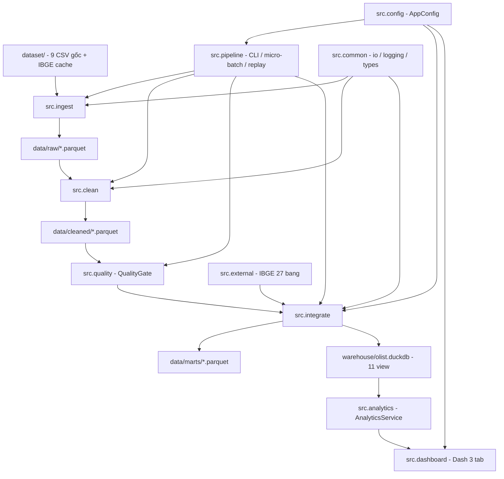
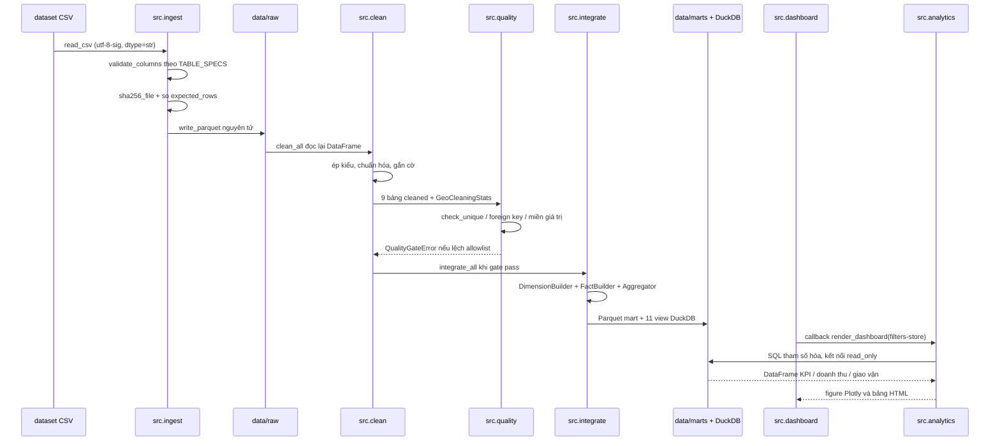
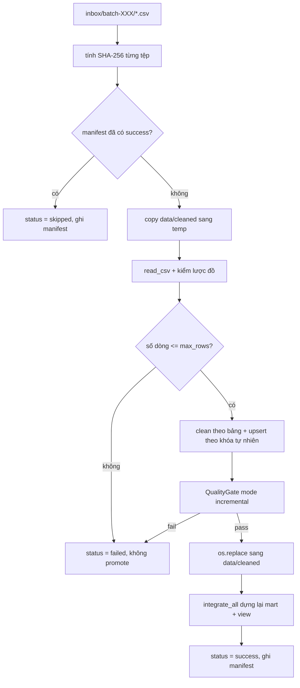

# Kiến trúc hệ thống — Olist E-commerce Data Pipeline

> Quét tại commit `41c422ffd7f3b27a2f78a67eaccc43a00d13c77e`. Chi tiết thành phần xem
> `component-inventory.md`; chi tiết tệp/dòng xem `code-structure.md`; bề mặt gọi xem
> `api-documentation.md`.

## 1. Tổng quan hệ thống

Hệ thống là **một ứng dụng Python đơn khối, kiểu batch, chia tầng theo hướng dữ liệu**:

```
dataset/ (9 CSV, bất biến)
   → data/raw/*.parquet            (src.ingest)
   → data/cleaned/*.parquet        (src.clean + src.quality)
   → data/marts/*.parquet          (src.integrate: 5 dim + 4 fact + 2 agg)
   → warehouse/olist.duckdb        (11 view read_parquet)
   → src.analytics → src.dashboard (Dash, 3 tab)
```

Điều phối nằm ở `src.pipeline`: CLI (`argparse`), chạy tầng, micro-batch, replay.
Cấu hình đọc một lần từ `config.yaml` thành `AppConfig` bất biến (`src/config.py`).

## 2. Phong cách kiến trúc

**Kết luận: monolith theo tầng (layered monolith) cho batch ETL, cộng mô hình
"read-model" chỉ đọc cho phục vụ phân tích.** Không có service mạng nào ngoài dashboard.

Bằng chứng:

- Một tiến trình, một gói Python (`src/`), không có HTTP API nội bộ, không message broker.
- Ranh giới tầng thể hiện bằng **thư mục gói** và **hướng import một chiều**:
  `ingest → clean → quality → integrate → analytics → dashboard`, dùng chung `config`, `common`, `external`.
- Truyền dữ liệu giữa tầng bằng **Parquet trên đĩa** (không phải đối tượng trong RAM xuyên suốt),
  riêng lần chạy `--stage all` giữ DataFrame trong RAM để tránh đọc lại.
- Mô hình dữ liệu đích là **star schema** (Kimball) với bảng ngày tách riêng.

### Phương án đã cân nhắc và bị loại

| Quyết định | Phương án chọn | Phương án bị loại | Lý do loại |
|---|---|---|---|
| Công cụ xử lý | pandas + Parquet cục bộ | Spark (local) | Không cần cụm; 1,55 triệu dòng vừa RAM; môi trường không có `pyspark` |
| Kho dữ liệu | DuckDB view trên Parquet | PostgreSQL/SQLite | Không cần server; DuckDB đọc trực tiếp Parquet, cài bằng pip |
| Phục vụ BI | Plotly Dash tự viết | Power BI / Superset | Yêu cầu chạy cục bộ, tiếng Việt, không phụ thuộc dịch vụ ngoài |
| Điều phối | CLI + `stages.py` | Airflow/Prefect | Đồ án một máy; thêm scheduler là chi phí không cần thiết |
| Kiểu ghi tệp | Ghi nguyên tử (temp → `os.replace`) | Ghi trực tiếp | Tránh tệp dở khi lỗi giữa chừng |

## 3. Quan hệ thành phần



<!-- Text fallback: 9 tệp CSV và cache IBGE đi vào src.ingest, sinh data/raw; src.clean đọc raw sinh data/cleaned; QualityGate kiểm tra cleaned; src.integrate kết hợp cleaned với src.external (IBGE) sinh data/marts và warehouse/olist.duckdb (11 view); src.analytics đọc DuckDB; src.dashboard gọi analytics để vẽ 3 tab; src.pipeline điều phối ingest/clean/quality/integrate; src.config và src.common là hạ tầng dùng chung. -->

## 4. Luồng dữ liệu

| Tầng | Đầu vào | Đầu ra | Ai ghi | Kiểm soát |
|---|---|---|---|---|
| Ingest | 9 CSV UTF-8 trong `dataset/` | `data/raw/<table>.parquet` | `src.ingest.reader.ingest_table` | Đối chiếu tên và **thứ tự** cột với `TABLE_SPECS`; SHA-256 từng tệp; so số dòng kỳ vọng |
| Clean | raw Parquet | `data/cleaned/<table>.parquet` | `src.clean.pipeline.clean_all` | Chuẩn hóa Unicode NFC/chữ thường cho thành phố; ép kiểu số/ngày; gắn cờ lỗi thay vì xóa dòng |
| Quality | cleaned trong RAM | `data/reports/quality-report.json` | `src.quality.gate.QualityGate` | 21 check cấu trúc; chế độ `full` thêm 9 check số dòng và 10 dị thường allowlist |
| Integrate | cleaned Parquet | `data/marts/*.parquet`, `warehouse/olist.duckdb`, báo cáo | `src.integrate.pipeline.integrate_all` | Kiểm grain/khóa (`StarSchemaValidator`), đối chiếu KPI với baseline (`KpiReconciler`) |
| Analyze | DuckDB view | DataFrame | `src.analytics.service.AnalyticsService` | Tham số hóa SQL bằng `?`, kết nối `read_only` |
| Present | DataFrame | HTML/Plotly | `src.dashboard.app` | Bắt lỗi và hiển thị banner; trả figure rỗng khi không có dữ liệu |

Chi tiết đường đi của một đơn hàng: xem mục 6.

## 5. Quyết định kiến trúc quan trọng

1. **Hợp đồng lược đồ tường minh, so khớp cả thứ tự cột.** `validate_columns` so sánh `tuple(df.columns)`
   với `TableSpec.columns` và ném `SchemaError` (kèm danh sách thiếu/thừa). Hệ quả: CSV đổi thứ tự cột
   bị chặn ngay ở ingest thay vì lỗi ngầm ở hạ nguồn. Đánh đổi: cứng nhắc, mọi thay đổi nguồn phải sửa code.
2. **Làm sạch bằng cờ (flag) thay vì xóa dòng.** `category_missing`, `translation_missing`,
   `price_outlier`, `multiple_reviews_per_order`, `is_delivered`, `has_invalid_timestamp` được gắn thay vì lọc.
   Nhờ vậy số dòng của mọi bảng giữ đúng grain gốc và KPI tái lập được; quyết định lọc dời xuống tầng phân tích.
3. **Số dòng kỳ vọng và baseline KPI là hằng số trong mã.** Ba nơi khai báo lại cùng bộ đếm
   (`src/ingest/schemas.py`, `src/quality/gate.py`, `src/integrate/validate.py`). Đây là chốt hồi quy mạnh
   nhưng là nguồn trôi lệch (xem `code-quality-assessment.md` TD-02).
4. **DuckDB chỉ là lớp view, không copy dữ liệu.** `DuckDbCatalog` tạo `CREATE OR REPLACE VIEW v_<table>
   AS SELECT * FROM read_parquet('<đường dẫn tuyệt đối>')`. Hệ quả: mart thay đổi là view thấy ngay, nhưng
   đường dẫn tuyệt đối bị "nướng" vào catalog — chuyển thư mục repo là phải chạy lại `integrate`.
5. **Ghi nguyên tử.** `AtomicWriter` ghi temp + đọc lại kiểm số dòng + `os.replace`; marts ghi vào
   `data/.tmp/<run_id>/marts` rồi thay thế từng tệp. Hệ quả: không có mart nửa vời, nhưng thay thế nhiều tệp
   không phải giao dịch nguyên khối (lỗi giữa vòng lặp để lại tập mart lệch phiên bản).
6. **Idempotent theo nội dung cho micro-batch.** `ManifestStore` lưu SHA-256 từng tệp; batch trùng hash bị
   `skipped`. Đánh đổi: phụ thuộc tính đúng đắn của trạng thái manifest (xem TD-01).
7. **Cấu hình tập trung, bất biến.** `AppConfig` là `frozen dataclass`; `load_config` tạo sẵn thư mục đầu ra.
   Test có thể tiêm `config.yaml` tạm (`tests/conftest.py`).

## 6. Sơ đồ tương tác

### 6.1 Một đơn hàng đi từ CSV nguồn tới dashboard



<!-- Text fallback: CSV được src.ingest đọc dạng chuỗi, kiểm tên và thứ tự cột, băm SHA-256 rồi ghi data/raw. src.clean đọc raw, ép kiểu và gắn cờ; QualityGate kiểm tra 9 bảng đã làm sạch và chặn nếu lệch allowlist. src.integrate dựng 5 dimension, 4 fact, 2 aggregate rồi ghi mart và tạo 11 view DuckDB. Khi người dùng đổi bộ lọc, callback Dash gọi AnalyticsService, service chạy SQL tham số hóa trên view read-only và trả DataFrame để vẽ hình. -->

### 6.2 Một micro-batch đi từ inbox tới mart



<!-- Text fallback: Mỗi thư mục trong inbox là một batch. Hệ thống băm từng tệp, bỏ qua nếu manifest đã ghi success cho hash đó. Ngược lại, nó sao toàn bộ data/cleaned sang thư mục tạm, đọc và kiểm lược đồ từng CSV, chặn nếu vượt max_rows, làm sạch và upsert theo khóa tự nhiên, chạy quality gate chế độ incremental; chỉ khi pass mới thay thế data/cleaned và chạy integrate_all để dựng lại mart và view. Batch lỗi không promote. -->

## 7. Cơ hội cải thiện kiến trúc

1. **Tách "hợp đồng dữ liệu" khỏi mã.** Số dòng kỳ vọng, allowlist dị thường và baseline KPI nên nằm trong
   một tệp cấu hình/JSON duy nhất thay vì ba mô-đun Python, để bộ dữ liệu mới chỉ cần đổi dữ liệu.
2. **Thêm tầng "ánh xạ lược đồ" tường minh** (schema mapping/mediation) cho đợt nâng cấp theo `doc/`:
   hiện `TABLE_SPECS` chỉ *kiểm tra* lược đồ, chưa có bảng ánh xạ nguồn→đích có thể cấu hình.
3. **Chuẩn hóa danh mục qua bảng dịch có kiểm soát phủ.** `clean_products` dùng left join nên hai danh mục
   thiếu bản dịch (`pc_gamer`, `portateis_cozinha_e_preparadores_de_alimentos`) chỉ được đánh cờ
   `translation_missing`; một bảng ánh xạ bổ sung sẽ làm giàu được thay vì chỉ báo lỗi.
4. **Hợp nhất cơ chế "chạy tầng"**: `STAGES` có 4 tầng nhưng `StageResult` ghi 5 mục (có `quality`);
   nên đưa `quality` thành tầng hạng nhất hoặc bỏ khỏi báo cáo tầng.
5. **Giảm phụ thuộc đường dẫn tuyệt đối trong catalog DuckDB** (dùng view theo đường dẫn tương đối hoặc
   tạo lại catalog khi khởi động dashboard).
6. **Cắt phụ thuộc ngược chiều `integrate → analytics`**: `src/integrate/pipeline.py` (dòng 10) import
   `AnalyticsService` nhưng không dùng; bỏ import này để luồng phụ thuộc chỉ còn một chiều
   `integrate → analytics` ở tầng điều phối (`src/pipeline/stages.py`).
