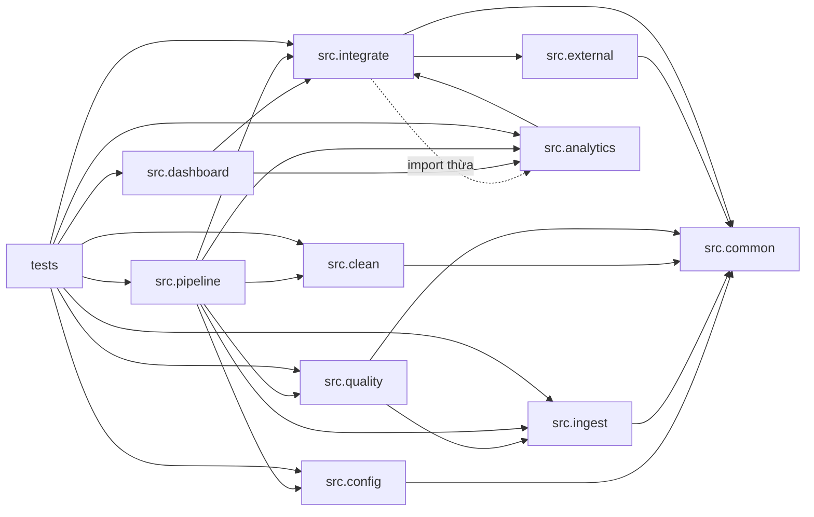

# Phụ thuộc — Olist E-commerce Data Pipeline

> Hai loại: **phụ thuộc ngoài** (thư viện, dịch vụ, dữ liệu) và **phụ thuộc nội bộ** (gói/tệp với nhau).
> Phiên bản và lý do chọn công nghệ: `technology-stack.md`. Tác động tới chất lượng: `code-quality-assessment.md`.

## 1. Phụ thuộc ngoài

### 1.1 Thư viện theo mô-đun

| Mô-đun | Thư viện bên thứ ba | Thư viện chuẩn |
|---|---|---|
| `src.config` | `yaml` | `dataclasses`, `pathlib` |
| `src.common.io` | `pandas` (+`pyarrow` khi ghi Parquet) | `hashlib`, `json`, `os`, `shutil`, `uuid` |
| `src.common.logging` | — | `json`, `uuid`, `datetime`, `pathlib` |
| `src.common.memory` | — | `tracemalloc` |
| `src.ingest.*` | `pandas` | `datetime`, `pathlib` |
| `src.clean.*` | `pandas` | — |
| `src.quality.*` | `pandas` | — |
| `src.external.ibge` | `pandas` | `hashlib`, `json`, `time`, `urllib.request`, `urllib.error`, `datetime`, `pathlib` |
| `src.external.region` | `pandas` | — |
| `src.integrate.*` | `pandas`, `duckdb` | `os` |
| `src.analytics.service` | `pandas`, `duckdb` (gián tiếp) | — |
| `src.dashboard.*` | `dash`, `plotly`, `pandas` | `datetime` |
| `src.pipeline.*` | `pandas` | `argparse`, `hashlib`, `os`, `shutil`, `time`, `json`, `datetime`, `dataclasses`, `sys` |
| `tests.*` | `pytest`, `pandas` | `json`, `sys`, `pathlib`, `dataclasses` |

Không có phụ thuộc nào cho HTTP client nâng cao (`requests`/`httpx`), retry (`tenacity`), migration
(`alembic`), hay orchestration (`airflow`, `prefect`). Mọi thứ dựng trên thư viện chuẩn + 8 gói ghim.

### 1.2 Dịch vụ ngoài

| Dịch vụ | Điểm gọi | Bắt buộc? | Chịu lỗi |
|---|---|---|---|
| API IBGE `https://servicodados.ibge.gov.br/api/v1/localidades/estados` | `IbgeClient._fetch_api` | Không | Retry `ibge.retries` (2) với backoff `1 + attempt` giây; fallback cache `estados.json`; hết cách mới ném `ExternalSourceError` |
| API IBGE `/municipios` | `IbgeClient.fetch_municipalities` | Không | Fallback cache nếu có; hiện không nơi nào gọi trong pipeline chính |

Không có dịch vụ đám mây, không có cơ sở dữ liệu mạng, không có xác thực. Dashboard bind `127.0.0.1`.

### 1.3 Phụ thuộc dữ liệu

| Nguồn | Kích thước | Vai trò | Tính bất biến |
|---|---:|---|---|
| `dataset/olist_orders_dataset.csv` | 99.441 dòng | Hạt nhân sự kiện đơn | Bất biến |
| `dataset/olist_customers_dataset.csv` | 99.441 | Chiều khách hàng (1:1 theo `customer_id`) | Bất biến |
| `dataset/olist_order_items_dataset.csv` | 112.650 | Doanh thu cấp dòng hàng | Bất biến |
| `dataset/olist_order_payments_dataset.csv` | 103.886 | Thanh toán (nhiều dòng/đơn) | Bất biến |
| `dataset/olist_order_reviews_dataset.csv` | 99.224 | Đánh giá (nhiều dòng/đơn) | Bất biến |
| `dataset/olist_products_dataset.csv` | 32.951 | Chiều sản phẩm | Bất biến |
| `dataset/olist_sellers_dataset.csv` | 3.095 | Chiều người bán | Bất biến |
| `dataset/olist_geolocation_dataset.csv` | 1.000.163 | Vị trí theo mã bưu chính (phải tổng hợp trước khi join) | Bất biến |
| `dataset/product_category_name_translation.csv` | 71 | Bảng dịch danh mục | Bất biến |
| `dataset/external/ibge/estados.json` | 27 | Ánh xạ bang → vùng (cache đi kèm) | Bất biến, có thể `--refresh-ibge` |

Nguồn `doc/` (PDF học liệu, quiz) **không** được mã đọc; đây là phụ thuộc của con người, không phải của hệ thống.

## 2. Phụ thuộc nội bộ

### 2.1 Đồ thị gói

<!-- Text fallback: src.common là gốc được mọi gói dùng. src.ingest, src.clean, src.quality, src.external, src.integrate đều trỏ về src.common; src.quality đọc hợp đồng lược đồ từ src.ingest; src.integrate dùng src.external (IBGE) và có một import thừa trỏ tới src.analytics; src.analytics phụ thuộc src.integrate (ConnectionFactory) tạo vòng phụ thuộc mức gói; src.dashboard dùng cả src.analytics và src.integrate; src.pipeline là điểm ghép nối trung tâm phụ thuộc gần như mọi gói; tests phụ thuộc toàn bộ. -->

### 2.2 Danh sách kề (tệp → phụ thuộc nội bộ)

| Tệp | Phụ thuộc nội bộ |
|---|---|
| `src/config.py` | `src.common.exceptions` |
| `src/common/io.py` | `src.common.exceptions`, `src.common.types` |
| `src/common/logging.py` | `src.common.types` |
| `src/ingest/schemas.py` | `src.common.types` |
| `src/ingest/reader.py` | `src.common.io`, `src.common.logging`, `src.common.types`, `src.ingest.schemas` |
| `src/ingest/reports.py` | `src.common.io`, `src.common.types` |
| `src/clean/*` (theo bảng) | `src.clean.common` (+ `src.common.types` ở `geolocation`) |
| `src/clean/pipeline.py` | 9 mô-đun `src.clean.*`, `src.common.io`, `src.common.logging`, `src.common.types` |
| `src/quality/gate.py` | `src.common.exceptions`, `src.common.logging`, `src.common.types`, `src.ingest.schemas`, `src.quality.checks`, `src.quality.allowlist` |
| `src/external/ibge.py` | `src.common.*`, `src.external.region` |
| `src/integrate/dimensions.py` | `src.external.region` |
| `src/integrate/catalog.py` | `src.integrate.connections` |
| `src/integrate/pipeline.py` | `src.analytics.service` (**không dùng**), `src.common.*`, `src.external.*`, `src.integrate.*` |
| `src/analytics/service.py` | `src.common.types`, `src.integrate.connections` |
| `src/dashboard/app.py` | `src.analytics.service`, `src.common.types`, `src.dashboard.components`, `src.dashboard.formatting`, `src.integrate.connections` |
| `src/dashboard/components.py` | `src.dashboard.formatting` |
| `src/pipeline/stages.py` | `src.analytics.service`, `src.clean.pipeline`, `src.common.*`, `src.ingest.reader`, `src.ingest.reports`, `src.integrate.pipeline`, `src.quality.gate` |
| `src/pipeline/micro_batch.py` | 9 mô-đun `src.clean.*`, `src.common.*`, `src.ingest.schemas`, `src.integrate.pipeline`, `src.pipeline.manifest`, `src.pipeline.upsert`, `src.quality.gate` |
| `src/pipeline/cli.py` | `src.config`, `src.pipeline.micro_batch`, `src.pipeline.replay`, `src.pipeline.stages` |
| `src/pipeline/replay.py` | `src.common.io`, `src.ingest.schemas` |

### 2.3 Chỉ số ghép nối

| Mô-đun | Fan-in (số tệp dùng nó) | Fan-out | Ghi chú |
|---|---:|---:|---|
| `src/common/types.py` | 14 | 0 | Hợp đồng dùng chung, ổn định |
| `src/common/io.py` | 9 | 2 | Trục IO; thay đổi chữ ký ảnh hưởng rộng |
| `src/ingest/schemas.py` | 5 | 1 | Hợp đồng nguồn; bị `quality` và `replay` đọc |
| `src/integrate/connections.py` | 4 | 0 | Cửa duy nhất vào DuckDB |
| `src/integrate/pipeline.py` | 3 | 8 | Điều phối nặng; chứa import thừa |
| `src/dashboard/app.py` | 2 | 6 | Phụ thuộc cả analytics và integrate |
| `src/pipeline/stages.py` | 2 | 7 | Điểm ghép nối trung tâm |

### 2.4 Vòng phụ thuộc mức gói

`src.integrate` ⇄ `src.analytics`:

- `src.analytics.service` → `src.integrate.connections` (hợp lý: cần kết nối DuckDB).
- `src.integrate.pipeline` → `src.analytics.service` (**import thừa**, dòng 10, không có lời gọi nào).

Vòng này **không gây lỗi import** hôm nay (vì `analytics` chỉ import `connections`, không import `pipeline`),
nhưng là mầm vòng thật nếu sau này `analytics` cần `integrate.pipeline`. Cách sửa rẻ nhất: xóa import thừa.

## 3. Chi phí khi thêm một bảng/nguồn mới

Đây là **phụ thuộc ẩn** quan trọng nhất cho đợt nâng cấp: muốn thêm một bảng nguồn, phải sửa **10 điểm**
nếu không muốn lệch âm thầm:

1. `src/ingest/schemas.py` — thêm `TableSpec`.
2. `src/clean/<bảng>.py` + `src/clean/pipeline.py` — hàm làm sạch, đưa vào dict `cleaned`, thêm `flag_columns`.
3. `src/quality/gate.py` — `expected_rows` (chế độ `full`) và có thể cả check mới.
4. `src/quality/allowlist.py` — nếu bảng có dị thường được chấp nhận.
5. `src/integrate/pipeline.py` — `CLEANED_TABLES`.
6. `src/integrate/validate.py` — `EXPECTED` (nếu sinh dim/fact).
7. `src/integrate/catalog.py` — `VIEW_TABLES` (nếu muốn truy vấn).
8. `src/pipeline/stages.py` — tuple `_load_raw` / `_load_cleaned`.
9. `src/pipeline/micro_batch.py` — `TABLE_KEYS` + nhánh trong `_clean_batch_table`.
10. `tests/conftest.py` + test tương ứng.

Bảng dưới đây cho thấy mức độ trùng lặp hiện tại (cùng một sự thật được khai báo nhiều nơi):

| Sự thật | Nơi khai báo |
|---|---|
| Số dòng kỳ vọng của 9 bảng | `src/ingest/schemas.py` (`expected_rows`) · `src/quality/gate.py` (`expected_rows`) |
| Số dòng kỳ vọng của 9 bảng mart | `src/integrate/validate.py` (`EXPECTED`) · test tích hợp |
| Khóa tự nhiên của bảng | `src/ingest/schemas.py` (`key_columns`) · `src/pipeline/micro_batch.py` (`TABLE_KEYS`) |
| 5 KPI chuẩn | `src/integrate/reconcile.py` (`BASELINE`) · `README.md` · `tests/integration/test_u2_end_to_end.py` |
| Danh sách bảng cleaned | `src/clean/pipeline.py` · `src/integrate/pipeline.py` · `src/pipeline/stages.py` (2 tuple) |
| Danh sách view | `src/integrate/catalog.py` (`VIEW_TABLES`) · test (`len(views) == 11`) |

## 4. Rủi ro phụ thuộc cần theo dõi

1. **Thiếu lock file** → môi trường dựng lại có thể lệch phiên bản bắc cầu (Flask/Werkzeug qua Dash, NumPy qua pandas).
2. **Import thừa `src.integrate.pipeline → src.analytics.service`** → cần xóa trước khi mở rộng tầng.
3. **`src.pipeline.micro_batch` lặp lại bảng điều phối làm sạch** của `src.clean.pipeline` bằng chuỗi `if`
   → thêm bảng là phải sửa cả hai nơi; nên gom về một registry.
4. **`tests/unit` phụ thuộc dữ liệu sinh ra**: `test_dashboard_smoke.py` và `test_cli.py::test_main_analyze_stage`
   gọi `load_config()` của repo → cần `warehouse/olist.duckdb` và `data/marts/` tồn tại.
5. **DuckDB 2.0 + đường dẫn tuyệt đối trong view** → nhạy cảm với việc di chuyển repo/worktree.
6. **`dataset/` bị coi là bất biến nhưng không có kiểm tra hash lưu trữ**: SHA-256 chỉ ghi vào báo cáo ingest,
   không so với giá trị đã biết; phát hiện nguồn bị sửa phụ thuộc con người đọc `ingest-report.json`.
