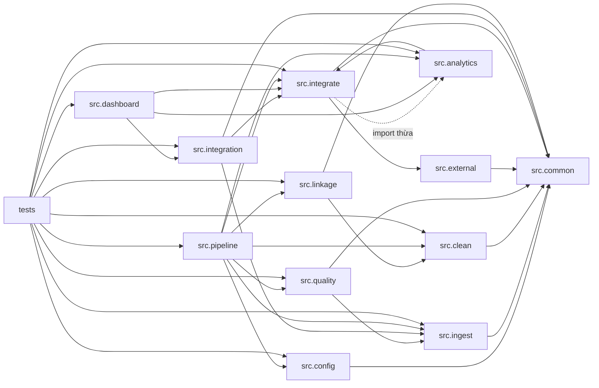
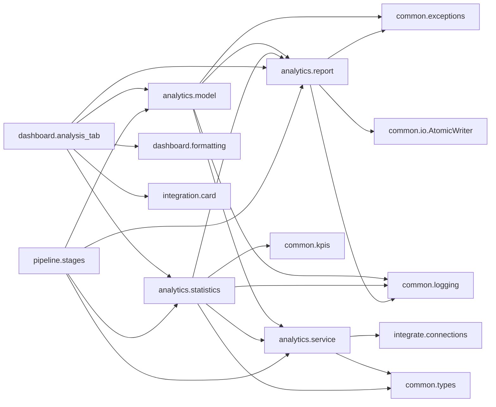

# Phụ thuộc — Olist E-commerce Data Pipeline

> Hai loại: **phụ thuộc ngoài** (thư viện, dịch vụ, dữ liệu) và **phụ thuộc nội bộ** (gói/tệp với nhau).
> Phiên bản và lý do chọn công nghệ: `technology-stack.md`. Tác động tới chất lượng: `code-quality-assessment.md`.
> Cập nhật tập trung ngày 2026-11-11 tại commit `ea77bdf88d1431de11c36e1b739972bd594063f0` cho
> `src/analytics/`, `src/integrate/`, `src/dashboard/`, `src/pipeline/`, `tests/`; các gói khác giữ nguyên
> phân tích trước đó (chưa xác minh lại).

## 1. Phụ thuộc ngoài

### 1.1 Thư viện theo mô-đun

| Mô-đun | Thư viện bên thứ ba | Thư viện chuẩn |
|---|---|---|
| `src.config` | `yaml` | `dataclasses`, `pathlib` |
| `src.common.io` | `pandas` (+`pyarrow` khi ghi Parquet) | `hashlib`, `json`, `os`, `shutil`, `uuid` |
| `src.common.logging` | — | `json`, `uuid`, `datetime`, `pathlib`, `os` |
| `src.common.kpis` | — | `dataclasses`, `collections.abc` |
| `src.common.memory` | — | `tracemalloc` |
| `src.ingest.*` | `pandas` | `datetime`, `pathlib` |
| `src.clean.*` | `pandas` | — |
| `src.quality.*` | `pandas` | — |
| `src.external.ibge` | `pandas` | `hashlib`, `json`, `time`, `urllib.request`, `urllib.error`, `datetime`, `pathlib` |
| `src.external.region` | `pandas` | — |
| `src.integrate.*` | `pandas`, `duckdb` | `os`, `dataclasses` |
| `src.integration.schema` / `selector` / `card` | `pandas`, `yaml` | `pathlib`, `dataclasses`, `collections.abc` |
| `src.integration.load` | `pandas` | `hashlib`, `pathlib`, `time` |
| `src.integration.rewrite` / `query` | `pandas`, `duckdb` | `pathlib`, `time` |
| `src.integration.tab` | `dash`, `dash-mantine-components`, `plotly` | `dataclasses`, `datetime`, `json` |
| `src.linkage.*` | `pandas` | `hashlib`, `json`, `dataclasses`, `datetime`, `pathlib` |
| **`src.analytics.service`** | `pandas`, `duckdb` (gián tiếp qua `ConnectionFactory`) | — |
| **`src.analytics.statistics`** | `pandas`, **`scipy`** (`scipy.stats`: `norm`, `chi2_contingency`, `pearsonr`) | `math`, `datetime` |
| **`src.analytics.model`** | `pandas`, **`scikit-learn`** (`LogisticRegression`, `StandardScaler`, `roc_auc_score`, `ConvergenceWarning`) | `warnings`, `dataclasses` |
| **`src.analytics.report`** | — | `json`, `os`, `uuid`, `dataclasses`, `pathlib` |
| `src.dashboard.app` | `dash`, `plotly`, `pandas` | `datetime`, `pathlib` |
| **`src.dashboard.analysis_tab`** | `dash`, `dash-mantine-components` | `dataclasses`, `typing` |
| `src.dashboard.components` | `dash`, `plotly` | — |
| `src.dashboard.formatting` | `pandas` | `datetime` |
| `src.pipeline.*` | `pandas` | `argparse`, `hashlib`, `os`, `shutil`, `time`, `json`, `datetime`, `dataclasses`, `sys` |
| `tests.*` | `pytest`, `pandas`, `duckdb` (dựng view tạm), `scikit-learn` (import trực tiếp), `yaml` (đọc `ci.yml`), `pytest-cov` (CI) | `json`, `sys`, `os`, `pathlib`, `dataclasses`, `time`, `types`, `re`, `math` |

Không có phụ thuộc nào cho HTTP client nâng cao (`requests`/`httpx`), retry (`tenacity`), migration
(`alembic`), orchestration (`airflow`, `prefect`), hay boosting (`xgboost`/`lightgbm`). Mọi thứ dựng trên
thư viện chuẩn + **12** gói ghim.

**Khác biệt so với lần quét trước**: `scipy` và `scikit-learn` **đã** được ghim (trước đó bản ghi nói "không
có gói thống kê/học máy nào"); `numpy` vẫn chỉ bắc cầu và **vẫn không ghim**.

### 1.2 Dịch vụ ngoài

| Dịch vụ | Điểm gọi | Bắt buộc? | Chịu lỗi |
|---|---|---|---|
| API IBGE `https://servicodados.ibge.gov.br/api/v1/localidades/estados` | `IbgeClient._fetch_api` | Không | Retry `ibge_retries` (2) với backoff `1 + attempt` giây; fallback cache `estados.json`; hết cách mới ném `ExternalSourceError` |
| API IBGE `/municipios` | `IbgeClient.fetch_municipalities` | Không | Fallback cache nếu có; pipeline chính không gọi |

Không có dịch vụ đám mây, không có cơ sở dữ liệu mạng, không có xác thực. Dashboard bind `127.0.0.1`.

### 1.3 Phụ thuộc dữ liệu

| Nguồn | Kích thước | Vai trò | Tính bất biến |
|---|---:|---|---|
| `dataset/olist_orders_dataset.csv` | 99.441 dòng | Hạt nhân sự kiện đơn (cũng là nguồn trực tiếp của tab "Tích hợp") | Bất biến |
| `dataset/olist_customers_dataset.csv` | 99.441 | Chiều khách hàng (1:1 theo `customer_id`) | Bất biến |
| `dataset/olist_order_items_dataset.csv` | 112.650 | Doanh thu cấp dòng hàng | Bất biến |
| `dataset/olist_order_payments_dataset.csv` | 103.886 | Thanh toán (nhiều dòng/đơn) | Bất biến |
| `dataset/olist_order_reviews_dataset.csv` | 99.224 | Đánh giá (nhiều dòng/đơn) | Bất biến |
| `dataset/olist_products_dataset.csv` | 32.951 | Chiều sản phẩm | Bất biến |
| `dataset/olist_sellers_dataset.csv` | 3.095 | Chiều người bán | Bất biến |
| `dataset/olist_geolocation_dataset.csv` | 1.000.163 | Vị trí theo mã bưu chính (phải tổng hợp trước khi join) | Bất biến |
| `dataset/product_category_name_translation.csv` | 71 | Bảng dịch danh mục | Bất biến |
| `dataset/external/ibge/estados.json` | 27 | Ánh xạ bang → vùng (cache đi kèm) | Bất biến, có thể `--refresh-ibge` |
| `config/mediated-schema.yaml` | 2 thực thể (đợt trước) | Hợp đồng lược đồ trung gian cho `src.integration` | Bất biến trong một lần chạy |
| `config/integration-tab.yaml` | 4 card id + 1 vùng kết quả | Hợp đồng giao diện tab "Tích hợp" | Bất biến; chỉ thêm id |
| `config/integration-sources.yaml` | 3 hồ sơ nguồn | Hồ sơ nguồn cho bộ chọn nguồn | Bất biến |
| `data/reports/analysis.json` | 2 khối | **Đầu vào của tab thứ năm** — hợp đồng giữa tầng `stats` và tầng trình bày | Sinh ra; versioned (`version: 2`) |

Nguồn `doc/` (PDF học liệu, quiz) **không** được mã đọc; đây là phụ thuộc của con người, không phải của hệ thống.

## 2. Phụ thuộc nội bộ

### 2.1 Đồ thị gói

<!-- Text fallback: src.common là gốc được mọi gói dùng. src.ingest, src.clean, src.quality, src.external, src.integrate, src.integration, src.linkage đều trỏ về src.common; src.quality đọc hợp đồng lược đồ từ src.ingest; src.integrate dùng src.external (IBGE) và có một import thừa trỏ tới src.analytics; src.analytics phụ thuộc src.integrate (ConnectionFactory) tạo vòng phụ thuộc mức gói; src.integration dùng src.ingest và src.integrate; src.linkage dùng src.clean; src.dashboard dùng src.analytics, src.integrate và src.integration; src.pipeline là điểm ghép nối trung tâm; tests phụ thuộc toàn bộ. -->

### 2.2 Đồ thị bên trong `src.analytics` (mới)

<!-- Text fallback: service là lá của gói (chỉ phụ thuộc integrate.connections và common.types); model phụ thuộc service, report, common.exceptions và common.logging; statistics phụ thuộc service, report, common.kpis, common.types và common.logging; report chỉ phụ thuộc common (exceptions, io, logging) nên không có vòng trong gói. Tab phân tích đọc report, model (AUC_TARGET) và statistics (MIN_STATE_ORDERS), dùng formatting và hai bảng nhãn của integration.card. pipeline.stages ghép cả bốn mô-đun. -->

`report.py` **không** import `service`/`statistics`/`model` → không có vòng trong `src.analytics`.
`model.py` import `report.ModelBlock` (kiểu dữ liệu), `service.AnalyticsService` (nguồn dữ liệu),
`common.exceptions.PipelineError` (gốc `ModelError`), `common.logging.NullLogger`.

### 2.3 Danh sách kề (tệp → phụ thuộc nội bộ)

| Tệp | Phụ thuộc nội bộ |
|---|---|
| `src/config.py` | `src.common.exceptions` |
| `src/common/io.py` | `src.common.exceptions`, `src.common.types` |
| `src/common/logging.py` | `src.common.types` |
| `src/common/kpis.py` | `src.common.exceptions` |
| `src/ingest/reader.py` | `src.common.io`, `src.common.logging`, `src.common.types`, `src.ingest.schemas` |
| `src/clean/pipeline.py` | 9 mô-đun `src.clean.*`, `src.common.*` |
| `src/quality/gate.py` | `src.common.*`, `src.ingest.schemas`, `src.quality.checks`, `src.quality.allowlist` |
| `src/external/ibge.py` | `src.common.*`, `src.external.region` |
| `src/integrate/pipeline.py` | `src.analytics.service` (**không dùng**), `src.common.*`, `src.external.*`, `src.integrate.*` |
| `src/integrate/facts.py` | `pandas` (thuần; **không** phụ thuộc gói nội bộ nào) |
| `src/integrate/dimensions.py` | `src.external.region` |
| `src/integrate/catalog.py` | `src.integrate.connections` |
| `src/integration/schema.py` | `src.common.*`, `src.integration.models`, `src.ingest.schemas` |
| `src/integration/load.py` | `src.common.*`, `src.config`, `src.integration.schema` |
| `src/integration/rewrite.py` | `src.common.*`, `src.integration.models`, `load`, `schema`, `src.integrate.connections` |
| `src/integration/query.py` | `src.integration.models`, `src.integration.rewrite` |
| `src/integration/selector.py` | `src.common.*`, `src.integration.models`, `src.integration.schema` |
| `src/integration/card.py` | `src.common.exceptions`, `src.integration.models`, `src.integration.schema` |
| `src/integration/tab.py` | `src.common.*`, `src.integration.card`/`load`/`query`/`rewrite`/`schema`/`selector`, `src.common.kpis` |
| `src/linkage/result.py` | `src.common.*`, `src.config`, `src.linkage.index`/`models`/`score` |
| **`src/analytics/service.py`** | `src.common.types`, `src.integrate.connections` |
| **`src/analytics/statistics.py`** | `src.analytics.report`, `src.analytics.service`, `src.common.kpis`, `src.common.logging`, `src.common.types` |
| **`src/analytics/model.py`** | `src.analytics.report`, `src.analytics.service`, `src.common.exceptions`, `src.common.logging` |
| **`src/analytics/report.py`** | `src.common.exceptions`, `src.common.io`, `src.common.logging` |
| `src/dashboard/app.py` | `src.analytics.service`, `src.common.*`, `src.dashboard.analysis_tab`, `src.dashboard.components`/`formatting`, `src.integrate.connections`, `src.integration.card`/`tab` |
| **`src/dashboard/analysis_tab.py`** | `src.analytics.report`, `src.analytics.model`, `src.analytics.statistics`, `src.dashboard.formatting`, `src.integration.card` |
| `src/dashboard/components.py` | `src.dashboard.formatting` |
| **`src/pipeline/stages.py`** | `src.analytics.model`, `src.analytics.report`, `src.analytics.service`, `src.analytics.statistics`, `src.clean.pipeline`, `src.common.*`, `src.ingest.*`, `src.integrate.pipeline`, `src.linkage.*`, `src.quality.gate` |
| `src/pipeline/micro_batch.py` | 9 mô-đun `src.clean.*`, `src.common.*`, `src.ingest.schemas`, `src.integrate.pipeline`, `src.pipeline.manifest`/`upsert`, `src.quality.gate` |
| `src/pipeline/cli.py` | `src.config`, `src.pipeline.micro_batch`/`replay`/`stages` |

### 2.4 Chỉ số ghép nối

| Mô-đun | Fan-in (số tệp dùng nó) | Fan-out | Ghi chú |
|---|---|---:|---|
| `src/common/types.py` | 14 | 0 | Hợp đồng dùng chung, ổn định |
| `src/common/exceptions.py` | 10+ | 1 | Mọi tầng ném cùng cây ngoại lệ; nay có thêm 2 lớp con (`ModelError`, `ReportError`) |
| `src/common/io.py` | 9 | 2 | Trục IO; `report.py` dùng `AtomicWriter` |
| `src/config.py` | 8+ | 1 | `AppConfig` là hợp đồng cho mọi lớp nhận `config` |
| `src/ingest/schemas.py` | 6 | 1 | Hợp đồng nguồn; `quality`, `replay`, `integration.schema` đọc |
| `src/integrate/connections.py` | 5 | 0 | Cửa duy nhất vào DuckDB (analytics, integration, dashboard, test) |
| **`src/analytics/report.py`** | **5** | 3 | `statistics`, `model`, `stages`, `analysis_tab`, 4 tệp test — nay là **hợp đồng liên đơn vị**, không còn là chi tiết nội bộ |
| **`src/analytics/service.py`** | **5** | 2 | `statistics`, `model`, `stages`, `dashboard.app`, test |
| `src/integration/models.py` | 5 | 0 | Dataclass dùng chung của lớp tích hợp |
| `src/integration/tab.py` | 2 | ~8 | Tệp lớn nhất repo (1.380 dòng) |
| `src/integrate/pipeline.py` | 3 | 8 | Điều phối nặng; chứa import thừa |
| `src/dashboard/app.py` | 2 | 9 | Phụ thuộc analytics, integrate **và** integration **và** analysis_tab |
| `src/pipeline/stages.py` | 2 | 10 | Điểm ghép nối trung tâm; nay chạm 4 mô-đun analytics |

### 2.5 Vòng phụ thuộc mức gói

`src.integrate` ⇄ `src.analytics`:

- `src.analytics.service` → `src.integrate.connections` (hợp lý: cần kết nối DuckDB).
- `src.integrate.pipeline` → `src.analytics.service` (**import thừa**, dòng 10, không có lời gọi nào;
  được `ruff.toml:27` miễn trừ `F401`).

Vòng này **không gây lỗi import** hôm nay, nhưng là mầm vòng thật nếu sau này `analytics` cần
`integrate.pipeline`. Nay nó còn kéo theo hệ quả: gói mô hình hóa (`integrate`) **phụ thuộc gián tiếp**
`scipy`/`scikit-learn` qua `analytics`. Cách sửa rẻ nhất: xóa import thừa.

## 3. Chi phí khi thêm một bảng/nguồn mới

Đây là **phụ thuộc ẩn** quan trọng nhất khi mở rộng: muốn thêm một bảng nguồn, phải sửa **10 điểm**
nếu không muốn lệch âm thầm:

1. `src/ingest/schemas.py` — thêm `TableSpec`.
2. `src/clean/<bảng>.py` + `src/clean/pipeline.py` — hàm làm sạch, đưa vào dict `cleaned`, thêm `flag_columns`.
3. `src/quality/gate.py` — `expected_rows` (chế độ `full`) và có thể cả check mới.
4. `src/quality/allowlist.py` — nếu bảng có dị thường được chấp nhận.
5. `src/integrate/pipeline.py` — `CLEANED_TABLES`.
6. `src/integrate/validate.py` — `EXPECTED` (nếu sinh dim/fact).
7. `src/integrate/catalog.py` — `VIEW_TABLES` (nếu muốn truy vấn).
8. `src/pipeline/stages.py` — tuple `_load_raw` / `_load_cleaned`.
9. `src/pipeline/micro_batch.py` — `TABLE_KEYS` + nhánh trong `_clean_batch_table`.
10. `tests/conftest.py` + test tương ứng.

**Thêm một CỘT vào mart đã có** (đường của intent hiện tại) rẻ hơn nhưng **không** miễn phí — ít nhất 6 điểm:

1. `src/integrate/facts.py` (hoặc `dimensions.py`) — chọn cột trong danh sách trả về.
2. `docs/data-dictionary.md` — mô tả cột; ngược lại tài liệu lệch mã.
3. `tests/integration/test_u2_end_to_end.py` — nếu số dòng/khối lượng đổi; còn **tập cột thì không** có test
   nào canh (rủi ro: thêm cột âm thầm không ai biết).
4. `src/analytics/service.py` — câu SQL mới/`TRAINING_FRAME_SQL` nếu cột phục vụ đọc.
5. `src/analytics/model.py` — `FEATURES`/`NUMERIC_FEATURES`/`CATEGORICAL_FEATURES`/`FORBIDDEN_COLUMNS` + luật
   "đúng 11 cột" trong `validate_features`.
6. `README.md`/`CHANGELOG.md` — mô tả bề mặt mới.

**Thêm một output/tab/callback** lên dashboard: ít nhất 6 điểm (mã hai nhánh `build_dashboard_outputs`
hoặc `build_layout`, 3 test số lượng, `README.md` mục Dashboard, `CHANGELOG.md`, và `assets/style.css` nếu
tab mới dùng lớp mới).

Bảng dưới đây cho thấy mức độ trùng lặp hiện tại (cùng một sự thật được khai báo nhiều nơi):

| Sự thật | Nơi khai báo |
|---|---|
| Số dòng kỳ vọng của 9 bảng nguồn | `src/ingest/schemas.py` (`expected_rows`) · `src/quality/gate.py` (`expected_rows`) |
| Số dòng kỳ vọng của 9 bảng mart | `src/integrate/validate.py` (`EXPECTED`) · test tích hợp |
| Khóa tự nhiên của bảng | `src/ingest/schemas.py` (`key_columns`) · `src/pipeline/micro_batch.py` (`TABLE_KEYS`) |
| 5 KPI chuẩn | `src/integrate/reconcile.py` (`BASELINE`) · `README.md` · `test_u2_end_to_end.py` · `test_u3_end_to_end.py` · `test_u1_stats_end_to_end.py` |
| **Baseline quần thể mô hình (96.478 / 7.826)** | `src/integrate/reconcile.py` · **`src/analytics/model.py:22-23`** · `README.md` (mục Chạy pipeline) · `test_u2_model_end_to_end.py` · `test_u3_end_to_end.py` (chuỗi "96.478") |
| Định nghĩa doanh thu | `src/common/kpis.py` (`REVENUE_DEFINITION`) · `src/integrate/reconcile.py` (ngầm trong `price + freight_value`) · `src/analytics/report.py` (ghi vào `seasonal`) · `README.md` |
| Danh sách bảng cleaned | `src/clean/pipeline.py` · `src/integrate/pipeline.py` · `src/pipeline/stages.py` (2 tuple) |
| Danh sách view | `src/integrate/catalog.py` (`VIEW_TABLES`) · test (`len(views) == 11`) · `src/analytics/service.py` (tên view trong 4 hằng SQL) |
| **Danh sách đặc trưng + danh sách cột cấm** | `src/analytics/model.py` (`FEATURES`, `FORBIDDEN_COLUMNS`) · `src/analytics/service.py` (`TRAINING_FRAME_SQL`) · `test_analytics_model.py` · `test_u2_model_end_to_end.py` · `README.md` |
| **Hợp đồng tệp báo cáo (7 trường mô hình, 4 trạng thái)** | `src/analytics/report.py` · `src/dashboard/analysis_tab.py` · `test_analytics_report.py` · `test_dashboard_analysis_tab.py` · README mục Dashboard |
| Số tab/callback/output của dashboard | `src/dashboard/app.py` (mã) · `test_dashboard_smoke.py` · `test_u3_end_to_end.py` · `test_integration_tab.py` · `CHANGELOG.md` |
| Id thẻ/vùng của tab "Tích hợp" | `config/integration-tab.yaml` · `src/integration/tab.py` (`CARD_TITLES`, hàm dựng vùng) · test |
| **Danh sách tệp `ruff format --check`** | `ci.yml:35` · `tests/unit/test_ci_config.py:14-29` (chỉ 14 tệp của đợt trước) |

## 4. Rủi ro phụ thuộc cần theo dõi

1. **Thiếu lock file** → môi trường dựng lại có thể lệch phiên bản bắc cầu (Flask/Werkzeug qua Dash,
   NumPy qua pandas, joblib/threadpoolctl qua scikit-learn). Với tầng `stats`/`model`, **NumPy bắc cầu** là
   rủi ro trực tiếp: nó chưa được ghim và mọi con số kiểm định phụ thuộc nó.
2. **Import thừa `src.integrate.pipeline → src.analytics.service`** → cần xóa trước khi mở rộng tầng; nay nó
   còn kéo `scikit-learn` vào đường phụ thuộc của gói mô hình hóa.
3. **`src.analytics.report` là hợp đồng liên đơn vị nhưng vẫn nằm trong gói `analytics`** → hai đơn vị cùng
   sửa một tệp 502 dòng; đổi `REPORT_VERSION` là breaking change cho tab và cho mọi test.
4. **`src.pipeline.micro_batch` lặp lại bảng điều phối làm sạch** của `src.clean.pipeline` bằng chuỗi `if`
   → thêm bảng là phải sửa cả hai nơi.
5. **`tests/unit` phụ thuộc dữ liệu sinh ra**: `test_dashboard_smoke.py` và `test_cli.py::test_main_analyze_stage`
   gọi `load_config()` của repo → cần `warehouse/olist.duckdb` và `data/marts/`. CI che lỗi này bằng
   `run --stage all` + `run --stage stats` trước khi test. 5 mô-đun test mới của đợt này **không** có phụ
   thuộc đó (tự dựng mart/tệp trong `tmp_path`).
6. **DuckDB + đường dẫn tuyệt đối trong view** → nhạy cảm với việc di chuyển repo/worktree; worktree mới
   phải chạy lại `integrate` (runbook đã ghi).
7. **`dataset/` bị coi là bất biến nhưng không có kiểm tra hash lưu trữ**: SHA-256 chỉ ghi vào báo cáo ingest.
8. **Ba hợp đồng YAML trong `config/` là phụ thuộc cứng của runtime**: thiếu/hỏng `integration-tab.yaml` thì
   dashboard rơi về bốn thẻ mặc định (`_tab_config`), còn thiếu `mediated-schema.yaml` hoặc
   `integration-sources.yaml` thì tab "Tích hợp" báo lỗi từng thẻ. Không có trường phiên bản, nên đổi cấu
   trúc YAML là breaking change ngầm.
9. **Đường phụ thuộc mà intent hiện tại sẽ đi qua, và cái gì còn thiếu**: `scipy` + `scikit-learn` **đã**
   ghim nên `HistGradientBoosting` (nằm trong `scikit-learn`) **không** cần thêm gói; nhưng ba thứ sau vẫn
   chưa có chỗ đứng trong repo: (a) **tuần tự hóa mô hình** — `joblib` đi kèm `scikit-learn` nhưng **không**
   được khai trực tiếp, nên dùng nó là thêm một phụ thuộc trực tiếp phải ghim; (b) **thư mục `data/models/`**
   — không có trường `AppConfig` nào cho nó; (c) **phụ thuộc mới trong `requirements.txt`** — theo quy ước
   team, mỗi gói mới phải ghim + ghi lý do + thêm vào danh sách `ruff format --check` nếu sinh tệp nguồn.
