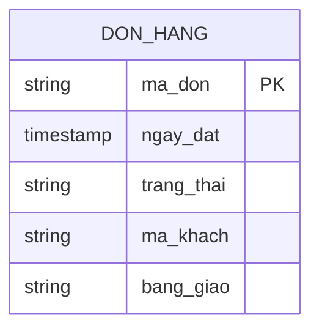

# Functional Spec — u1-thin-slice

Đơn vị: `u1-thin-slice` (Bolt 1, lát cắt mỏng). Phục vụ các câu chuyện US1.1, US2.1, US2.2 và điều kiện đóng US6.1 (xem `stories.md`).

## Workflow 1 — Nạp thực thể `don_hang`

1. Đọc tệp khai báo lược đồ và lấy định nghĩa `don_hang`.
2. Với mỗi trường **được nạp trong lát cắt**, đối chiếu tên cột nguồn có thật trong bảng nguồn tương ứng (BR1.3). Trường `bang_giao` có ánh xạ tới `olist_customers_dataset` nhưng được đánh dấu chưa nạp, nên chỉ kiểm cột nguồn mà không đọc dữ liệu.
3. Đọc dữ liệu nguồn, dựng bản ghi `DonHang` theo năm trường.
4. Kiểm mã đơn duy nhất; bản ghi trùng bị loại và đếm.
5. Kiểm ngày đặt có giá trị và trạng thái thuộc tám giá trị; bản ghi hỏng bị loại và đếm.
6. Trả về tập bản ghi đã nạp cùng số bản ghi bị loại kèm lý do.

**Lỗi:** thiếu tệp lược đồ hoặc tệp CSV nguồn → `ConfigurationError`. Nội dung khai báo sai (cột nguồn không tồn tại, định danh không hợp lệ) → `SchemaError` nêu tên trường và tên cột, dừng nạp.

## Workflow 2 — Chạy truy vấn "số đơn theo tháng"

1. Nhận truy vấn trung gian: chọn `thang(ngay_dat)`, `trang_thai`, `đếm(ma_don)` từ `don_hang`, nhóm theo tháng và trạng thái.
2. Kiểm truy vấn có điều kiện trạng thái tường minh (BR1.4); thiếu thì từ chối.
3. Sinh kế hoạch viết lại: `don_hang` → `olist_orders_dataset`, ánh xạ ba trường, không cần join.
4. Kiểm có kế hoạch viết lại trước khi thực thi (BR1.6).
5. Chạy câu SQL trên nguồn; trả kết quả, số dòng và thời gian chạy.

**Phạm vi đếm:** truy vấn của lát cắt đếm **mọi trạng thái** và tách theo từng trạng thái (BR1.5), không lọc riêng `delivered` như mô tả tóm tắt của `unit-of-work.md` §U1. Lý do: thẻ hiển thị số đơn theo tháng kèm trạng thái, nên lọc `delivered` sẽ làm mất sáu trạng thái còn lại; phần "chỉ `delivered`" thuộc phép đối chiếu KPI ở đơn vị sau.

**Lỗi:** truy vấn thiếu điều kiện trạng thái (BR1.4) hoặc chưa có kế hoạch viết lại (BR1.6) → `QueryExecutionError`, không thực thi. SQL lỗi → `QueryExecutionError` nêu truy vấn và lỗi; kết quả lần trước được giữ và ghi rõ là kết quả cũ.

## Workflow 3 — Vùng số liệu của lát cắt trong tab "Tích hợp"

Vùng này **không phải một `card_id`**: tab "Tích hợp" khai đúng bốn `card_id` theo C9 (`luoc-do-trung-gian`, `viet-lai-truy-van`, `ghep-ban-ghi`, `chon-nguon`). Vùng số liệu của lát cắt là một khối kết quả nằm trong thân tab, phía trên lưới bốn thẻ.

**Nối với khung tab (C9).** Tab có `tab_id: tich-hop`, `callback_ids: [tich-hop-cap-nhat]` và `result_region_ids: [don-theo-thang]`. Vùng số liệu của lát cắt chính là vùng `don-theo-thang`; nút "Chạy truy vấn" của vùng mang đúng id callback `tich-hop-cap-nhat`; khi được bấm, nó gọi Workflow 2 rồi dựng lại vùng. Kết quả **thành công gần nhất** được giữ ở cấp tiến trình (một biến của mô-đun, không ghi ra đĩa) để lần chạy sau lỗi vẫn hiện được "kết quả lần trước" kèm giờ. Truy vấn không tự chạy khi mở tab: trạng thái đầu tiên luôn là "chưa chạy".

1. Nếu chưa chạy truy vấn lần nào: chuẩn bị trạng thái chưa chạy.
2. Nếu chưa chạy: hiện câu "Chưa chạy truy vấn lần nào" và nút "Chạy truy vấn", không hiện 0 (BR1.8). Không hướng dẫn chạy pipeline: đường dữ liệu là DuckDB in-memory đọc `dataset/` trong chính lần chạy (TS-U1-2).
3. Nếu có dữ liệu: tính tổng số đơn toàn kỳ và lấy 12 tháng gần nhất (BR1.7).
4. Hiển thị: tên vùng, trạng thái, tổng số đơn toàn kỳ, rồi bảng — mỗi tháng một dòng tổng và một dòng cho mỗi trạng thái có mặt (BR1.5, BR1.7).
5. Nếu cửa sổ 12 tháng thiếu tháng: hiện nhãn "một phần" và nêu tên tháng thiếu.
6. Nếu truy vấn chạy xong mà không có dòng nào: trạng thái rỗng với câu riêng "Truy vấn chạy xong nhưng không có đơn nào", không hiện 0.

**Lỗi:** không đọc được kết quả → trạng thái lỗi kèm câu nêu việc gì hỏng và nút thử lại.

## Trạng thái của vùng số liệu

| Trạng thái | Điều kiện | Hiển thị |
|---|---|---|
| Chưa chạy | Chưa chạy truy vấn lần nào | Câu "Chưa chạy truy vấn lần nào" + nút "Chạy truy vấn" |
| Đang tải | Đang chạy truy vấn | Khung tải đúng hình dạng vùng |
| Rỗng | Đã chạy, không có dòng nào | Câu "Truy vấn chạy xong nhưng không có đơn nào", không hiện 0 |
| Đầy đủ | Đủ 12 tháng, mỗi tháng có ít nhất một dòng | Tổng toàn kỳ + bảng theo tháng và trạng thái |
| Một phần | Có kết quả nhưng cửa sổ 12 tháng thiếu tháng | Nhãn "một phần" + tên tháng thiếu |
| Lỗi | Không đọc được kết quả | Câu lỗi + nút thử lại |

## Sơ đồ thực thể

<!-- Text fallback: một thực thể duy nhất DON_HANG với năm trường; không có quan hệ. -->

## Tóm tắt quy tắc (dẫn xuất từ rules.md)

| Mã | Áp dụng ở bước |
|---|---|
| BR1.1 | Workflow 1, bước 4 |
| BR1.2 | Workflow 1, bước 5 |
| BR1.3 | Workflow 1, bước 2 |
| BR1.4 | Workflow 2, bước 2 |
| BR1.5 | Workflow 2, bước 1 |
| BR1.6 | Workflow 2, bước 4 |
| BR1.7 | Workflow 3, bước 3 |
| BR1.8 | Workflow 3, bước 2 và bước 5 |

## Ghi chú thiết kế

- Lát cắt cố ý không join bảng nào: truy vấn đếm đơn chỉ đọc `olist_orders_dataset`, nên chứng minh được đường mediation mà không cần `mat_hang`/`san_pham`.
- `bang_giao` có trong thực thể nhưng chưa dùng ở truy vấn này; đơn vị sau dùng cho truy vấn giao trễ.
- Không có trạng thái lưu trữ: thực thể chỉ tồn tại trong bộ nhớ khi chạy; kết quả truy vấn không ghi ra đĩa ở lát cắt này.
