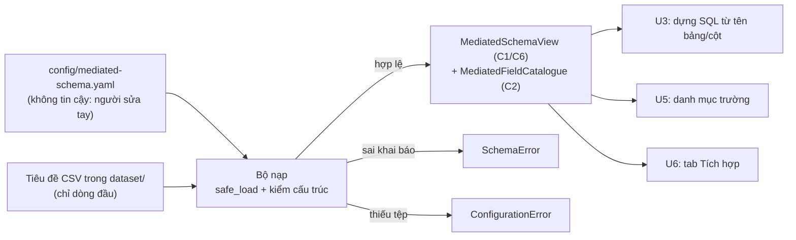

# Security Design — u2-mediated-schema

Nguồn: `nfr-requirements/security-requirements.md` (SR-U2-1..11), `nfr-requirements/tech-stack-decisions.md`
(TS-U2-1..10, NFR1.1–NFR6.1), `functional-design/functional-spec.md` (Workflow 1–4, A1–A2),
`inception/contract-design/contract-summary.md` (C1, C2, C6, C8), `inception/requirements-analysis/requirements.md`
(NFR4–NFR6, OS5).

Đơn vị: `u2-mediated-schema`. Không có cổng, không có đăng nhập, không có bí mật — nhưng **có một đường
đi thật của dữ liệu nguy hiểm**: chữ trong một tệp YAML trở thành tên bảng và tên cột mà U3 đưa vào SQL.
Thiết kế dưới đây đặt toàn bộ hàng rào ở đúng chỗ đường đi đó bắt đầu.

## 1. Mô hình mối đe doạ

| Tài sản | Mối đe doạ | Khả năng | Tác động | Kiểm soát |
|---|---|---|---|---|
| Tệp `config/mediated-schema.yaml` (C8, người sửa tay) | Bị sửa để chèn định danh lạ, cột không tồn tại, hoặc `data_type` lạ | **Trung bình** — tệp nằm trong repo, ai sửa mã cũng sửa được | U3 dựng SQL trên tên không kiểm; đọc sai cột; hỏng cả tab "Tích hợp" | Chuỗi kiểm tra đóng (ADR-U2-S1, ADR-U2-S2) |
| Nội dung YAML như một chương trình | `yaml.load` dựng đối tượng tuỳ ý từ tệp | Thấp nhưng hậu quả nặng | Chạy mã trong tiến trình | `yaml.safe_load` (SR-U2-5, ADR-U2-S1) |
| Tệp CSV nguồn trong `dataset/` | Bị ghi đè, hoặc giá trị ô bị đọc và rò ra ngoài | Thấp | Mất dữ liệu gốc; rò dữ liệu khách hàng | Chỉ đọc **tiêu đề** (ADR-U2-S3); không đường ghi |
| Giá trị trả về `MediatedSchemaView` / `MediatedFieldCatalogue` (C1, C2, C6) | Consumer nhận dữ liệu đã qua kiểm nhưng tưởng là thô; hoặc consumer bắt thiếu kiểu lỗi | Trung bình | Tab hiện ngoại lệ thay vì trạng thái lỗi (FR5.5) | Hợp đồng khai hai kiểu lỗi; `elapsed_ms` + `partial` nằm trong payload (SR-U2-11) |
| Nhật ký `logs/*.jsonl` | Ghi kèm giá trị ô hoặc nội dung YAML | Thấp, chỉ khi bên gọi truyền logger | Rò dữ liệu vào tệp dễ đọc hơn | Danh mục sự kiện đóng + hai vế cấm/cho phép (`security-requirements.md` §3) |
| `requirements.txt` | Thêm gói lạ để "tiện" xử lý | Thấp | Tấn công chuỗi cung ứng | Không thêm gói (TS-U2-6, SR-U2-9) |

Ranh giới tin cậy — không có vùng "tin cậy" nào bên trong tiến trình; mọi thứ đi vào bộ nạp đều bị kiểm:

<!-- Text fallback: tệp YAML và tiêu đề CSV đi vào bộ nạp; bộ nạp chỉ nhả ra view/catalogue khi mọi định danh và cột đã hợp lệ, còn lại ném SchemaError (nội dung sai) hoặc ConfigurationError (thiếu tệp). U3, U5, U6 chỉ nhận dữ liệu đã qua kiểm. -->

## 2. Quyết định thiết kế

### ADR-U2-S1 — Một chốt kiểm duy nhất, chạy ngay khi nạp (fail-closed)

**Bối cảnh:** ba consumer (U3, U5, U6) cần cùng một lược đồ đã kiểm. Nếu mỗi consumer tự kiểm, hàng rào
sẽ lệch nhau, và consumer thêm sau sẽ quên.

**Quyết định:** toàn bộ kiểm tra nằm trong một hàm dựng view, chạy **eager** tại thời điểm nạp, theo thứ
tự cố định: (1) `safe_load`; (2) cấu trúc tệp + `schema_kind = GAV`; (3) định danh (`^[a-z][a-z0-9_]{0,63}$`)
và thành viên trong `TABLE_SPECS`; (4) trùng `field_name`, `data_type` thuộc tập kín; (5) tiêu đề thật của
từng tệp nguồn. Consumer chỉ nhận view đã qua toàn bộ chuỗi này.

**Hệ quả:** U3 không bao giờ thấy một tên chưa qua kiểm — đó là toàn bộ giá trị an toàn của đơn vị.
Cái giá: một lần đọc tiêu đề của ba tệp nguồn mỗi lần nạp, đo trong `view.elapsed_ms` (NFR1.1). Thứ tự
các bước là một phần của thiết kế: kiểm định danh **trước** khi mở tệp, để một tệp YAML xấu không điều
khiển được đường dẫn đọc.

### ADR-U2-S2 — Thành viên trong tập cho phép là hàng rào chống SQL injection

**Quyết định:** mỗi `source_table` phải nằm trong `TABLE_SPECS` (theo `file_name`); mỗi `source_column`
phải có trong **tiêu đề thật** của tệp đó. Không có nhánh "chuẩn hoá rồi chấp nhận": sai là ném lỗi
(BR2.3, BR2.8).

**Lý do:** U3 dựng câu SQL từ chính các tên này. Tham số hoá `?` chỉ bảo vệ **giá trị**, không bảo vệ
**định danh**; với định danh, tập cho phép là biện pháp duy nhất đúng. Hai lớp (hình dạng + thành viên)
giữ được cả khi `TABLE_SPECS` lớn lên hoặc khi tiêu đề CSV khác với khai báo.

**Hệ quả:** thêm bảng nguồn mới là thay đổi ở `src/ingest/schemas.py`, không phải ở tệp YAML — đúng ý
"một nguồn sự thật". Một tệp YAML trỏ tới tệp CSV không có mặt → `ConfigurationError` (Q3 = A).

### ADR-U2-S3 — Chỉ đọc tiêu đề, không đọc dữ liệu

**Quyết định:** kiểm cột bằng `csv.reader` trên dòng đầu, `encoding="utf-8-sig"`; không `pd.read_csv`,
không đọc toàn tệp.

**Hệ quả:** giá trị ô không vào bộ nhớ của đơn vị, nên không thể lọt vào thông điệp lỗi hay nhật ký
(SR-U2-6). Cái giá: không kiểm được kiểu dữ liệu có khớp cột nguồn hay không — đã ghi là câu hỏi mở Q2
của `functional-spec.md`, và việc kiểm giá trị thuộc tầng chất lượng đã có.

### ADR-U2-S4 — Hai kiểu lỗi, không tự sửa, thông điệp nêu tên trường và tên cột

**Quyết định:** `ConfigurationError` cho tệp thiếu (lược đồ hoặc CSV nguồn); `SchemaError` cho mọi sai
về nội dung khai báo (BR2.2–BR2.6). Không nhánh nào tự sửa, tự bỏ qua hay tự hạ kiểu (BR2.8). C1, C2, C6
khai cả hai kiểu, nên consumer bắt cả hai (SR-U2-10, SR-U2-11).

**Hệ quả:** người sửa tệp nhận câu lỗi đủ để sửa mà không phải mở mã. Cái giá: tệp lỗi nặng dừng cả lần
nạp thay vì bỏ qua phần sai — đúng ý "không để lược đồ sai đi tiếp".

### ADR-U2-S5 — Nhật ký là tuỳ chọn, do bên gọi bật

**Quyết định:** bộ nạp nhận `logger`, mặc định `NullLogger`, theo đúng mẫu `query.py`/`load.py`/`card.py`
đang dùng. Khi có logger, phát đúng ba sự kiện `integration.schema.*` với danh mục trường đóng và ánh xạ
`error_code` ở `security-requirements.md` §3. NFR1.1 **không** phụ thuộc sự kiện: nó đo trên
`view.elapsed_ms`.

**Hệ quả:** mặc định không có dòng log nào (không có đường rò), nhưng đường quan sát vẫn mở khi cần chẩn
đoán. Những lỗi khai báo không có mã riêng trong `ERROR_CODES` được ghi là `unknown` — chấp nhận, không
thêm mã trong đợt này.

### ADR-U2-S6 — Không có xác thực, không có mã hoá, và đó là quyết định đã chốt

**Quyết định:** không thêm đăng nhập, token, khoá hay mã hoá cho đơn vị này (OS5 ngoài phạm vi; NFR6 chạy
local, không mạng).

**Hệ quả:** bảo vệ duy nhất là quyền truy cập thư mục của hệ điều hành. Nếu đợt sau cho phép nạp lược đồ
từ nguồn ngoài (C5 hiện cấm), ADR-U2-S2 và ADR-U2-S6 phải được xem lại trước.

## 3. Kiểm chứng

| Kiểm chứng | Cách làm |
|---|---|
| Định danh lạ bị từ chối | Test với bảng mẫu các tên sai (`"Orders";DROP`, `don hang`, `A_B`, 65 ký tự) → `SchemaError`, thông điệp nêu tên trường và tên cột |
| Cột không có trong tiêu đề bị từ chối | Fixture CSV nhỏ, khai một cột không tồn tại → `SchemaError` thuộc nhánh `column_missing` |
| Thiếu tệp là `ConfigurationError` | Test tệp lược đồ thiếu (đã có: `test_load_schema_rejects_a_missing_file`) và test bảng nguồn thiếu CSV |
| Chỉ đọc tiêu đề | Test dùng tệp CSV có dòng dữ liệu sai kiểu; nạp vẫn thành công (không đọc dòng đó); thêm một monkeypatch đếm số dòng đã đọc nếu cần |
| `safe_load` | Grep `src/integration/`: không `yaml.load`, không `Loader`/`FullLoader` |
| Không tự sửa | Rà mã: không `strip`/`lower`/`replace` trên tên trường, bảng, cột |
| Không có mạng, không cổng, không bí mật | Grep `src/integration/`: không `socket`, `http`, `urllib`, `requests`, `os.environ` |
| `dataset/` chỉ đọc | `git status dataset/` trống sau lần chạy thử |
| Mặc định không ghi log | Gọi nạp không truyền logger, khẳng định logger rỗng (SR-U2-7) |
| Thời lượng đo được | Test khẳng định `view.elapsed_ms` là số nguyên dương và `<= 2000` trên fixture (NFR1.1) |
| Consumer bắt hai kiểu lỗi | Rà C1/C2/C6 trong `contract-summary.md`; test của U6 (khi có) khẳng định trạng thái lỗi thay vì ngoại lệ |

## 4. Rủi ro đã biết

- **Không có đăng nhập/phân quyền** (OS5). Ai chạy được Python trên máy này đọc được lược đồ. Đã chốt.
- **Tệp lược đồ do người sửa tay** (A1): phần lớn sự cố là sửa sai, không phải tấn công; cách xử lý là từ
  chối kèm vị trí, không tự sửa.
- **Thông điệp lỗi nêu tên cột** là cần thiết và không tiết lộ gì ngoài tên cột vốn công khai trong
  `dataset/` và `src/ingest/schemas.py`.
- **Tập kín giả định tệp nằm trong repo và đi qua git.** Nếu C5 đổi, phải xem lại trước.
- **NFR4 (WCAG AA) không áp dụng** cho đơn vị này; thuộc `u6-integration-ui`.
