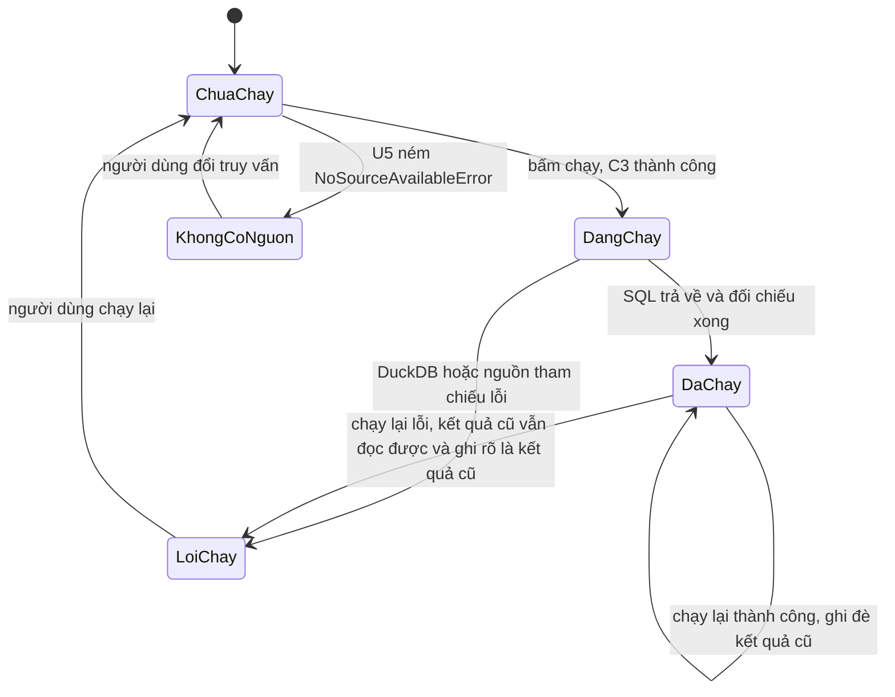
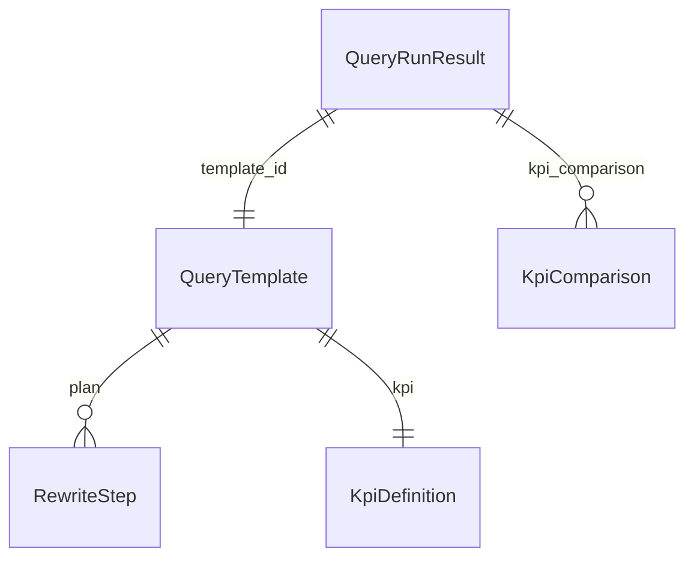

# Functional Spec — u3-query-rewriter

Nguồn: `inception/units-generation/unit-of-work.md` §U3, `inception/domain-design/components.md` (`QueryRewriter`, `SemanticLayer`), `inception/user-stories/stories.md` (US2.1–US2.3, US6.2), `inception/contract-design/contract-summary.md` (C1, C3, C4), `inception/requirements-analysis/requirements.md` (FR2.1–FR2.5, FR6.1–FR6.2), `entities.md` và `rules.md` cùng thư mục.

Tệp này là nguồn sự thật cho **workflow và máy trạng thái**.

## Câu chuyện được hiện thực

- **US2.1** — chọn một truy vấn mẫu và chạy (AC2.1.x). Phần chọn và bấm thuộc `u6-integration-ui`; U3 cung cấp kết quả C4.
- **US2.2** — xem kế hoạch viết lại và hai bản SQL (AC2.2.x): kế hoạch từng bước, SQL trung gian, SQL nguồn.
- **US2.3** — đối chiếu KPI (AC2.3.x): giá trị nguồn so với `src/analytics`, dung sai 0.
- **US6.2** — một định nghĩa KPI dùng chung (AC6.2.x): `src/analytics/kpis.py` là nguồn duy nhất.
- **US6.1** — không hồi quy: đơn vị không đổi số liệu ba tab cũ.

## Workflows

### W1 — Chạy một truy vấn mẫu

Đầu vào: `template_id`; kết quả chọn nguồn C3 của U5; danh mục trường C2; lược đồ trung gian C1.

1. Tra `QueryTemplate` theo `template_id`. Không có → `SchemaError` nêu mã.
2. Dựng bộ tham số của lần chạy: `ngay_tu`, `ngay_den` (có thể rỗng) và `trang_thai` ('delivered' cho hai mẫu doanh thu, rỗng cho mẫu giao trễ). Sai kiểu hoặc ngày không hợp lệ → `SchemaError` (BR3.12). Đúng bộ tham số này dùng cho cả SQL và lời gọi `src/analytics`.
3. Yêu cầu C3 cho `template_id` từ U5. Nếu U5 ném `NoSourceAvailableError`, truyền nguyên vẹn lỗi đó ra ngoài và dừng (BR3.7).
4. Kiểm mẫu SQL của template: mọi bảng thuộc chín bảng nguồn, mọi cột có thật trong tiêu đề tệp nguồn (BR3.5). Sai → `SchemaError` nêu bảng hoặc cột.
5. Điền tham số của bước 2 vào mẫu bằng placeholder `?`; không nối chuỗi.
6. Đo thời gian quanh lời gọi DuckDB (BR3.8); chạy SQL; nhận `rows`.
7. Lấy giá trị `src/analytics` cho cùng KPI và **cùng bộ tham số** (BR3.6, BR3.12); dựng một `KpiComparison` cho từng nhóm và một dòng `__all__`.
8. Trả `QueryRunResult` (C4) gồm hai bản SQL, kế hoạch từng bước, `rows`, `row_count`, `elapsed_ms`, định nghĩa KPI, kết quả đối chiếu, và `partial` rỗng (hoặc danh sách lý do nếu có nhóm không đối chiếu được).

### W2 — Xem kế hoạch viết lại và hai bản SQL

1. Đọc `QueryRunResult` của lần chạy gần nhất cho mỗi mẫu (lưu trong bộ nhớ tiến trình, không cần tệp).
2. Trả `mediated_query_text`, `source_sql`, `rewrite_plan` (BR3.10).
3. Nếu chưa chạy mẫu nào, trả danh sách rỗng và lý do "chưa chạy truy vấn này" — giao diện hiển thị trạng thái rỗng, U3 không bịa số.
4. Bước đọc lại SQL của lần chạy gần nhất chỉ cần `source_sql` từ bước 2; không chạy lại truy vấn (FR2.4).

### W3 — Đối chiếu KPI

1. Với mỗi nhóm của kết quả, dựng một `KpiComparison` (BR3.6); thêm dòng `__all__` so số dòng và tổng tiền.
2. `matches = |delta| <= tolerance`, với `tolerance = 0,01` cho tiền tệ (khớp `src/integrate/reconcile.py`; con số này **thay** dòng `0.0` từng ghi ở C4), `0` cho số dòng, và `0,01` cho phần trăm sau khi làm tròn 2 chữ số hai bên.
3. Nhóm chỉ có ở một bên vẫn có dòng, bên thiếu nhận 0 và `matches = false`.
4. Nếu **bất kỳ** nhóm nào `matches = false`, lần chạy ném `KpiMismatchError` đúng như C4 và `components.md` — lệch là lỗi, không phải cảnh báo (BR3.6). Lỗi mang danh sách nhóm lệch và delta của từng nhóm để giao diện nêu tên truy vấn và mức lệch (AC2.1.3).
5. Nhóm không đối chiếu được (analytics không trả giá trị cho nhóm đó) được ghi vào `partial` kèm lý do; các nhóm khác vẫn đối chiếu bình thường. `partial` và `KpiMismatchError` không cùng một sự kiện: thiếu dữ liệu để so là `partial`, so được mà lệch là lỗi.
6. Không gọi lại `src/analytics` lần thứ hai trong cùng một lần chạy.

**Công thức ba KPI** (khai trong `src/common/kpis.py`):

| `template_id` | Công thức | Lọc |
|---|---|---|
| `doanh_thu_theo_danh_muc` | `SUM(price + freight_value)` theo `product_category_name`, sắp giảm dần | `order_status = 'delivered'` |
| `doanh_thu_theo_thang` | `SUM(price + freight_value)` theo tháng của `order_purchase_timestamp` | `order_status = 'delivered'` |
| `ty_le_giao_tre_theo_bang` | `100 * COUNT(order_delivered_customer_date > order_estimated_delivery_date) / COUNT(*)` theo `customer_state`, làm tròn 2 chữ số | `order_status = 'delivered'` và cả hai ngày khác rỗng |

Mẫu giao trễ vì vậy vẫn lọc `delivered` dù `trang_thai` trong bộ tham số để rỗng; bộ tham số chỉ mang khoảng ngày.

### W4 — Nhánh lỗi

| Tình huống | Hành vi | Ai bắt |
|---|---|---|
| U5 không chọn được nguồn | `NoSourceAvailableError` lan nguyên vẹn, kèm `missing_fields` và `catalogue` | giao diện |
| `template_id` không có | `SchemaError` nêu mã | giao diện |
| Mẫu SQL tham chiếu bảng/cột không có thật | `SchemaError` nêu bảng/cột | giao diện + test |
| Bất kỳ nhóm nào lệch quá dung sai | `KpiMismatchError` nêu truy vấn, nhóm và delta | giao diện |
| Một nhóm không đối chiếu được (analytics không trả giá trị) | không ném; ghi vào `partial` kèm lý do | giao diện |
| DuckDB không chạy được (tệp thiếu, khoá) | `QueryExecutionError` nêu lời gọi | giao diện |
| `src/analytics` không chạy được cho cả lần đối chiếu | lỗi đó lan ra; **không** bỏ qua phép đối chiếu | giao diện |

## Máy trạng thái

Vòng đời một lần chạy của một mẫu:

<!-- Text fallback: mỗi mẫu bắt đầu ở "Chưa chạy". Bấm chạy đi sang "Đang chạy" nếu C3 thành công, hoặc "Không có nguồn" nếu U5 báo không nguồn nào đủ trường. "Đang chạy" kết thúc ở "Đã chạy" khi SQL trả về và đối chiếu xong, hoặc "Lỗi chạy" khi DuckDB/nguồn tham chiếu lỗi. Từ "Đã chạy", chạy lại thành công ghi đè kết quả cũ; chạy lại lỗi thì kết quả cũ vẫn đọc được và được ghi rõ là kết quả cũ. "Không có nguồn" và "Lỗi chạy" quay về "Chưa chạy" khi người dùng thao tác lại. -->

Quy tắc chuyển trạng thái:

- Không có trạng thái nào tự chuyển sang `Đã chạy` mà thiếu bước đối chiếu KPI.
- `Đã chạy` là trạng thái cuối của một lần chạy; chạy lại không cộng dồn, chỉ ghi đè kết quả của mẫu đó.
- `Không có nguồn` không bao giờ chứa số liệu, kể cả số 0.

## Sơ đồ thực thể (bản vẽ lại từ `entities.md`)

<!-- Text fallback: QueryTemplate một-nhiều RewriteStep và một-một KpiDefinition; QueryRunResult trỏ về QueryTemplate và mang nhiều KpiComparison. SourceSelection của U5 là đầu vào của workflow, không phải quan hệ trong sơ đồ thực thể. -->

## Tóm tắt luật (bản vẽ lại từ `rules.md`)

| Mã | Luật một dòng |
|---|---|
| BR3.1 | Bộ mẫu **mới** đúng ba mã, mã trùng `query_id` của U5; vùng `don-theo-thang` của lát cắt vẫn tồn tại song song trong `result_region_ids` |
| BR3.2 | Doanh thu = `price + freight_value` của đơn `delivered` |
| BR3.3 | Kế hoạch từng bước, thứ tự cố định |
| BR3.4 | SQL là mẫu khai tay có placeholder |
| BR3.5 | Bảng/cột có thật; tham số hoá |
| BR3.6 | Đối chiếu từng nhóm; dung sai 0,01 tiền, 0 số dòng, 0,01 phần trăm; lệch → `KpiMismatchError` |
| BR3.7 | Không có nguồn thì không chạy; lỗi lan nguyên vẹn |
| BR3.8 | `elapsed_ms` đo quanh lời gọi SQL |
| BR3.9 | Sổ KPI ở `src/common/kpis.py`, kiểu payload ở `models.py` |
| BR3.10 | Kết quả mang hai bản SQL, kết quả đối chiếu, `partial` |
| BR3.11 | Bổ sung bốn trường vào lược đồ trung gian |
| BR3.12 | Một bộ tham số cho cả SQL và analytics |

## Không nằm trong đơn vị này

- Nút chọn/chạy truy vấn, bảng kết quả, bốn trạng thái hiển thị — thuộc `u6-integration-ui`.
- Quyết định chọn nguồn — thuộc `u5-source-selector` (C3); U3 chỉ đọc kết quả.
- Ba tab báo cáo cũ và số liệu của chúng — giữ nguyên, không chạm (FR5.6).
