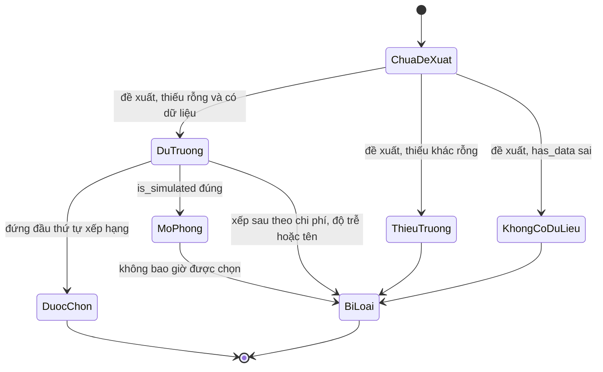
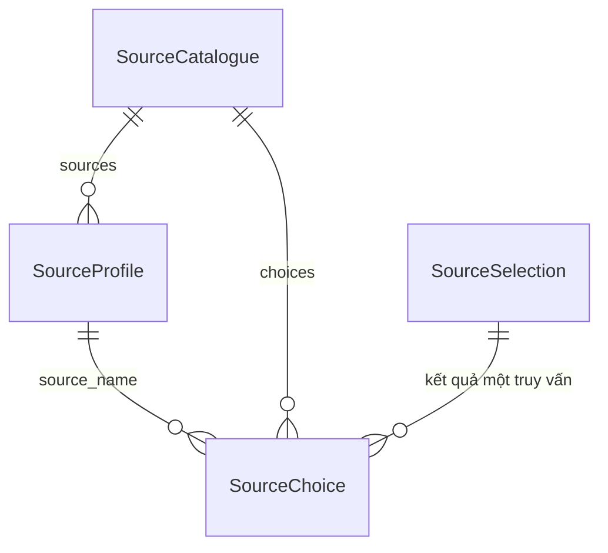

# Functional Spec — u5-source-selector

Nguồn: `inception/units-generation/unit-of-work.md` §U5, `inception/user-stories/stories.md` (US4.1, US4.2), `inception/contract-design/contract-summary.md` (C2, C3, C7), `inception/requirements-analysis/requirements.md` (FR2.1, FR4.1–FR4.3), `entities.md` và `rules.md` cùng thư mục.

**Bản sửa sau review 1:** W2 nói rõ U5 tự giữ ánh xạ truy vấn → trường cần, khai trong cùng tệp cấu hình (R-02); `tables` lấy từ hồ sơ nguồn (R-01); nhánh "một phần" có `partial_reason` và `pending_query_id` (R-03); nguồn mô phỏng bị loại trước khi chọn (R-05); W1 nói rõ U5 làm gì khi C2 ném lỗi (R-08).

Tệp này là nguồn sự thật cho **workflow và máy trạng thái**. Hình dạng dữ liệu nằm ở `entities.md` (khối YAML là nguồn), logic quyết định nằm ở `rules.md` (khối YAML là nguồn); hai phần cuối tệp này chỉ là bản vẽ lại để đọc.

## Câu chuyện được hiện thực

- **US4.1** — xem bảng nguồn ứng viên (AC4.1.1, AC4.1.2, AC4.1.3). Phần hiển thị thuộc `u6-integration-ui`; đơn vị này cung cấp payload C7 đủ để bảng có tên nguồn, có dữ liệu hay không, chi phí, độ trễ, trạng thái được chọn, lý do bằng chữ.
- **US4.2** — đề xuất nguồn cho một truy vấn (AC4.2.1, AC4.2.2). Phần nút bấm thuộc U6; đơn vị này cung cấp kết quả `SourceSelection` (C3) mà U6 đọc lên bảng và U3 dùng để viết lại truy vấn.
- **US6.1** — không hồi quy (AC6.1.1, AC6.1.2, AC6.1.3): đơn vị này không chạm pipeline, không ghi mart, không đổi hình dạng dashboard; ba tiêu chí được kiểm ở Build and Test.

## Workflows

### W1 — Dựng bảng nguồn và nạp ánh xạ truy vấn

Đầu vào: tệp cấu hình nguồn (hồ sơ ba nguồn + ánh xạ truy vấn → trường cần); danh mục trường C2 từ U2. Đầu ra: `SourceCatalogue` (C7) với `choices` rỗng ở lần dựng đầu.

1. Đọc tệp cấu hình nguồn (BR5.1). Thiếu tệp, thiếu trường bắt buộc, hoặc `cost_level` ngoài 1..5 → `ConfigurationError`, dừng.
2. Kiểm tập nguồn đúng ba tên đã chốt và đúng một nguồn mô phỏng (BR5.2). Sai → `SchemaError`.
3. Đọc danh mục trường C2. Nếu C2 ném `SchemaError` hoặc `ConfigurationError`, U5 **không bọc lại và không nuốt lỗi**: lỗi lan truyền nguyên vẹn ra người gọi C7 (U6), chỉ thêm ngữ cảnh "khi dựng bảng nguồn" vào thông điệp (BR5.3, bề mặt lỗi ở `entities.md`).
4. Đối chiếu `covered_fields` của từng nguồn với C2: mã trường không tồn tại → `SchemaError` nêu mã và nguồn, không bỏ qua (BR5.3). Đối chiếu **tên** từng phần tử `tables` với `SOURCE_TABLES` của `src/integration/schema.py`; tên lạ → `SchemaError` nêu tên bảng và tên nguồn (SR-U5-14). Không kiểm chéo trường ↔ bảng: C2 không mang ánh xạ thực thể → bảng và U5 không có hợp đồng với C1. `tables` rỗng hợp lệ khi `covered_fields` rỗng — đó là trường hợp `ibge_cache`; `tables` rỗng mà `covered_fields` khác rỗng là lỗi cấu hình.
5. Dựng `coverage` cho từng nguồn bằng câu tiếng Việt từ tập trường phủ được (BR5.3).
6. Kiểm ánh xạ truy vấn → trường cần: ba `query_id` phải đúng ba truy vấn mẫu của FR2.1, **và mọi mã trường trong cả ba danh sách phải có trong C2** (cùng phép kiểm với `covered_fields`; thiếu bước này, một mã trường gõ sai trong ánh xạ sẽ lộ ra thành `NoSourceAvailableError` thay vì `SchemaError`). Sai → `SchemaError` (BR5.4, SR-U5-5).
7. Trả `SourceCatalogue` với toàn bộ hồ sơ, `query_fields`, `choices` rỗng, `partial_reason` = "chưa có kết quả đề xuất cho truy vấn đang chọn" và `pending_query_id` = truy vấn chờ đề xuất (BR5.9). **Không có `generated_at`**: danh mục phải tất định giữa hai lần dựng cùng một cấu hình (SR-U5-12).
8. Không ghi tệp, không mở kết nối mạng (BR5.7).

### W2 — Đề xuất nguồn cho một truy vấn

Đầu vào: `query_id`; ánh xạ truy vấn → trường cần do **chính U5** giữ trong tệp cấu hình ở W1 bước 6 (không phải đầu vào từ U3; U3 chỉ nhận kết quả qua C3); bộ hồ sơ từ W1.

1. Tra ánh xạ để lấy `required_fields` của `query_id`. Không có truy vấn này trong ánh xạ → `SchemaError`.
2. Với mỗi nguồn trong `SourceCatalogue.sources`, tính `missing = required_fields − covered_fields`.
3. Nguồn **đủ trường** khi `missing` rỗng và `has_data = true`. Ghi lại danh sách thiếu cho các nguồn còn lại.
4. Loại mọi nguồn có `is_simulated = true` khỏi danh sách ứng viên thắng, kể cả khi nó đủ trường và rẻ nhất (BR5.11). Lý do của nó là "nguồn mô phỏng, chỉ dùng để so sánh".
5. Nếu còn ít nhất một nguồn đủ trường và không mô phỏng: sắp xếp theo `cost_level` → `latency_ms` → `source_name` (BR5.4) và chọn phần tử đầu.

   Ánh xạ truy vấn → trường cần được khai trong tệp cấu hình (W1 bước 6) và cố định trong đợt này:

   | `query_id` | Trường cần | Kết quả kỳ vọng |
   |---|---|---|
   | `doanh_thu_theo_danh_muc` | `don_hang.ma_don`, `don_hang.trang_thai`, `mat_hang.ma_don`, `mat_hang.gia`, `mat_hang.ma_san_pham`, `san_pham.ma_san_pham`, `san_pham.ten_danh_muc` | `olist_csv`; `ibge_cache` thiếu trường; `partner_simulated` vi phạm BR5.11 |
   | `doanh_thu_theo_thang` | `don_hang.ma_don`, `don_hang.ngay_dat`, `don_hang.trang_thai`, `mat_hang.ma_don`, `mat_hang.gia` | `olist_csv`; `ibge_cache` thiếu trường; `partner_simulated` vi phạm BR5.11 |
   | `ty_le_giao_tre_theo_bang` | `don_hang.ma_don`, `don_hang.trang_thai`, `don_hang.bang_giao` | `olist_csv` (bảng `olist_customers_dataset` mang `bang_giao`); `ibge_cache` thiếu trường; `partner_simulated` vi phạm BR5.11 |

   Ba `query_id` trên phải khớp định nghĩa truy vấn mẫu của U3 (`FR2.1`). Bước kiểm là ở W1 bước 6: danh sách mã phải trùng đúng ba truy vấn mẫu, và mọi mã trường phải có trong C2. Khi U3 đổi tập trường của một truy vấn, cả hai bên sửa cùng lúc và bộ test của U5 đỏ nếu lệch.
6. Dựng `rejected_sources`: mọi nguồn còn lại, mỗi dòng một lý do theo thứ tự ưu tiên sáu nhánh của BR5.5. Một nguồn thoả nhiều nhánh nhận lý do của nhánh đầu tiên.
7. Trả `SourceSelection` với đúng một phần tử trong `selected_sources`, mang `tables` **nguyên từ** `SourceProfile.tables` của nguồn thắng (không tính lại từ mã trường).
8. Ghi các dòng `SourceChoice` tương ứng vào `SourceCatalogue.choices` để giao diện đọc lại (C7) — mỗi cặp (truy vấn, nguồn) đúng một dòng; chạy lại cùng `query_id` ghi đè các dòng cũ. Lần ghi này **xoá `partial_reason` và `pending_query_id`**, vì danh mục không còn ở trạng thái "một phần" (BR5.9).

### W3 — Không nguồn nào đủ trường

1. Bước 2–4 của W2 cho ra mọi nguồn đều thiếu trường, `has_data = false`, hoặc mô phỏng.
2. Không chọn nguồn nào; `selected_sources` rỗng (BR5.6).
3. Trả `NoSourceAvailableError` mang `missing_fields` = hợp các trường không nguồn nào phủ, và với mỗi nguồn gần nhất là nguồn đó thiếu trường gì.
4. Ghi các dòng `SourceChoice` với `is_selected = false` và lý do tương ứng, để bảng nguồn vẫn giải thích được vì sao không có kết quả.
5. Giao diện hiển thị thông báo và danh sách trường thiếu; không hiển thị số 0 thay cho dữ liệu thiếu.

### W4 — Đọc kết quả cho giao diện

1. Giao diện đọc `SourceCatalogue` (C7) một lần khi mở màn hình, và bắt cả ba lớp lỗi ở bề mặt lỗi của `entities.md`.
2. Nếu `choices` rỗng → trạng thái "một phần" theo BR5.9: hiển thị `partial_reason` và truy vấn đang chờ ở `pending_query_id`.
3. Nếu có `choices` → bảng đầy đủ: nguồn, có dữ liệu hay không, chi phí, độ trễ, được chọn hay không, lý do.
4. Nguồn có `is_simulated = true` được ghi chú rõ là nguồn mô phỏng (BR5.7).
5. Đơn vị này không render; các bước trên mô tả dữ liệu giao diện sẽ đọc, không phải mã của U5.

## Máy trạng thái

Thực thể có vòng đời: `SourceChoice` cho một cặp (truy vấn, nguồn).

<!-- Text fallback: mỗi dòng SourceChoice bắt đầu ở "Chưa đề xuất". Một lần đề xuất đưa nó sang "Đủ trường", "Thiếu trường" hoặc "Không có dữ liệu". Dòng "Đủ trường" mà là nguồn mô phỏng đi thẳng sang "Bị loại". Chỉ dòng "Đủ trường" đứng đầu thứ tự xếp hạng mới thành "Được chọn"; mọi dòng còn lại thành "Bị loại". Chạy lại một lần đề xuất ghi đè trạng thái cũ của cùng cặp. -->

Quy tắc chuyển trạng thái:

- Từ `Chưa đề xuất`, mọi lần đề xuất đều đi tới đúng một trong ba trạng thái đánh giá; không có trạng thái "bỏ qua".
- `Mô phỏng` không bao giờ chuyển sang `Được chọn` (BR5.11).
- `Thiếu trường` và `Không có dữ liệu` không bao giờ chuyển sang `Được chọn` (BR5.5, BR5.6).
- Chạy lại đề xuất cho cùng `query_id` ghi đè toàn bộ dòng của truy vấn đó; không cộng dồn.

## Sơ đồ thực thể (bản vẽ lại từ `entities.md`)

<!-- Text fallback: SourceProfile một-nhiều SourceChoice qua source_name; SourceCatalogue chứa nhiều SourceProfile và nhiều SourceChoice; SourceSelection là tập con các SourceChoice của một truy vấn. -->

## Tóm tắt luật (bản vẽ lại từ `rules.md`)

| Mã | Luật một dòng |
|---|---|
| BR5.1 | Hồ sơ nguồn trong tệp cấu hình tĩnh, đủ tám dữ kiện |
| BR5.2 | Đúng ba nguồn, chi phí và độ trễ đã chốt |
| BR5.3 | Khả năng đáp ứng = tập trường C2; trường phải thuộc bảng đã khai |
| BR5.4 | Xếp hạng: đủ trường → chi phí → độ trễ → tên; kết quả kỳ vọng là `olist_csv` |
| BR5.5 | Đúng một nguồn được chọn; sáu nhánh lý do loại theo thứ tự ưu tiên |
| BR5.6 | Không nguồn nào đủ trường → lỗi, nêu trường thiếu |
| BR5.7 | Nguồn mô phỏng không gọi mạng |
| BR5.8 | Lý do luôn bằng chữ, không dựa vào màu |
| BR5.9 | Chưa đề xuất → "một phần" với lý do và truy vấn đang chờ |
| BR5.10 | Mở rộng payload chỉ cộng thêm trường |
| BR5.11 | Nguồn mô phỏng không bao giờ được chọn |

## Quy ước đánh dấu traceability cho tiêu chí có nửa giao diện

Hai tiêu chí của US4 vừa có phần hiển thị (U6) vừa có phần dữ kiện (U5). Quy ước áp dụng, và đã áp dụng nhất quán trong `traceability.json`:

- Tiêu chí mà **toàn bộ** nội dung là hiển thị → `N/A` với lý do "delivered by u6-integration-ui". Áp dụng cho AC4.1.1 (bảng nguồn có năm cột).
- Tiêu chí mà phần **quyết định** thuộc U5, U6 chỉ vẽ lại kết quả → `OK` trỏ tới luật của U5. Áp dụng cho AC4.2.1 (cột "Được chọn" cập nhật theo kết quả đề xuất — kết quả đó do BR5.4/BR5.5 sinh ra).

## Không nằm trong đơn vị này

- Nút "Đề xuất nguồn", bảng nguồn, bốn trạng thái hiển thị và ghi chú "nguồn mô phỏng" trên màn hình — thuộc `u6-integration-ui`.
- Định nghĩa ba truy vấn mẫu, SQL nguồn và cách chạy truy vấn — thuộc `u3-query-rewriter`. U5 chỉ giữ ánh xạ "truy vấn nào cần trường nào" ở mức dữ kiện để chọn nguồn; U3 vẫn là nơi định nghĩa truy vấn và sinh SQL.
- Sinh SQL, gọi DuckDB, gọi mạng — không thuộc bất kỳ workflow nào ở trên.
