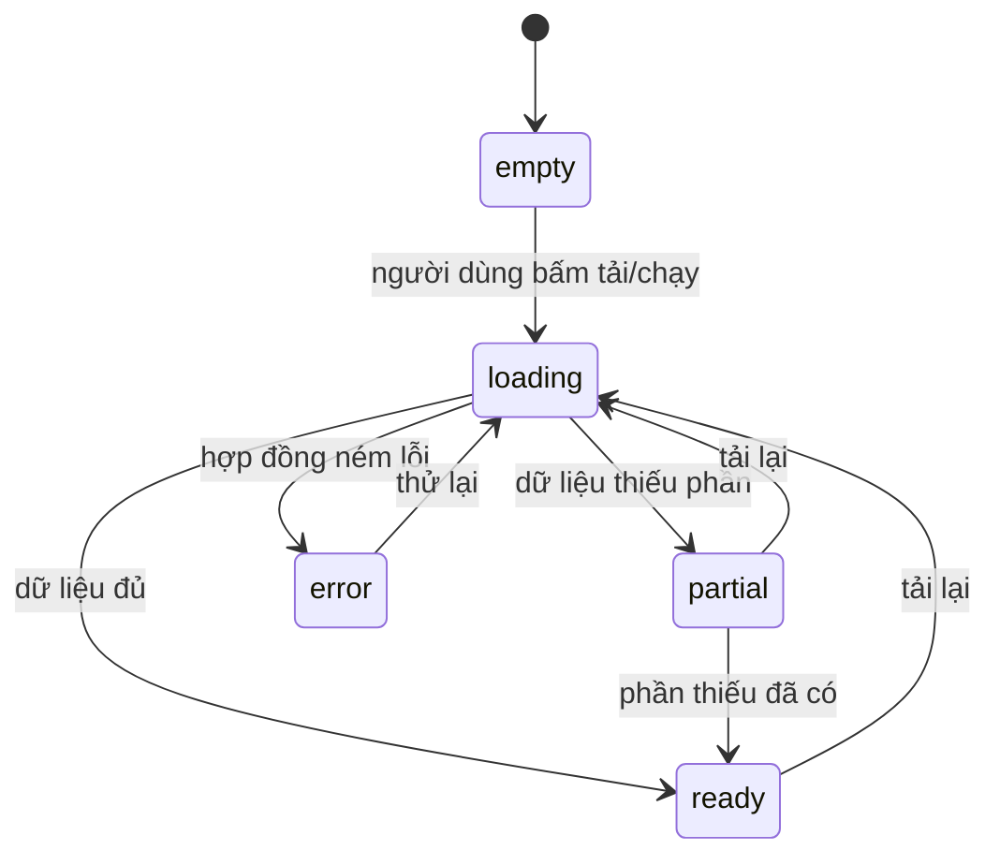

# Functional Spec — u6-integration-ui

Nguồn: `inception/units-generation/unit-of-work.md` §U6, `inception/user-stories/stories.md` (US1.1–US5.3, US6.1), `inception/requirements-analysis/requirements.md` (FR1.3–FR1.4, FR2.2–FR2.4, FR3.3–FR3.4, FR4.2, FR5.1–FR5.6, NFR1, NFR4), `inception/domain-design/components.md` (`IntegrationUI`), `inception/contract-design/contract-summary.md` (C1–C9).

Tệp này là nguồn sự thật cho **workflow và máy trạng thái** của tab "Tích hợp". Chi tiết thành phần giao diện nằm ở `frontend-components.md`.

## Câu chuyện được hiện thực

- **US1.1 / US1.2** — danh sách thực thể và bảng ánh xạ (C6), nhãn `GAV`.
- **US2.1 / US2.2** — chọn và chạy truy vấn mẫu, xem hai bản SQL và kế hoạch (C4).
- **US3.1–US3.3** — số liệu ghép bản ghi, bảng cặp, dòng "Bỏ qua" (C5).
- **US4.1 / US4.2** — bảng nguồn và nút "Đề xuất nguồn" (C7).
- **US5.1 / US5.2 / US5.3** — tab, bốn thẻ, điều hướng vào/ra, bốn trạng thái.
- **US6.1** — không hồi quy ba tab cũ.

## Bản đồ màn hình

| Màn hình | `screen_id` | Vào từ | Ra bằng |
|---|---|---|---|
| Tổng quan | `overview` | Tab "Tích hợp" | Bốn nút chi tiết |
| Lược đồ trung gian | `schema` | Thẻ 1 | "Quay lại tổng quan" |
| Truy vấn viết lại | `queries` | Thẻ 2 | "Quay lại tổng quan" |
| Ghép bản ghi | `linkage` | Thẻ 3 | "Quay lại tổng quan" |
| Chọn nguồn | `sources` | Thẻ 4 | "Quay lại tổng quan" |
| Vùng kết quả (trong thân tab) | `don-theo-thang` | Tab "Tích hợp" | Không rời tab — nằm phía trên lưới thẻ, không phải `card_id` |

## Workflows

### W1 — Mở tab (tổng quan)

1. Người dùng chọn tab "Tích hợp" (`tab_id = "tich-hop"` theo C9).
2. Dựng **mọi** `result_region_ids` của C9 (`don-theo-thang`) phía trên lưới thẻ; vùng có callback riêng cho nút "Chạy truy vấn".
3. Vẽ bốn thẻ theo `card_ids` của C9, mỗi thẻ: tiêu đề, trạng thái (`empty`/`loading`/`error`/`partial`/`ready`), hai dòng số liệu, một nút vào chi tiết.
4. Số liệu của mỗi thẻ đọc từ hợp đồng tương ứng: thẻ 1 từ C6, thẻ 2 từ C4, thẻ 3 từ C5, thẻ 4 từ C7.
5. Trạng thái của từng thẻ theo **đúng hợp đồng của nó**, không dán một nhãn chung:
   - Thẻ 3 (ghép bản ghi): tệp kết quả **chưa có** → trạng thái `empty` kèm hướng dẫn chạy pipeline (C5 quy định), không phải `partial`.
   - Thẻ 4 (chọn nguồn): chưa đề xuất lần nào → `partial` kèm `partial_reason` và `pending_query_id` của C7.
   - Thẻ 1 (lược đồ) và thẻ 2 (truy vấn): `empty` khi chưa có kết quả; `error` khi hợp đồng ném lỗi.
6. Hai dòng số liệu của mỗi thẻ, cố định: thẻ 1 = số thực thể và số trường; thẻ 2 = số mẫu đã chạy và số mẫu lệch KPI (0 khi tất cả khớp); thẻ 3 = số cặp vượt ngưỡng và tỉ lệ ghép đúng; thẻ 4 = số nguồn có dữ liệu và số nguồn được chọn.
7. Không chạy truy vấn nào khi mở tab: chỉ đọc dữ liệu đã có.

### W2 — Vào màn hình chi tiết

1. Bấm nút của một thẻ → màn hình tương ứng; ẩn tổng quan, hiện màn hình chi tiết.
2. Màn hình chi tiết giữ nguyên dữ liệu đã tải; không tải lại trừ khi người dùng bấm "Tải lại".
3. "Quay lại tổng quan" trả về đúng trạng thái trước đó, không làm mới số liệu.

### W3 — Chạy một truy vấn mẫu (màn hình `queries`)

1. Chọn một trong ba mẫu; bấm "Chạy".
2. Nút chuyển sang trạng thái chờ; vùng kết quả hiện khung tải, **không** giữ kết quả cũ trông như mới (AC2.1.2).
3. Gọi U5 để lấy nguồn (C3), rồi gọi U3 `run_template`; nhận C4.
4. Vẽ kết quả: hai bản SQL, kế hoạch từng bước, bảng kết quả, thời gian chạy, số dòng, kết quả đối chiếu KPI.
5. Lỗi: hiện thông báo nêu tên truy vấn và lỗi, kèm nút thử lại; kết quả lần trước (nếu có) được ghi rõ là "kết quả cũ" và không trình bày như mới (AC2.1.3).
6. "Xem SQL nguồn" hiện SQL của lần chạy gần nhất (FR2.4).

### W4 — Đề xuất nguồn (màn hình `sources`)

1. Chọn một truy vấn; bấm "Đề xuất nguồn".
2. Gọi U5 `select_source`; nhận C3 và bản C7 mới.
3. Vẽ lại bảng nguồn: nguồn, có dữ liệu hay không, chi phí, độ trễ, được chọn hay không, lý do.
4. Không nguồn nào đủ trường: hiện thông báo kèm danh sách trường thiếu, không chọn nguồn nào (AC4.2.2).
5. Nguồn mô phỏng có ghi chú "nguồn mô phỏng" (AC4.1.3).

### W6 — Màn hình lược đồ trung gian (`schema`)

1. Đọc C6 (`MediatedSchemaViewForUi`). Lỗi → `error`.
2. Vẽ danh sách thực thể (tên + mô tả) và, cho thực thể đang chọn, bảng ánh xạ ba cột: tên trường trung gian, nguồn (dạng `<bảng>.<cột>`), kiểu dữ liệu.
3. Nhãn `GAV` hiện ngay trên bảng, không kèm đoạn giải thích dài (FR1.4).
4. Chọn thực thể khác bằng bàn phím hoặc chuột; bảng cập nhật, không tải lại trang.
5. Chưa có dữ liệu → `empty` kèm câu giải thích; một thực thể thiếu trường → `partial` nêu tên thực thể thiếu.

### W7 — Màn hình ghép bản ghi (`linkage`)

1. Đọc C5 (tệp kết quả ghép). Tệp chưa có → `empty` kèm hướng dẫn chạy pipeline; tệp hỏng → `error`.
2. Hiển thị ngưỡng đang dùng (0,85), số cặp vượt ngưỡng, số nhóm trùng, và tỉ lệ ghép đúng kèm mẫu số (FR3.2, FR3.3).
3. Bảng cặp tiêu biểu: điểm 2 chữ số và quyết định `Ghép`/`Xem lại`; có chuyển giữa khách hàng và người bán (AC3.1.2).
4. Dòng "Bỏ qua": mỗi cặp không chấm được điểm kèm lý do; nếu không có cặp nào, hiện câu "Không có cặp bị bỏ qua", không ẩn cả mục (AC3.3.2).
5. Nếu người bán không có khoá mốc, tỉ lệ đúng của người bán hiện "Không đo được" kèm lý do — không hiện 0 (AC3.2.3).

### W5 — Bốn trạng thái bắt buộc của mỗi màn hình (FR5.5), cộng trạng thái "đủ dữ liệu"

| Trạng thái | Khi nào | Hiển thị |
|---|---|---|
| `empty` | Chưa có dữ liệu cho màn hình | Câu giải thích + một hành động gợi ý (nếu có) |
| `loading` | Đang tải/chạy | Khung tải; nút đang chạy ở trạng thái chờ |
| `error` | Hợp đồng ném lỗi | Thông báo lỗi bằng chữ + nút thử lại |
| `partial` | Có dữ liệu nhưng thiếu phần nào | Dữ liệu đã có + danh sách phần thiếu và lý do; **không** hiện số 0 thay cho dữ liệu thiếu |
| `ready` | Đủ dữ liệu | Dữ liệu đầy đủ |

FR5.5 đòi **bốn** trạng thái: rỗng, đang tải, lỗi, một phần. `ready` không phải trạng thái thứ năm bắt buộc — nó là trạng thái bình thường khi đã đủ dữ liệu, dùng cùng bộ token `data-state` hiện có (`rong`, `dang-tai`, `loi`, `mot-phan`, `day-du`).

## Máy trạng thái

Trạng thái của một màn hình trong tab:

<!-- Text fallback: mỗi màn hình bắt đầu ở "rỗng"; bấm tải/chạy đi sang "đang tải"; "đang tải" kết thúc ở "đủ", "một phần" hoặc "lỗi"; mọi trạng thái kết thúc đều quay lại "đang tải" khi người dùng tải lại; "một phần" chuyển sang "đủ" khi phần thiếu đã có. -->

Quy tắc:

- Không màn hình nào tự chuyển từ `empty` sang `ready` mà không qua `loading`.
- `partial` và `error` đều phải nêu lý do bằng chữ; không dùng màu làm tín hiệu duy nhất (NFR4).
- Đổi tab hoặc quay lại tổng quan **không** đặt lại trạng thái màn hình.

## Định nghĩa KPI trên màn hình truy vấn

`QueryRunResult` mang `kpi_definitions` với ghi chú "để U6 hiển thị"; `components.md` cũng khai `IntegrationUI` phụ thuộc `SemanticLayer` để lấy định nghĩa KPI. Quyết định của đơn vị: **hiển thị** danh sách định nghĩa trong màn hình `queries`, ngay dưới bảng kết quả, mỗi mục gồm tên KPI, công thức và `revenue_definition`. Nhờ vậy AC6.2.2 (định nghĩa doanh thu được nêu rõ) có bề mặt giao diện, và câu hỏi mở của C4 ("hiển thị hay chỉ dùng trong test") được chốt là "hiển thị".

## Ràng buộc giao diện

- Chỉ dùng `dcc.Tab`/`dmc` như đã dùng trong dự án; không thêm thư viện UI nào ngoài DMC (`dash-mantine-components`).
- Ba tab báo cáo cũ giữ nguyên nội dung, số liệu và số callback (FR5.6); tab mới không được làm hỏng chúng.
- Mọi điều khiển tương tác có `data-testid` để test tự động bám vào.
- Điều hướng và thao tác hoàn toàn bằng bàn phím; tiêu điểm thấy rõ (NFR4).

## Không nằm trong đơn vị này

- Logic chọn nguồn, viết lại truy vấn, ghép bản ghi, sổ KPI — thuộc U5, U3, U4.
- Sửa ba tab báo cáo cũ (OS1).
