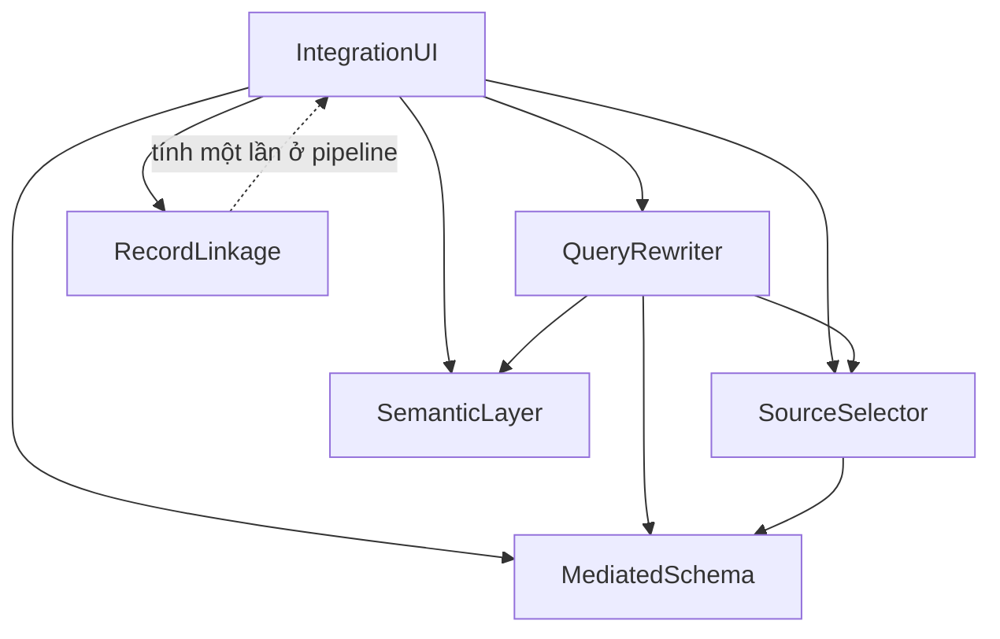

# Components — Nâng cấp tích hợp dữ liệu Olist

Nguồn: `inception/requirements-analysis/requirements.md`, `inception/user-stories/stories.md`, CodeKB `architecture.md` và `component-inventory.md`, `inception/practices-discovery/team-practices.md`.

```yaml
components:
  - name: MediatedSchema
    summary: Khai báo lược đồ trung gian và ánh xạ từ nguồn Olist vào lược đồ đó
    behaviour: >
      Đọc tệp khai báo YAML/JSON chứa ba thực thể trung gian (don_hang, mat_hang,
      san_pham) và ánh xạ từng trường tới bảng/cột nguồn kèm kiểu. Kiểm tra mọi
      cột nguồn nêu trong ánh xạ tồn tại thật trong CSV trước khi phục vụ truy vấn.
      Báo lỗi nêu tên trường và tên cột sai, không tự sửa ánh xạ.
    responsibilities:
      - Sở hữu tệp khai báo lược đồ trung gian
      - Kiểm tra ánh xạ khớp cột nguồn thật
      - Cung cấp danh sách thực thể và ánh xạ cho các thành phần khác
    depends_on: []
    dependents:
      - component: QueryRewriter
        interaction: đọc lược đồ và ánh xạ để viết lại truy vấn
      - component: SourceSelector
        interaction: đọc lược đồ để biết truy vấn cần trường nào
      - component: IntegrationUI
        interaction: hiển thị danh sách thực thể và bảng ánh xạ
    external_dependencies:
      - name: Tệp CSV trong dataset/
        kind: other
        purpose: nguồn dữ liệu để kiểm tra tên cột
    entities:
      - name: MediatedEntity
        identifier: name
        attributes: [name, description, source_tables]
      - name: FieldMapping
        identifier: entity_name + field_name
        attributes: [entity_name, field_name, source_table, source_column, data_type]
        references:
          - entity: MediatedEntity
            owned_by: MediatedSchema
            relationship: mỗi ánh xạ thuộc đúng một thực thể

  - name: QueryRewriter
    summary: Viết lại truy vấn trên lược đồ trung gian thành truy vấn chạy trên nguồn
    behaviour: >
      Nhận một trong ba truy vấn mẫu, sinh kế hoạch viết lại từng bước (thực thể →
      bảng nguồn → điều kiện join) và câu SQL chạy được trên DuckDB. Trả kèm thời
      gian chạy và số dòng. Đối chiếu kết quả với định nghĩa KPI dùng chung; lệch
      là lỗi, không phải cảnh báo.
    responsibilities:
      - Sở hữu ba truy vấn mẫu
      - Sinh kế hoạch viết lại và SQL nguồn
      - Đối chiếu kết quả với định nghĩa KPI
    depends_on:
      - component: MediatedSchema
        interaction: đọc lược đồ và ánh xạ
        style: sync
      - component: SemanticLayer
        interaction: lấy định nghĩa KPI để đối chiếu kết quả
        style: sync
      - component: SourceSelector
        interaction: lấy nguồn đã chọn cho truy vấn
        style: sync
    dependents:
      - component: IntegrationUI
        interaction: chạy truy vấn và hiển thị kế hoạch, SQL, kết quả
    external_dependencies:
      - name: DuckDB
        kind: database
        purpose: chạy SQL trên Parquet và view hiện có
    entities:
      - name: QueryTemplate
        identifier: template_id
        attributes: [template_id, title, mediated_query_text, kpi_id]
      - name: RewritePlan
        identifier: plan_id
        attributes: [plan_id, template_id, steps, source_sql, row_count, elapsed_ms]
        references:
          - entity: QueryTemplate
            owned_by: QueryRewriter
            relationship: mỗi kế hoạch thuộc một truy vấn mẫu

  - name: RecordLinkage
    summary: Ghép bản ghi khách hàng và người bán từ hai bảng nguồn
    behaviour: >
      Chặn theo tiền tố mã bưu chính, so khớp thành phố đã chuẩn hoá và tiền tố mã
      bưu chính bằng tỉ lệ khớp ký tự, ngưỡng cố định 0,85. Cặp đạt ngưỡng ghi là
      Ghép, đúng bằng ngưỡng ghi là Xem lại. Bản ghi thiếu trường so khớp bị loại
      và ghi thành SkippedPair kèm lý do. Đọc trực tiếp bảng nguồn, không qua lược
      đồ trung gian. Kết quả được tính một lần ở giai đoạn pipeline rồi ghi ra tệp
      trong `data/`; giao diện chỉ đọc tệp đó, nên mỗi tương tác không phải ghép lại.
    responsibilities:
      - Sở hữu luật chặn và cách tính điểm
      - Sinh danh sách cặp khớp kèm quyết định
      - Đếm và giải thích cặp bị bỏ qua
      - Tính tỉ lệ ghép đúng so với mốc customer_unique_id / seller_id
    depends_on: []
    dependents:
      - component: IntegrationUI
        interaction: hiển thị số liệu và bảng cặp
    external_dependencies:
      - name: Tệp CSV khách hàng và người bán trong dataset/
        kind: other
        purpose: dữ liệu để ghép
    entities:
      - name: BlockingRule
        identifier: rule_id
        attributes: [rule_id, target_entity, blocking_field, match_fields, threshold]
      - name: MatchPair
        identifier: pair_id
        attributes: [pair_id, target_entity, record_a, record_b, score, decision, is_correct]
      - name: SkippedPair
        identifier: skip_id
        attributes: [skip_id, target_entity, record_a, record_b, missing_fields, reason]

  - name: SourceSelector
    summary: Mô tả nguồn dữ liệu và chọn nguồn cho một truy vấn
    behaviour: >
      Giữ hồ sơ từng nguồn ứng viên: có đáp ứng trường cần đọc hay không, chi phí
      tương đối 1–5, độ trễ ước tính. Với một truy vấn đã chọn, xếp hạng nguồn và
      ghi lý do chọn hoặc loại bằng chữ. Nguồn mô phỏng không phát sinh lệnh gọi
      mạng nào.
    responsibilities:
      - Sở hữu hồ sơ nguồn
      - Xếp hạng và chọn nguồn cho từng truy vấn
      - Ghi lý do chọn/loại
    depends_on:
      - component: MediatedSchema
        interaction: biết truy vấn cần những trường nào
        style: sync
    dependents:
      - component: QueryRewriter
        interaction: nhận nguồn đã chọn để sinh SQL
      - component: IntegrationUI
        interaction: hiển thị bảng nguồn và kết quả đề xuất    external_dependencies:
      - name: Cache IBGE cục bộ
        kind: other
        purpose: một nguồn ứng viên có dữ liệu thật
    entities:
      - name: SourceProfile
        identifier: source_name
        attributes: [source_name, tables, coverage, cost_level, latency_ms, is_simulated]
      - name: SourceChoice
        identifier: query_id + source_name
        attributes: [query_id, source_name, is_selected, reason]

  - name: SemanticLayer
    summary: Định nghĩa KPI một lần và dùng chung cho analytics, truy vấn và dashboard
    behaviour: >
      Khai báo mã, tên, công thức và định nghĩa doanh thu của từng KPI. Cung cấp
      giá trị tham chiếu để QueryRewriter đối chiếu và để dashboard hiển thị. Không
      tự tính toán lại dữ liệu; chỉ giữ định nghĩa và nguồn tính.
    responsibilities:
      - Sở hữu định nghĩa KPI
      - Cung cấp giá trị tham chiếu để đối chiếu
    depends_on: []
    dependents:
      - component: QueryRewriter
        interaction: đối chiếu kết quả truy vấn với KPI
      - component: IntegrationUI
        interaction: hiển thị KPI nhất quán với ba tab cũ
    external_dependencies:
      - name: DuckDB (các bảng mart hiện có)
        kind: database
        purpose: đọc giá trị KPI mà `src/analytics` đang tính, để làm giá trị tham chiếu
    entities:
      - name: KpiDefinition
        identifier: kpi_id
        attributes: [kpi_id, title, formula, revenue_definition, unit, reference_value]

  - name: IntegrationUI
    summary: Tab "Tích hợp" với màn hình tổng quan và bốn màn hình chi tiết
    behaviour: >
      Dựng bằng Dash Mantine Components trong các tệp dashboard hiện có. Hiển thị
      bốn thẻ trạng thái, cho mở chi tiết từng nhóm, hiển thị bảng và trạng thái
      rỗng/đang tải/lỗi/một phần. Không gọi thẳng nguồn dữ liệu; chỉ đọc qua các
      thành phần phía sau.
    responsibilities:
      - Sở hữu bố cục và trạng thái hiển thị của tab mới
      - Chuyển lựa chọn của người dùng thành lời gọi tới bốn thành phần kia
    depends_on:
      - component: MediatedSchema
        interaction: lấy thực thể và ánh xạ
        style: sync
      - component: QueryRewriter
        interaction: chạy truy vấn mẫu
        style: sync
      - component: RecordLinkage
        interaction: lấy số liệu và cặp ghép
        style: sync
      - component: SourceSelector
        interaction: lấy bảng nguồn và đề xuất
        style: sync
      - component: SemanticLayer
        interaction: lấy định nghĩa KPI để hiển thị
        style: sync
    dependents: []
    external_dependencies:
      - name: Plotly Dash
        kind: other
        purpose: nền tảng giao diện hiện có
      - name: Dash Mantine Components
        kind: third-party-api
        purpose: bộ thành phần giao diện cho tab mới, ghim trong requirements.txt
    entities: []
```

## Component Diagram



<!-- Text fallback: IntegrationUI gọi năm thành phần còn lại; QueryRewriter đọc MediatedSchema, SemanticLayer và SourceSelector; SourceSelector đọc MediatedSchema; RecordLinkage ghi kết quả ở giai đoạn pipeline để giao diện chỉ đọc lại. -->

## Component Summary

| Component | Purpose | Depends On | Dependents | Entities Owned |
|---|---|---|---|---|
| MediatedSchema | Lược đồ trung gian và ánh xạ | — | QueryRewriter, SourceSelector, IntegrationUI | MediatedEntity, FieldMapping |
| QueryRewriter | Viết lại truy vấn và đối chiếu KPI | MediatedSchema, SemanticLayer, SourceSelector | IntegrationUI | QueryTemplate, RewritePlan |
| RecordLinkage | Ghép bản ghi khách/người bán | — | IntegrationUI | BlockingRule, MatchPair, SkippedPair |
| SourceSelector | Hồ sơ nguồn và chọn nguồn | MediatedSchema | QueryRewriter, IntegrationUI | SourceProfile, SourceChoice |
| SemanticLayer | Định nghĩa KPI dùng chung | — | QueryRewriter, IntegrationUI | KpiDefinition |
| IntegrationUI | Tab "Tích hợp" | cả năm thành phần trên | — | — |

## Entity Ownership

| Entity | Owning Component | Identifier | Attributes | References |
|---|---|---|---|---|
| MediatedEntity | MediatedSchema | name | name, description, source_tables | — |
| FieldMapping | MediatedSchema | entity_name + field_name | entity_name, field_name, source_table, source_column, data_type | MediatedEntity |
| QueryTemplate | QueryRewriter | template_id | template_id, title, mediated_query_text, kpi_id | — |
| RewritePlan | QueryRewriter | plan_id | plan_id, template_id, steps, source_sql, row_count, elapsed_ms | QueryTemplate |
| BlockingRule | RecordLinkage | rule_id | rule_id, target_entity, blocking_field, match_fields, threshold | — |
| MatchPair | RecordLinkage | pair_id | pair_id, target_entity, record_a, record_b, score, decision, is_correct | — |
| SkippedPair | RecordLinkage | skip_id | skip_id, target_entity, record_a, record_b, missing_fields, reason | — |
| SourceProfile | SourceSelector | source_name | source_name, tables, coverage, cost_level, latency_ms, is_simulated | — |
| SourceChoice | SourceSelector | query_id + source_name | query_id, source_name, is_selected, reason | — |
| KpiDefinition | SemanticLayer | kpi_id | kpi_id, title, formula, revenue_definition, unit, reference_value | DuckDB mart (nguồn giá trị) |

## External Dependencies

| Component | Dependency | Kind | Purpose |
|---|---|---|---|
| MediatedSchema | Tệp CSV trong `dataset/` | other | kiểm tra tên cột nguồn |
| QueryRewriter | DuckDB | database | chạy SQL trên Parquet và view |
| RecordLinkage | CSV khách hàng, người bán | other | dữ liệu để ghép |
| SourceSelector | Cache IBGE cục bộ | other | một nguồn có dữ liệu thật |
| SemanticLayer | DuckDB (các bảng mart) | database | đọc giá trị KPI làm tham chiếu |
| IntegrationUI | Plotly Dash | other | nền tảng giao diện |
| IntegrationUI | Dash Mantine Components | third-party-api | bộ thành phần giao diện cho tab mới |

## Rationale

| Component | Vì sao là khối riêng |
|---|---|
| MediatedSchema | Dữ liệu khai báo thay đổi theo từng lần thêm thực thể, tách khỏi logic truy vấn; là nguồn sự thật cho ba thành phần khác |
| QueryRewriter | Thuật toán viết lại thay đổi độc lập với cách khai báo lược đồ và với giao diện |
| RecordLinkage | Đọc trực tiếp bảng nguồn, không phụ thuộc lược đồ trung gian; vòng đời và cách kiểm thử riêng |
| SourceSelector | Luật chọn nguồn thay đổi khi thêm/bớt nguồn, không kéo theo truy vấn hay giao diện |
| SemanticLayer | Định nghĩa KPI là hợp đồng dùng chung cho cả hệ thống; tách ra để không nơi nào tự định nghĩa lại |
| IntegrationUI | Chỉ lo hiển thị và điều hướng; mọi logic nằm ở năm thành phần kia |

Ghi chú: chọn cách tách này thay vì gộp một khối `Integration`; đánh đổi được ghi ở `decisions.md` ADR-001.
