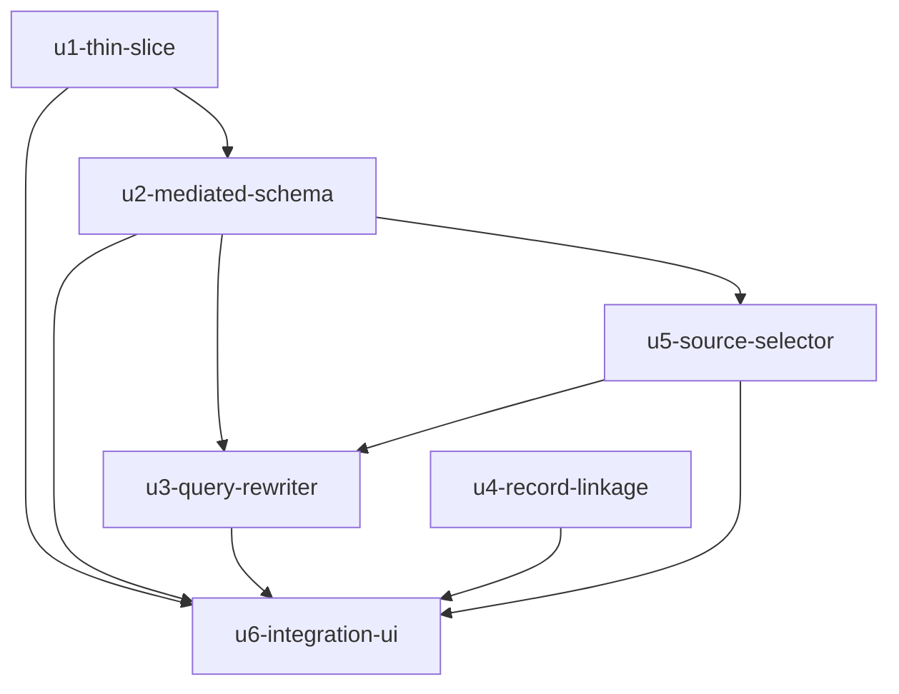

# Unit Dependency DAG — Nâng cấp tích hợp dữ liệu Olist

Chỉ mô tả phụ thuộc (cái gì cần cái gì), không chọn thứ tự thi công. Người đặt yêu cầu đã chọn xây tuần tự; thứ tự kinh tế cụ thể thuộc bước Delivery Planning.

```yaml
units:
  - name: u1-thin-slice
    kind: service
    depends_on: []
  - name: u2-mediated-schema
    kind: library
    depends_on: [u1-thin-slice]
  - name: u3-query-rewriter
    kind: library
    depends_on: [u2-mediated-schema, u5-source-selector]
  - name: u4-record-linkage
    kind: library
    depends_on: []
  - name: u5-source-selector
    kind: library
    depends_on: [u2-mediated-schema]
  - name: u6-integration-ui
    kind: ui
    depends_on: [u1-thin-slice, u2-mediated-schema, u3-query-rewriter, u4-record-linkage, u5-source-selector]
```

## Sơ đồ



<!-- Text fallback: u1 là gốc; u2 phụ thuộc u1; u5 phụ thuộc u2; u3 phụ thuộc u2 và u5; u4 độc lập; u6 phụ thuộc u1, u2, u3, u4, u5. Không có vòng. -->

## Điểm tích hợp giữa các đơn vị

| Từ | Tới | Cái gì đi qua | Kiểu |
|---|---|---|---|
| U2 | U3, U5 | danh sách thực thể và ánh xạ (đọc tại chỗ) | gọi hàm đồng bộ |
| U5 | U3 | nguồn đã chọn cho một truy vấn | gọi hàm đồng bộ |
| U3 | U6 | kế hoạch viết lại, SQL nguồn, kết quả, số liệu đối chiếu KPI | dữ liệu trong bộ nhớ |
| U4 | U6 | danh sách cặp, tổng hợp cặp bị bỏ qua | đọc tệp kết quả trong `data/` |
| U2, U5 | U6 | danh sách thực thể, hồ sơ nguồn | gọi hàm đồng bộ |

## Cơ hội làm song song

Sau khi U2 xong, U4 độc lập nên chạy được cùng lúc với U3/U5. U5 phải xong trước U3 vì U3 nhận nguồn đã chọn từ U5. Người đặt yêu cầu đã chọn làm tuần tự nên các cơ hội này chỉ là thông tin, không phải kế hoạch.

## Lát cắt đầu tiên

`u1-thin-slice` là đơn vị gốc của DAG và là lát cắt chạy xuyên suốt: nó chạy được trước mọi đơn vị khác vì chỉ cần chính nó, dữ liệu nguồn có sẵn, và một thẻ trên tab mới. Đây là đơn vị dùng cho checkpoint lát cắt mỏng ở giai đoạn Construction.

## Kiểm tra tính hợp lệ

- Không có vòng: U1 → U2 → U3/U5 → U6; U1 → U4 → U6.
- Mọi tên trong `depends_on` đều là đơn vị đã khai.
- Không đơn vị nào phụ thuộc chính nó.
