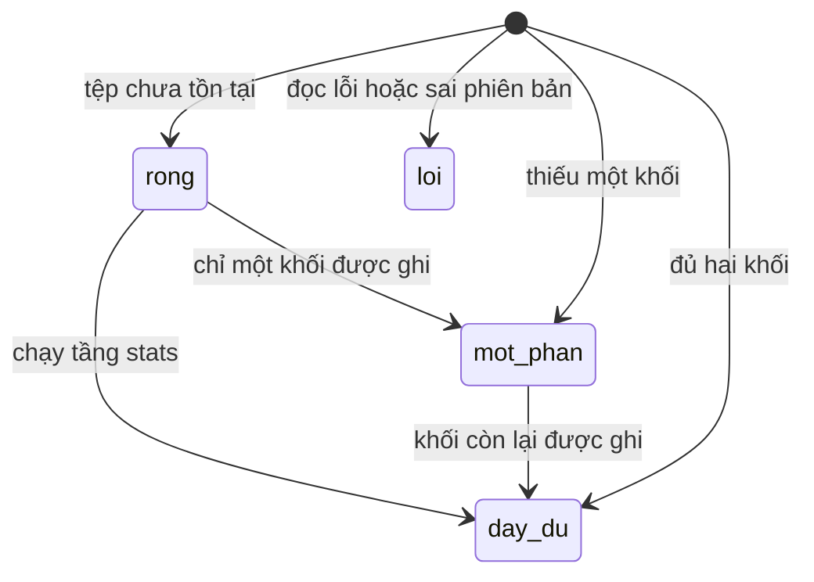
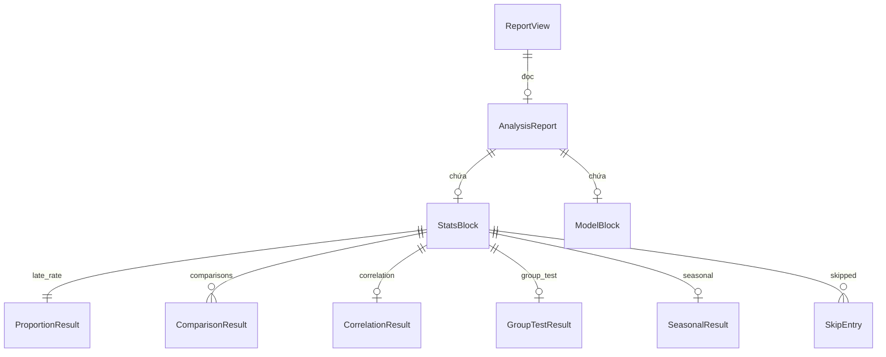

# Functional Spec — u1-statistics

Nguồn: `entities.md`, `rules.md`, `../../../inception/requirements-analysis/requirements.md`, `../../../inception/contract-design/contract-summary.md` (C1, C2 — phiên bản 2), `../../../inception/user-stories/stories.md`.

Đơn vị này hiện thực **US1.1** (chạy kiểm định thống kê và đọc kết quả), **US3.1** (nhận một tệp báo cáo dùng chung) và **US5.1** (chạy đúng chuỗi xác nhận của nhóm). Phần đọc báo cáo phục vụ US4.1 nhưng U3 là bên dựng giao diện.

Tệp này là nguồn sự thật cho **luồng chạy** và **máy trạng thái của hàm đọc**. Hình dạng dữ liệu thuộc `entities.md`; quyết định logic thuộc `rules.md`; hai mục cuối ở đây chỉ là bản vẽ lại cho dễ đọc.

## Luồng 1 — Ghi báo cáo (tầng `stats`)

```
[1] Tầng `stats` bắt đầu
      │
      ├─ đọc dữ liệu qua AnalyticsService trên v_fact_orders, v_dim_customer, v_fact_order_items
      │
      ├─ BR1.1  tỉ lệ trễ + khoảng Wilson            → ProportionResult
      ├─ BR1.2  so sánh bang cao nhất / thấp nhất     → list[ComparisonResult] + excluded
      ├─ BR1.3  tương quan giá–phí + khoảng Fisher    → CorrelationResult
      ├─ BR1.4  vùng × trễ, chi-square khi ô kỳ vọng đạt 5 → GroupTestResult
      ├─ BR1.5  doanh thu tháng từ v_agg_sales_daily, chu kỳ 12, ≥ 24 tháng → SeasonalResult
      │
      ├─ mỗi kiểm định không đủ điều kiện: kết quả = null, thêm một SkipEntry   (BR1.6)
      ├─ BR1.7  gắn alpha 0,05 và confidence 0,95
      ├─ BR1.8  làm tròn 4 chữ số (hệ số tương quan 3)
      │
      ├─ đọc khối `model` hiện có trong tệp (nếu có) để không làm mất việc của U2
      ├─ dựng AnalysisReport(version = 2, generated_at, stats, model)
      ├─ BR1.11 write_report() → data/reports/analysis.json qua AtomicWriter
      └─ trả đường dẫn tệp
```

Thứ tự thực hiện có ràng buộc:

1. Đọc dữ liệu phải xong trước mọi phép kiểm định.
2. BR1.1 phải xong trước BR1.2 vì ngưỡng 100 đơn tính trên đơn đã giao.
3. Bốn phép BR1.2–BR1.5 độc lập nhau về kết quả; chạy tuần tự theo thứ tự trên.
4. Dựng `StatsBlock` sau khi cả bốn xong, để `skipped` gom đủ.
5. Ghi tệp sau cùng; ghi hỏng thì không để lại tệp dở.

## Luồng 2 — Đọc báo cáo (hàm `read_report`)

```
[2] Bên gọi (tab hoặc lệnh) gọi read_report(path)
      │
      ├─ [1] tệp không tồn tại                        → rong     (BR1.9)
      ├─ [2] không parse được JSON                    → loi      (BR1.9)
      ├─ [3] version khác 2                           → loi      (BR1.10)
      ├─ [4] thiếu trường bắt buộc hoặc sai kiểu      → loi      (BR1.9)
      ├─ [5] stats hoặc model là null                 → mot-phan (BR1.9)
      └─ [6] đủ hai khối                              → day-du   (BR1.9)
```

Hàm đọc **không ném ngoại lệ**. Mọi hỏng hóc biểu hiện thành một `ReportView`, để bên gọi luôn có một giá trị mà dựng giao diện.

## Máy trạng thái của `ReportView.status`



Bốn trạng thái là tập đóng: `rong`, `day-du`, `mot-phan`, `loi`. Không có trạng thái thứ năm ở tầng này; tab có thể có thêm trạng thái riêng của giao diện (`chua-chay`, `dang-tai`) nhưng chúng không đi qua hợp đồng C2.

| Trạng thái | `report` | `missing` | `message` |
|---|---|---|---|
| `rong` | `null` | `()` | Câu nêu tệp chưa có và lệnh cần chạy |
| `day-du` | báo cáo | `()` | rỗng |
| `mot-phan` | báo cáo | tên khối thiếu | Câu nêu phần đang thiếu |
| `loi` | `null` | `()` | Câu nêu lý do và đường dẫn tệp |

## Điều kiện biên

| Điều kiện | Hành vi |
|---|---|
| Chưa có tệp báo cáo | `rong`, không phải lỗi |
| Tệp có nhưng không parse được | `loi` kèm đường dẫn |
| `version` khác 2 | `loi`, thông điệp nêu phải chạy lại `run --stage stats`; kiểm trước bước kiểm cấu trúc |
| Thiếu trường bắt buộc hoặc sai kiểu | `loi`, thông điệp nêu tên trường |
| Chỉ có khối `stats` | `mot-phan`, `missing = ("model",)` |
| Chỉ có khối `model` | `mot-phan`, `missing = ("stats",)` |
| Không có đơn đã giao | Tầng `stats` dừng, không ghi tệp (BR1.1) |
| Ghi tệp thất bại | Ném ở biên CLI; không để tệp dở hay tệp tạm |

## Sơ đồ thực thể (dẫn xuất từ `entities.md`)



## Tóm tắt quy tắc (dẫn xuất từ `rules.md`)

| Mã | Một dòng |
|---|---|
| BR1.1 | Tỉ lệ trễ trên đơn đã giao, khoảng Wilson |
| BR1.2 | So sánh bang cao nhất với thấp nhất, ngưỡng 100 đơn, ghi `excluded` |
| BR1.3 | Tương quan giá–phí, khoảng Fisher |
| BR1.4 | Chi-square khi mọi ô kỳ vọng đạt 5 |
| BR1.5 | Chu kỳ 12, tối thiểu 24 tháng, điền 0 tháng thiếu |
| BR1.6 | Không đủ điều kiện → `null` + `SkipEntry` |
| BR1.7 | `alpha` và `confidence` từ một hằng số |
| BR1.8 | Làm tròn 4 chữ số, hệ số tương quan 3 chữ số |
| BR1.9 | Bốn trạng thái đọc, gồm `rong` |
| BR1.10 | Sai phiên bản → `loi` |
| BR1.11 | Ghi qua `AtomicWriter`, đọc lại kiểm |
