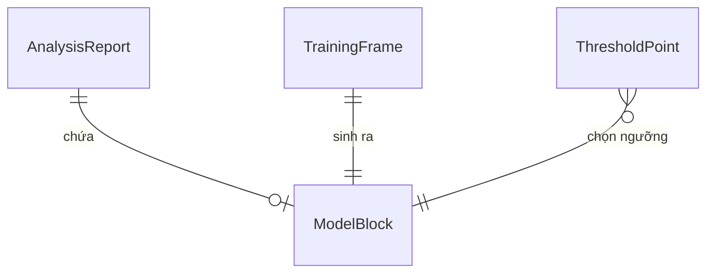

# Functional Spec — u2-model

Nguồn: `entities.md`, `rules.md`, `../../../inception/requirements-analysis/requirements.md`, `../../../inception/contract-design/contract-summary.md` (C1, C3), `../../../inception/user-stories/stories.md`.

Đơn vị này hiện thực **US2.1** (huấn luyện mô hình đơn trễ và đọc chỉ số).

Tệp này là nguồn sự thật cho **luồng chạy** của bước mô hình. Hình dạng dữ liệu thuộc `entities.md`; quyết định logic thuộc `rules.md`. U2 không có máy trạng thái: nó chạy một lần, ghi một khối, kết thúc.

## Luồng — huấn luyện và ghi khối mô hình

```
[1] Bước mô hình bắt đầu (chạy sau bước ghi của U1, trong cùng tầng `stats`)
      │
      ├─ BR2.1  quần thể: chỉ đơn đã giao, lọc tường minh; kỳ vọng 96.478 đơn / 7.826 trễ
      ├─ BR2.3  chốt danh sách cột đặc trưng; loại 9 cột bị cấm (rò rỉ nhãn)
      ├─ BR2.2  chia theo thời gian: train trước, test sau, không xáo trộn
      ├─ BR2.4  huấn luyện với trọng số lớp cân bằng
      │
      ├─ tính điểm số trên tập kiểm tra
      ├─ tính AUC                                    → BR2.6 gắn cờ nếu < 0,70
      ├─ BR2.5  duyệt lưới 0,05…0,95, chọn ngưỡng có F1 lớn nhất
      ├─ đếm flagged / not_flagged / total           → BR2.7 kiểm khớp và khớp test_n
      ├─ BR2.9  làm tròn 4 chữ số; ngưỡng vẫn phải trong (0,1)
      │
      ├─ chia tập TRƯỚC, rồi mới mã hoá: phạm trù one-hot và tham số chuẩn hoá khớp **chỉ trên tập huấn luyện** (TS-6)
      ├─ BR2.8  trả khối ModelBlock cho tầng `stats` của U1 — U2 không đọc, không ghi tệp
      └─ tầng `stats` đọc tệp cũ, giữ khối stats, gọi write_report
```

## Thứ tự có ràng buộc

1. Chia tập phải xong trước khi huấn luyện; mốc thời gian là dữ liệu, không phải tham số tuỳ ý.
2. Danh sách đặc trưng phải chốt trước khi huấn luyện — đây là chỗ chống rò rỉ, và sửa sau khi huấn luyện là làm lại từ đầu.
3. Ngưỡng chỉ chọn được sau khi có điểm số trên tập kiểm tra.
4. Số đếm phải khớp trước khi ghi; lệch nghĩa là báo cáo sai.
5. Ghi tệp sau cùng, qua hàm ghi của U1 — không tự mở tệp.

## Danh sách đặc trưng

Đặc trưng hợp lệ là những gì biết được **lúc đặt hàng**. Danh sách cột cụ thể nằm ở `entities.md` § "Danh sách đặc trưng (cụ thể theo cột)" và đó là bản có thẩm quyền: chín cột, trong đó năm cột phân loại và bốn cột số.

**Hạng mục sản phẩm không nằm trong danh sách.** Một đơn có thể chứa nhiều hạng mục, nên đưa nó vào sẽ cần multi-hot với số cột bằng số hạng mục — 73 cột cho một tín hiệu yếu, và làm loãng ma trận đặc trưng. Nếu sau này cần, nó là một thay đổi riêng có đo lường.

Bị loại, vì chỉ biết sau khi giao: ngày giao thực tế, số ngày giao, chênh lệch so với ngày dự kiến, đánh giá của người mua, và mọi cột dẫn xuất từ chúng.

## Điều kiện biên

| Điều kiện | Hành vi |
|---|---|
| Một trong hai tập rỗng | Dừng, không ghi khối mô hình |
| Tập kiểm tra chỉ có một lớp | Không chọn được ngưỡng (BR2.4); dừng |
| Danh sách đặc trưng còn cột bị cấm | Không huấn luyện |
| Tệp báo cáo cũ không đọc được | Ghi với `stats = null`; báo cáo thành `mot-phan` cho tới khi U1 chạy lại |
| Ba con số đếm lệch nhau | Dừng, không ghi |
| AUC dưới 0,70 | **Vẫn ghi**, kèm `auc_below_target = true` |

## Sơ đồ thực thể (dẫn xuất từ `entities.md`)



## Tóm tắt quy tắc (dẫn xuất từ `rules.md`)

| Mã | Một dòng |
|---|---|
| BR2.1 | Chỉ đơn đã giao, lọc tường minh; 96.478 đơn / 7.826 trễ |
| BR2.2 | Chia theo thời gian, không xáo trộn |
| BR2.3 | Danh sách cột cụ thể, không cột nào có sau khi giao |
| BR2.4 | Cân trọng số lớp, không lấy mẫu lại |
| BR2.5 | Ngưỡng = F1 cao nhất trên lưới 19 điểm |
| BR2.6 | AUC dưới 0,70 được ghi rõ |
| BR2.7 | Ba con số đếm khớp nhau |
| BR2.8 | Giữ khối thống kê khi ghi |
| BR2.9 | Làm tròn 4 chữ số, ngưỡng vẫn trong (0,1) |
