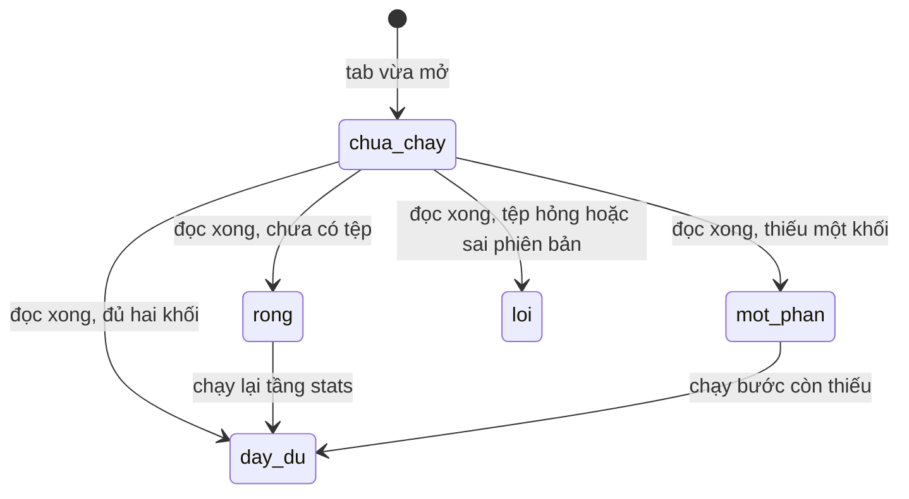
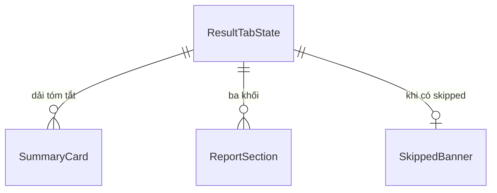

# Functional Spec — u3-display

Nguồn: `entities.md`, `rules.md`, `../../../inception/requirements-analysis/requirements.md`, `../../../inception/contract-design/contract-summary.md` (C2), `../../../inception/user-stories/stories.md`, `functional-design-questions.md`.

Đơn vị này hiện thực **US4.1** (mở tab kết quả và đọc theo thứ tự). Nó **không tính toán gì**: mọi con số đến từ tệp báo cáo do U1/U2 ghi. Đây là đặc tả cho luồng dựng tab và máy trạng thái của nó.

## Luồng — mở tab và dựng nội dung

```
[1] Người dùng mở tab kết quả
      │
      ├─ gọi read_report() của U1                       (BR3.1)
      │
      ├─ status = rong     → thông điệp + lệnh cần chạy  (BR3.5)
      ├─ status = loi      → thông điệp lỗi + đường dẫn  (BR3.5)
      ├─ status = mot-phan → dựng phần có, ghi rõ phần thiếu (BR3.4)
      └─ status = day-du   → dựng đủ
      │
      ├─ dải tóm tắt: tỉ lệ trễ, số đơn đã giao, số kiểm định bị bỏ,
      │                AUC kèm dấu đạt/không đạt                    (BR3.3)
      ├─ mục thống kê: tỉ lệ trễ, so sánh bang, tương quan,
      │                 kiểm định nhóm, mùa vụ; dải skipped nếu có (BR3.6)
      └─ mục mô hình: AUC, ngưỡng, precision, recall — chỉ đọc (BR3.7)
```

## Máy trạng thái của tab



Năm token, nhưng chỉ **một** do giao diện tự sinh: `chua-chay`. Bốn token còn lại lấy thẳng từ `ReportView.status` (BR3.1) — không có ánh xạ lại, không dò chuỗi thông điệp.

| Token | Nội dung dựng | Điều kiện |
|---|---|---|
| `chua-chay` | Chỉ báo đang tải | Trong lúc đọc tệp |
| `rong` | Thông điệp + lệnh `run --stage stats` | Chưa có tệp |
| `loi` | Thông điệp lỗi + đường dẫn tệp | Tệp hỏng hoặc sai phiên bản |
| `mot-phan` | Dải tóm tắt, mục thống kê, ghi rõ phần thiếu | Thiếu `model` |
| `day-du` | Dải tóm tắt, thống kê, mô hình | Đủ hai khối |

## Thứ tự đọc (BR3.2)

Cố định, không đổi theo dữ liệu: **tóm tắt → thống kê → mô hình**. Ở `mot-phan`, chỗ của khối thiếu vẫn được giữ và mang câu chữ "chưa chạy bước mô hình" kèm lệnh — không bị bỏ khỏi bố cục, vì bỏ đi sẽ làm tab trông như đã đầy đủ.

## Cơ chế đọc và làm mới

Tab đọc báo cáo **trong callback**, không đọc lúc dựng layout. Lý do: đọc lúc dựng thì nội dung đóng băng tại thời điểm khởi động dashboard, và token `chua-chay` không bao giờ hiện ra.

Hệ quả phải xử lý trong cùng thay đổi:

- Dashboard hiện có **8 callback, 9 output**; thêm tab là **9 callback, 9 output** — số output **không đổi**, vì assert đó đo tuple của callback KPI chứ không phải toàn dashboard.
- `tests/unit/test_dashboard_smoke.py` khẳng định ba con số đó và phải được sửa cùng lúc; `tests/integration/test_u3_end_to_end.py` khẳng định lại số callback.
- Tab vẫn là **tab thứ năm**; số tab thành 5.

`chua-chay` chỉ tồn tại trong khoảng thời gian callback đang chạy — nó là trạng thái của giao diện, không phải của hợp đồng.

## Điều kiện biên

| Điều kiện | Hành vi |
|---|---|
| Chưa có tệp | `rong`, kèm lệnh cần chạy |
| Tệp hỏng / sai phiên bản | `loi`, kèm đường dẫn |
| Thiếu khối mô hình | `mot-phan`, khối thống kê vẫn đầy đủ |
| `skipped` rỗng | Không dựng dải cảnh báo |
| `skipped` có phần tử | Mỗi phần tử một dòng, nêu tên phép và lý do |
| AUC dưới 0,70 | Thẻ AUC ghi "không đạt mốc 0,70" |
| Chiều rộng đúng 1280px | Không tràn ngang, không cắt chữ |

## Sơ đồ thực thể (dẫn xuất từ `entities.md`)



## Tóm tắt quy tắc (dẫn xuất từ `rules.md`)

| Mã | Một dòng |
|---|---|
| BR3.1 | Ánh xạ thẳng `status` thành token |
| BR3.2 | Tóm tắt → thống kê → mô hình |
| BR3.3 | Bốn thẻ, AUC có dấu đạt/không đạt |
| BR3.4 | Thiếu khối mô hình vẫn hiện thống kê |
| BR3.5 | Ba trạng thái ba câu chữ |
| BR3.6 | Liệt kê kiểm định bị bỏ |
| BR3.7 | Ngưỡng chỉ đọc |
| BR3.8 | Nhãn, bàn phím, 1280px |
| BR3.9 | Chỉ dùng token sẵn có |

## Điều đã chốt ở câu hỏi thiết kế

- **Q1 = A:** không có bộ chọn ngưỡng. Tab chỉ hiện ngưỡng đã báo cáo. Điều này **đi ngược** `unit-of-work.md` (giao U3 một "bộ chọn ngưỡng"), nên `unit-of-work.md` phải được sửa cho khớp — ghi ở đây để không ai đọc tài liệu cũ rồi dựng thanh trượt.
- **Q2 = A:** bốn thẻ tóm tắt.
- **Q3 = A:** `mot-phan` hiện đủ khối thống kê và ghi rõ phần thiếu.
