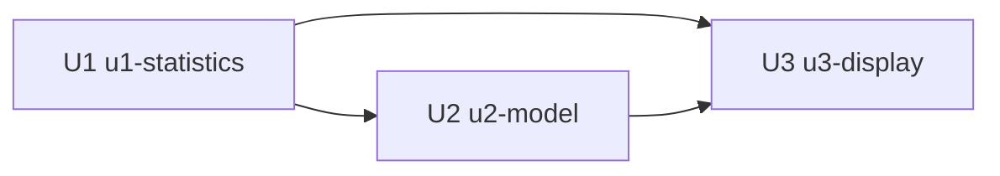

# Unit Dependency DAG

```yaml
units:
  - name: u1-statistics
    kind: service
    depends_on: []
  - name: u2-model
    kind: library
    depends_on: [u1-statistics]
  - name: u3-display
    kind: ui
    depends_on: [u1-statistics, u2-model]
```



| Từ | Đến | Lý do |
|---|---|---|
| U1 | U2 | U2 dùng thành phần ghi báo cáo và kiểu báo cáo do U1 dựng |
| U1 | U3 | U3 dùng hàm đọc báo cáo do U1 dựng |
| U2 | U3 | Khối mô hình trên tab cần kết quả do U2 sinh |

## Thứ tự thi công

Thứ tự đã chốt ở câu hỏi Q3 của stage này là thống kê → mô hình → hiển thị; việc chọn đường đi cụ thể thuộc Delivery Planning. Tệp này chỉ mô tả topology.

## Cơ hội song song

Không có cặp đơn vị nào chạy song song được: DAG là một chuỗi U1 → U2 → U3, mọi đường đi đều qua U1 trước.

## Chu trình

Không có chu trình: mọi cạnh đi từ U1 ra, U3 là nút cuối.
