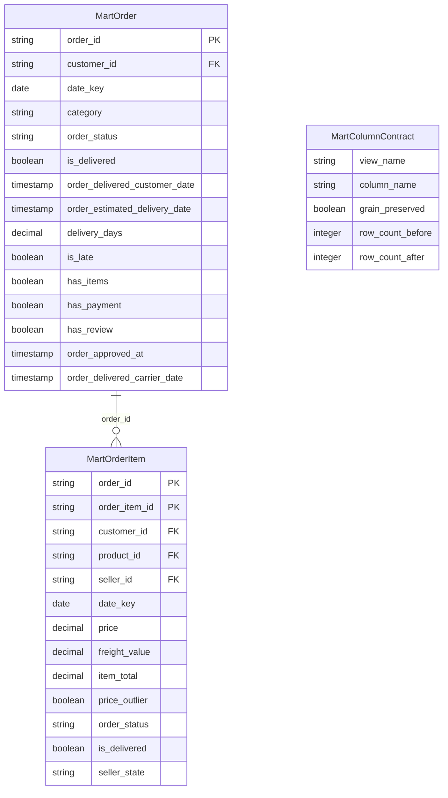

# Functional Spec — u1-mart-and-baseline

Đơn vị: `u1-mart-and-baseline`. Truyện nó tham gia: **US1.1** — cụ thể `AC1.1.3` (US1.1 do U2 dẫn dắt; xem `traceability.json`).
Nguồn: `entities.md` (nguồn sự thật về hình dạng), `rules.md` (nguồn sự thật về quyết định), `../../../inception/contract-design/contract-summary.md` (C1).

Tài liệu này là nguồn sự thật cho **thứ tự hành vi**; hai tài liệu kia không mô tả được thứ tự.

## W1 — Dựng mart với ba cột mới

**Kích hoạt:** `run --stage integrate` (và `run --stage all`).
**Kết quả:** mart có thêm ba cột; số dòng của 9 bảng và 11 view **không đổi** (13 → 15 cột ở `fact_orders`, 12 → 13 cột ở `fact_order_items`).

| # | Bước | Điều kiện dừng |
|---|---|---|
| 1 | Đọc dữ liệu đã làm sạch của `orders`, `sellers`, `order_items` | thiếu tệp Parquet ⇒ `FileNotFoundError` từ `load_cleaned` (pipeline.py:56) |
| 2 | Nối `dim_seller` trên `seller_id`; **đổi tên cột `state` → `seller_state`** ngay tại chỗ nối | `seller_id` không có bản ghi ⇒ null, **không** ném (BR1.2) |
| 3 | Gắn `order_approved_at`, `order_delivered_carrier_date` vào `fact_orders`; `seller_state` vào `fact_order_items` | sai kiểu hoặc đặt NOT NULL ⇒ từ chối (BR1.6) |
| 4 | Đếm số dòng **trước** và **sau** của từng bảng mart và từng view | hai số khác nhau ⇒ `QualityGateError` (BR1.1) |
| 5 | Chạy 5 KPI của `KpiReconciler` trên mart mới | lệch quá dung sai ⇒ `QualityGateError` từ `KpiReconciler.enforce` (reconcile.py:66) |

**Vì sao bước 2 phải đổi tên ngay tại chỗ nối.** `dim_customer` đã có cột `state`; `agg_sales_daily` nối `dim_customer` với `fact_order_items`. Nếu cột mới cũng tên `state`, phép nối sinh `state_x`/`state_y` và tổng hợp hỏng — tức chính bất biến số dòng mà đơn vị này bảo vệ (BR1.7). Đổi tên ở đây rẻ hơn sửa `agg_sales_daily` ở đây.

**Điều W1 cố ý không làm:** không lọc lại dòng nào, không đổi khoá, không sắp xếp lại, không "dọn" dữ liệu nhân tiện. Một thay đổi dọn dẹp lẫn vào đây sẽ làm phép đếm dòng mất nghĩa — và phép đếm dòng là toàn bộ cơ chế an toàn của đơn vị này.

## W2 — Đo baseline một đặc trưng

**Kích hoạt:** được gọi từ tầng mô hình (U2); đơn vị này chỉ cung cấp hàm.
**Kết quả:** một số AUC trong (0,1), hoặc một `ModelError`.

| # | Bước | Điều kiện dừng |
|---|---|---|
| 1 | Nhận khung dữ liệu, tên cột nhãn, tên cột đặc trưng, `cut_date`, `random_state` | thiếu cột ⇒ `ModelError` nêu tên cột |
| 2 | Kiểm `cut_date` bằng `SPLIT_DATE` của mô-đun | khác ⇒ `ModelError` (BR1.4) |
| 3 | Chia hai tập theo `date_key`: trước mốc là huấn luyện, từ mốc là kiểm tra | một phía rỗng ⇒ `ModelError` (BR1.5) |
| 4 | Kiểm tập kiểm tra có đủ hai lớp nhãn | chỉ một lớp ⇒ `ModelError`, **không** trả 0,0 (BR1.5) |
| 5 | Mã hoá đặc trưng phân loại one-hot **trên phạm trù của tập huấn luyện** | giá trị lạ ở tập kiểm tra rơi vào phạm trù đã học, không tạo cột mới |
| 6 | Huấn luyện baseline một đặc trưng, chấm điểm trên tập kiểm tra | — |
| 7 | Trả **một số** AUC | — |

**Vì sao trả một số, không trả cấu trúc.** Hợp đồng C1 đã chốt chữ ký `-> float`. Cấu trúc mang `cohort_rows`/`same_split_as_model` do U2 lắp, và `cohort_rows` chính là bộ đếm mà C1 cấm U1 khai — trả nó ở đây sẽ tạo nguồn thứ hai cho bốn con số.

**Vì sao bước 2 tồn tại.** Bản trước để người gọi tự khai "cùng phép chia với mô hình". Đó là một lời hứa không kiểm được: `cut_date` là tham số tự do, nên một lần gọi với mốc khác sẽ cho AUC không so được với mô hình — mà không ai biết. Kiểm ngay trong hàm biến lời hứa thành điều kiện.

**Điều W2 cố ý không làm:** không lọc `delivered`, không lọc dòng thiếu carrier date. Hàm là grain-neutral: người gọi truyền quần thể đã lọc (U2 truyền khung grain dòng hàng; U1 tự kiểm hàm trên khung order-grain mà `AnalyticsService.training_frame()` trả hiện nay). Nhét bộ lọc vào hàm sẽ khiến hai đơn vị cùng định nghĩa quần thể — và chúng sẽ định nghĩa khác nhau.

## Mô hình quan hệ (dẫn xuất từ `entities.md`)

`MartColumnContract` không nối vào hai bảng fact bằng khoá ngoại: nó là danh sách điều kiện, không phải dòng dữ liệu. Vẽ nó thành bảng có khoá sẽ là bịa ra một quan hệ không tồn tại.

## Trạng thái và chuyển tiếp

Đơn vị này không có thực thể có vòng đời (không có trạng thái chờ/duyệt/huỷ). Mart là dữ liệu dẫn xuất, dựng lại được từ `dataset/`; mỗi lần chạy là một phiên bản thay thế nguyên khối, không có chuyển tiếp trạng thái nào để mô hình hoá.

Đây là lý do `functional-spec.md` của đơn vị này ngắn: không có máy trạng thái, và bịa ra một máy trạng thái cho mart sẽ là trang trí.

## Tóm tắt luật (dẫn xuất từ `rules.md`)

| ID | Một dòng |
|---|---|
| `BR1.1` | Số dòng của 9 bảng mart và 11 view không đổi |
| `BR1.2` | `seller_state` chỉ từ `dim_seller`; thiếu thì null |
| `BR1.3` | Mốc thời gian thô bị cấm làm đặc trưng (U2 cưỡng chế) |
| `BR1.4` | Baseline là hàm thuần, grain-neutral, chia trên `date_key` với `SPLIT_DATE` |
| `BR1.5` | Tập kiểm tra rỗng hoặc một lớp ⇒ `ModelError` |
| `BR1.6` | Kiểu dữ liệu và tính nullable của ba cột là hợp đồng |
| `BR1.7` | Tên cột phải là `seller_state`; `state` sẽ phá `agg_sales_daily` |

## Điều kiện xong của đơn vị (nhắc lại để đối chiếu)

1. Ba cột có mặt, đúng kiểu, đúng nullable; `seller_state` không phải `state`.
2. 9 bảng mart + 11 view giữ nguyên số dòng; `StarSchemaValidator` xanh; 5 KPI xanh.
3. Hàm baseline có test đơn vị cho ba nhánh lỗi (sai `cut_date`, tập rỗng, một lớp nhãn) và chạy được trên khung order-grain thật.
4. Test end-to-end `slow` riêng của U1 xanh trên `dataset/`.
5. `ruff check .` và `ruff format --check` sạch; tệp mới vào danh sách khai tay của `ci.yml`.

## Điểm chệch so với hợp đồng C1 — ghi lại, không tự sửa hợp đồng

Hợp đồng `contract-summary.md` (C1) đã được duyệt ở stage trước, nên nó **không** được sửa sau cổng. Ba chỗ bước này đọc mã thật rồi viết khác C1, và đây là chỗ ghi lại:

| Chỗ | C1 nói | Mã thật / thiết kế này nói | Hệ quả |
|---|---|---|---|
| Tên bảng người bán | `dim_sellers` | `dim_seller` (số ít), cột nguồn tên `state` — `dimensions.py:47-63` | C1 sai chính tả tên bảng; thi công theo C1 sẽ `KeyError` |
| Nhánh lỗi của hàm baseline | một nhánh: "quần thể kiểm tra rỗng hoặc một lớp nhãn" | **ba** nhánh: thêm `cut_date != SPLIT_DATE` | Bước này **siết** hợp đồng. Siết là an toàn cho người đọc (mọi lần gọi hợp lệ cũ vẫn hợp lệ); nhưng nó phải được ghi, không được im lặng |
| Tên lớp ngoại lệ ở W1 | `PipelineError` gốc cho hàm; không nêu cho W1 | `FileNotFoundError` khi thiếu Parquet, `QualityGateError` cho cả kiểm star schema lẫn KPI | C1 chỉ nói về hàm, nên đây là bổ sung chứ không phải mâu thuẫn |

**Vì sao không sửa C1 ngay.** Sửa một artefact đã qua cổng sẽ làm review của stage đó thành lời khai sai. Ghi ở đây thì người thi công đọc được cả hai, và lần mở C1 tiếp theo (khi U2 cần) sẽ sửa một lần.

**Về "số dòng trước" của 11 view và 2 bảng `agg_*`.** `StarSchemaValidator` chỉ đếm 9 bảng nền (`validate.py:12-22`), không đếm view hay bảng tổng hợp; view được tạo lại **sau** khi ghi mart. Vì vậy bất biến của chúng không kiểm bằng phép đếm trực tiếp mà bằng hệ quả: view và `agg_*` chỉ là phép chiếu/tổng hợp trên bảng nền, nên bảng nền giữ số dòng thì chúng cũng vậy — trừ khi chính câu SQL đổi, và điều đó bị chặn bởi việc đơn vị này không sửa câu SQL nào.
