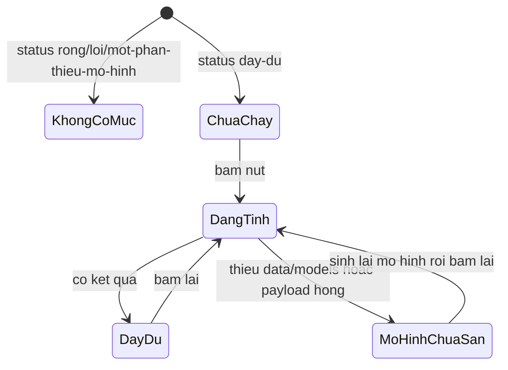

# Functional Spec — u3-prediction-ui

Đơn vị: `u3-prediction-ui` (`ui`, gắn vào dashboard hiện có). Nguồn: `../../../inception/units-generation/unit-of-work.md` §U3, `../../../inception/user-stories/stories.md` (US2.1–US2.5, US3.1, US3.2), `../../../inception/requirements-analysis/requirements.md` (FR3, FR3.1–FR3.5, FR2.6, NFR5, NFR6), `../../../inception/contract-design/contract-summary.md` (C2, C2b, C3), `../../../inception/domain-design/decisions.md` (ADR-005, ADR-008).

Đơn vị này **không** huấn luyện, **không** đọc DuckDB, **không** tính lại chỉ số: nó đọc `analysis.json`, nạp tệp mô hình qua C2b, gọi `score_item` của U2, và dựng cây Dash.

Tài liệu này tự chứa phần giao diện (`ui` không cần `entities.md`); `rules.md` vẫn được viết vì mọi `ACx.y.z` phải có đích `BRx.y`. Đánh số luật **bắt đầu từ BR3.11** — các luật hiển thị của đợt trước vẫn đang ràng buộc mã hiện có, không định nghĩa lại.

## 0. Ba điểm lệch với upstream, và cách xử lý

Thiết kế này **không** giấu ba chỗ upstream và mã hiện tại không khớp nhau. Chúng được ghi ở đây và là đầu vào cho cổng duyệt:

| # | Điều upstream nói | Sự thật trên mã | Cách xử lý |
|---|---|---|---|
| D-1 | FR3.2 có trạng thái "có kết quả **chưa có ngưỡng** (`mot-phan`)" | `report.py::_model_block` **bắt buộc** `threshold` và đủ 9 khoá `counts`; thiếu là `loi`. `mot-phan` hiện chỉ sinh ra khi **vắng một trong hai khối** (một tệp chỉ có khối mô hình cũng đọc ra `mot-phan`, và khi đó `threshold` vẫn có). `score_item(..., *, threshold)` **không có giá trị mặc định** (C3) | Trạng thái "có kết quả chưa có ngưỡng" **không dựng được** dưới C2. `mot-phan` có khối mô hình vẫn chấm được như `day-du`; thiếu khối mô hình thì **không có mục Dự đoán**. AC2.5.3 đánh `N/A` kèm lý do trong `traceability.json` |
| D-2 | FR3 nói cập nhật `len(outputs) == 10` trong `test_dashboard_smoke.py` | `outputs = build_dashboard_outputs(...)` là **9 giá trị của callback KPI**; nó phải giữ **9**. Callback mới có **1** `Output` riêng | Ghi rõ hợp đồng kiểm được: `len(app.callback_map) == 10`, `len(build_dashboard_outputs(...)) == 9` **không đổi**, callback mới khai đúng **1** `Output`. Con số "10 output" của FR3 là *9 Output của callback KPI + 1 Output mới*, không phải tổng Output của mọi callback |
| D-3 | FR3.2 có trạng thái "đang tính"; unit-of-work ghi "nút **không** bị khoá" (ADR-005) | Một render trung gian "nút disabled + kết quả mờ" cần `Output` thứ hai ⇒ phá BR3.13 | "Đang tính" do **spinner của `dcc.Loading`** thể hiện; nút **không** bị khoá, kết quả cũ giữ nguyên nhưng `dcc.Loading` phủ overlay chờ. Không có Output thứ mười một |

## 1. Vị trí và thứ tự mục

Tab "Kết quả phân tích" hiện có ba mục: `tom-tat`, `thong-ke`, `mo-hinh`. Đơn vị này thêm mục thứ tư **`du-doan`** ngay sau `mo-hinh`.

| Thứ tự | `data-section` | Tiêu đề | Nguồn dữ liệu |
|---|---|---|---|
| 1 | `tom-tat` | Tóm tắt | `report.stats` + `report.model` |
| 2 | `thong-ke` | Thống kê | `report.stats` |
| 3 | `mo-hinh` | Mô hình | `report.model` |
| 4 | `du-doan` | Dự đoán | `report.model.threshold` + `data/models/` + `score_item` |

Ràng buộc: không thêm tab (vẫn **5** tab), không thêm thẻ tóm tắt (vẫn **4** thẻ), tiêu đề mục là `html.H3` cùng cấp ba mục kia, dùng lại `_section` và `.chart-card`.

## 2. Cấu trúc khối Dự đoán

```
Section#du-doan (html.Section, data-section="du-doan")
├─ Header (_section_header)
│  ├─ html.H3 "Dự đoán"
│  └─ caption: dự đoán cho MỘT DÒNG HÀNG ...
├─ form (html.Fieldset, id="bieu-mau-du-doan")
│  ├─ legend "Thông tin một dòng hàng"
│  ├─ 3 dcc.Dropdown   : seller_state, customer_state, payment_type
│  ├─ 6 dcc.Input      : order_date, item_price, item_count, installments,
│  │                     handling_days, approval_days
│  ├─ 1 dcc.Checklist  : has_items, has_payment  (hai mục)
│  └─ html.Button "Dự đoán" (id="nut-du-doan")
└─ dcc.Loading(custom_spinner)        ← nơi thể hiện "đang tính"
   └─ Div#du-doan-ket-qua
      └─ trạng thái hiển thị (xem §3)
```

**Mười một giá trị nhập dựng bằng mười thành phần.** Bốn trường `payment_type`, `installments`, `has_items`, `has_payment` có mặt trên màn hình với đúng giá trị mặc định và sửa được.

## 3. Sáu trạng thái của khối

Sáu nhãn là **đúng sáu nhãn của FR3.2**. Cột "dựng được?" nói thật trạng thái nào chạm tới được trên báo cáo v3.

| # | Trạng thái (FR3.2) | Token | Dựng được? | Điều kiện | Hiển thị |
|---|---|---|---|---|---|
| 1 | Không có khối | — | Có | `ReportView.status ∈ {rong, loi}` | **Không có mục Dự đoán**; tab hiện lệnh hoặc lý do + đường dẫn tệp |
| 2 | Chưa dự đoán | `chua-chay` | Có | Báo cáo `day-du`, hoặc `mot-phan` **có** khối mô hình, chưa bấm | Một dòng hướng dẫn bấm nút; **không** chữ số nào |
| 3 | Đang tính | `dang-tai` | Có | Callback đang chạy | `dcc.Loading` hiện spinner; nút **không** khoá; không render trung gian thứ hai |
| 4 | Có kết quả **có** ngưỡng | `day-du` | Có | `report.model.threshold` có (bắt buộc bởi C2), đã bấm | Xác suất + so ngưỡng + kết luận về dòng hàng + ba đóng góp |
| 5 | Có kết quả **chưa có** ngưỡng | `mot-phan` | **Không** | C2 bắt buộc `threshold`; thiếu là `loi`. `mot-phan` chỉ xảy ra khi **vắng khối**, và khi vắng khối mô hình thì không chấm được | **Không có mục Dự đoán** khi `report.model is None`; xem D-1 |
| 6 | Mô hình chưa sẵn | `mo-hinh-chua-san` | Có | Báo cáo đủ, `load_model()` trả `None` **hoặc** ném `ModelError` | Câu chứa **nguyên văn** `python -X utf8 -m src.pipeline run --stage stats` và `data/models/`; nút tắt; **không** hiện `str(error)` (chứa đường dẫn tuyệt đối) |

Trạng thái lỗi khối (`score_item` ném `ModelError`, hoặc payload mô hình hỏng) dùng nhãn 6 với `notice` là thông điệp nguyên văn — vẫn là "mô hình chưa sẵn", không thêm trạng thái thứ bảy.

## 4. Luồng

### W1 — Mở tab khi báo cáo đủ

1. Callback đọc báo cáo (đường hiện có) → `state_for(view)` trả token của tab.
2. `sections_for(view)` dựng bốn mục theo thứ tự §1.
3. Mục Dự đoán dựng biểu mẫu với giá trị mặc định (§5) và vùng kết quả ở `chua-chay`.
4. `load_model(models_dir)` trả `None` → vùng kết quả ở `mo-hinh-chua-san`; nút `disabled=True`.
5. `load_model` ném `ModelError` (payload hỏng) → cũng `mo-hinh-chua-san` với **câu hướng dẫn cố định** (không hiện `str(error)` vì nó chứa đường dẫn tuyệt đối — SR3.10); thông điệp thô vào nhật ký.

### W2 — Bấm Dự đoán (đường xanh)

1. Callback đọc **lại** `read_report(report_path(config))` — cùng một lần đọc rẻ trên tệp cục bộ, và là nguồn duy nhất của `report.model.threshold`. Không truyền ngưỡng qua `State`: nếu tệp báo cáo bị `--stage stats` thay giữa lúc dựng panel và lúc bấm, callback vẫn thấy bản mới nhất thay vì một giá trị cũ.
2. Nếu bản đọc lại có `report.model is None` (báo cáo vừa bị thay bằng bản thiếu khối) ⇒ trả `mo-hinh-chua-san` với câu hướng dẫn; **không** truy cập `None.threshold`.
3. Kiểm hợp lệ từng ô (§5). Sai ô nào → hiện lỗi **tại ô đó** và dừng; không ném.
4. `load_model()` → `None` ⇒ `mo-hinh-chua-san`.
5. `score_item(model, item, threshold=report.model.threshold)` — ngưỡng **luôn** đến từ báo cáo vừa đọc, không có mặc định.
6. Dựng kết quả: `format_percent(probability * 100)` (hàm **không** nhân 100 — người gọi nhân), câu so ngưỡng, ba đóng góp.

### W3 — Báo cáo `mot-phan`

1. `report.model is None` ⇒ **không dựng mục Dự đoán** (BR3.23). Không có biểu mẫu, không có nút.
2. `report.model is not None` ⇒ có ngưỡng (C2 bắt buộc) ⇒ chạy W2 bình thường. Không có nhánh "có kết quả nhưng không có ngưỡng".

### W4 — Bấm lại cùng đầu vào

Cùng 11 giá trị ⇒ cùng xác suất tuyệt đối, cùng ba đóng góp. Sau khi khởi động lại dashboard, nạp lại cùng tệp mô hình ⇒ vẫn cùng xác suất.

### W5 — Đang tính

`dcc.Loading` bọc vùng kết quả hiện spinner trong lúc callback chạy. Nút **không** bị khoá (ADR-005: "spinner của `dcc.Loading` là đủ"), không có Output thứ mười một, kết quả cũ chỉ bị overlay chờ che tạm.

### W6 — Đọc thẻ AUC ở dải tóm tắt

1. `below = report.model.counts["auc_below_target"]` — **chỉ** đọc cờ, không dựng lại phép so (C2: "U3 chỉ đọc … không dùng để tự suy cờ").
2. Nhãn = "không đạt mốc {format_number(AUC_TARGET, 2)}" hoặc "đạt mốc {…}", lấy giá trị từ hằng `AUC_TARGET` — không viết literal "0,70".
3. `auc_tree` **không** làm đổi kết luận.
4. Nhánh dự phòng `model.auc < AUC_TARGET` hiện có (`analysis_tab.py::_auc_note`) và test canh nó (`test_dashboard_analysis_tab.py::test_auc_card_falls_back_to_the_value_when_the_flag_is_absent`) **phải xoá** trong cùng thay đổi: nó chính là "tự suy cờ" mà C2 cấm.

### W7 — Nhãn grain của khối mô hình

C2 giao U3 đổi nhãn hiển thị của `split.train_n`, `split.test_n`, `counts.flagged` từ "đơn" sang "dòng hàng" (dự đoán giờ ở grain dòng hàng); giá trị số không đổi.

## 5. Biểu mẫu — giá trị mặc định và kiểm hợp lệ

| Thành phần | Trường | Mặc định | Miền hợp lệ | Thông điệp lỗi (tại ô) |
|---|---|---|---|---|
| `dcc.Dropdown` | `seller_state` | `SP` | một trong 27 mã UF của `STATE_CODES` | "Chọn bang người bán" |
| `dcc.Dropdown` | `customer_state` | `SP` | như trên | "Chọn bang người mua" |
| `dcc.Dropdown` | `payment_type` | `credit_card` | `credit_card`, `boleto`, `voucher`, `debit_card`, `not_defined` | "Chọn hình thức thanh toán" |
| `dcc.Input` | `order_date` | `2018-01-01` | `pd.Timestamp` đọc được | "Ngày phải theo dạng YYYY-MM-DD" |
| `dcc.Input` | `item_price` | `100` | số hữu hạn, `>= 0` | "Giá phải là số không âm" |
| `dcc.Input` | `item_count` | `1` | số nguyên, `>= 1` | "Số món phải là số nguyên từ 1" |
| `dcc.Input` | `installments` | `1` | số nguyên, `>= 1` | "Số kỳ trả góp phải từ 1" |
| `dcc.Input` | `handling_days` | `3` | số, `0…365` | "Số ngày duyệt→bàn giao phải trong 0…365" |
| `dcc.Input` | `approval_days` | `1` | số, `0…365` | "Số ngày đặt→duyệt phải trong 0…365" |
| `dcc.Checklist` | `has_items` | chọn | boolean | — |
| `dcc.Checklist` | `has_payment` | chọn | boolean | — |

Miền số **trùng** `MAX_DAYS`/`STATE_CODE_LENGTH` của U2 (365 và 2). `payment_type` là miền **do giao diện** khai (U2 coi nó là chuỗi tự do và một giá trị lạ rơi vào `'unknown'`); `STATE_CODES` là hằng **mới của U3** gồm 27 mã UF — repo hiện **không** có danh sách này, chỉ có `FittedModel.state_regions` dựng từ `customer_state` sau khi nạp mô hình, và nó **không** dùng được cho `seller_state`.

## 6. Kết quả và ba đóng góp

1. **Xác suất** — `format_percent(probability * 100)`.
2. **So ngưỡng** — "Xác suất 12,34% **cao hơn** ngưỡng 40,00%" / "**thấp hơn**"; câu kết luận nói về **dòng hàng**, không nói "đơn".
3. **Ba đóng góp lớn nhất** — đúng ba dòng, mỗi dòng một **trường** (mọi cột one-hot đã gộp), kèm dấu và log-odds 4 chữ số. Nhãn bắt buộc: **"Ba đóng góp lớn nhất (log-odds, không phải tổng)"**. Tên trường hiển thị bằng bảng nhãn tiếng Việt: `seller_state` → "Bang người bán", `customer_state` → "Bang người mua", `customer_region` → "Vùng người mua", `payment_type` → "Hình thức thanh toán", `payment_installments` → "Số kỳ trả góp", `item_count`/`item_total`/`item_price_max` → "Số món"/"Tổng giá trị"/"Giá cao nhất", `purchase_month`/`purchase_weekday` → "Tháng đặt"/"Thứ trong tuần", `has_items`/`has_payment` → "Có món"/"Có thanh toán", `handling_days`/`approval_days` → "Ngày duyệt→bàn giao"/"Ngày đặt→duyệt". Trường lạ rơi về chính tên trường.

## 7. Bề mặt callback

| Hạng mục | Trước | Sau | Ghi chú |
|---|---|---|---|
| `len(app.callback_map)` | 9 | **10** | thêm đúng một callback |
| Output của callback KPI | 9 | 9 | `build_dashboard_outputs` vẫn trả **9** |
| Output của callback mới | 0 | **1** | `Output("du-doan-ket-qua", "children")` |
| Mục của tab | 3 | **4** | |
| Tab | 5 | 5 | |
| Thẻ tóm tắt | 4 | 4 | |

Callback mới: `Input("nut-du-doan", "n_clicks")` + 11 giá trị, `prevent_initial_call=True`, **không** `State`. Ngưỡng không đi qua `State`: callback tự `read_report(report_path(config))` mỗi lần bấm (W2 bước 1), nên vừa có nguồn ngưỡng, vừa chịu được việc tệp báo cáo bị thay giữa hai lần render.

Ba tệp test hình dạng sửa **cùng thay đổi**: `tests/unit/test_dashboard_smoke.py` (`callback_map == 10`, `build_dashboard_outputs` giữ 9), `tests/unit/test_dashboard_analysis_tab.py` (bốn mục đúng thứ tự, xoá test dự phòng AUC), `tests/integration/test_u3_end_to_end.py` (10 callback, 5 tab).

## 8. Mốc sàn

- Hàm thuần `beats_floor(auc, baseline_auc, floor=MODEL_AUC_FLOOR) -> bool` thuộc U2, trả `auc >= max(floor, baseline_auc)`; hàm **không** tự làm tròn — hai giá trị đầu vào là hai giá trị **đã làm tròn 4 chữ số** trong báo cáo.
- U3 viết test đơn vị cho **cả hai nhánh** (đỏ và xanh) với giá trị dựng tay.
- U3 viết **một** test `slow` khẳng định nhánh **xanh** trên tệp báo cáo **thật** do `--stage stats` sinh: `beats_floor(model.auc, model.baseline_auc) is True`; không fixture.
- Ngoại lệ có chủ đích với luật NEVER "đặt một giá trị AUC (hay precision/recall/ngưỡng) làm **kỳ vọng** của một test viết trước" (`project.md` `## Forbidden`, affirmed 2026-11-12). Ngoại lệ **phải** được ghi qua nghi thức learnings vào `project.md` **`## Corrections`** — nơi ghi các sửa đổi so với luật đã ban — **trước khi đóng intent**, và dòng đó phải dẫn lại chính câu NEVER này cùng lý do NFR5. `team.md` cũng phải ghi hai ngân sách 300 s/240 s ở cùng cổng. Ghi ở `functional-spec` là ghi nhận, **không** thay cho bước đó.

## 9. Truy vết truyện

| Truyện | AC | Luật |
|---|---|---|
| US2.1 | AC2.1.1–AC2.1.6 | BR3.11–BR3.16 |
| US2.2 | AC2.2.1–AC2.2.3 | BR3.17–BR3.19 |
| US2.3 | AC2.3.1–AC2.3.3 | BR3.20–BR3.21 |
| US2.4 | AC2.4.1–AC2.4.6 | BR3.22 (AC2.4.3–AC2.4.6 do U2 giao) |
| US2.5 | AC2.5.1–AC2.5.6 | BR3.23–BR3.27 (AC2.5.3 là `N/A` — D-1) |
| US3.1 | AC3.1.1–AC3.1.3 | BR3.28 |
| US3.2 | AC3.2.1–AC3.2.2 | BR3.29 |

## 10. Derived view — máy trạng thái



Fallback chữ: không có mục khi `rong`/`loi` hoặc thiếu khối mô hình; `day-du` vào `chua-chay`; bấm nút → `dang-tai` (spinner); rồi `day-du` hoặc `mo-hinh-chua-san`; bấm lại từ trạng thái có biểu mẫu.

## 11. Derived view — bảng luật

| Luật | Tóm tắt |
|---|---|
| BR3.11 | Bốn mục đúng thứ tự, mục mới `du-doan` sau `mo-hinh`, `H3` |
| BR3.12 | Không `tabIndex` dương, mọi vùng có `aria-label`/heading, không thẻ thứ năm |
| BR3.13 | 10 callback, 4 mục, 5 tab; Output của callback KPI giữ 9, callback mới 1 |
| BR3.14 | Một `aria-live` duy nhất; không token màu mới |
| BR3.15 | Bỏ câu "chỉ đọc" ở `model_caption` và README; chữ < 16px dùng `--text-2` |
| BR3.16 | Câu mở đầu nói rõ dự đoán cho một dòng hàng |
| BR3.17 | Bấm Dự đoán → xác suất, so ngưỡng, kết luận về dòng hàng |
| BR3.18 | Bốn trường mặc định hiện đúng giá trị và sửa được |
| BR3.19 | Ô trống/sai định dạng → lỗi tại ô, không ném |
| BR3.20 | Ba đóng góp, gộp theo trường |
| BR3.21 | Nhãn "Ba đóng góp lớn nhất (log-odds, không phải tổng)" |
| BR3.22 | Cùng đầu vào ⇒ cùng xác suất, kể cả sau khởi động lại |
| BR3.23 | `rong`/`loi`/thiếu khối mô hình ⇒ không có mục Dự đoán |
| BR3.24 | `mot-phan` không có nhánh "kết quả thiếu ngưỡng": thiếu khối mô hình thì không có mục |
| BR3.25 | Thiếu `data/models/` hoặc payload hỏng ⇒ câu lệnh + đường dẫn |
| BR3.26 | `chua-chay` ⇒ không hiện số |
| BR3.27 | "Đang tính" do `dcc.Loading`; nút không khoá, không Output thứ hai |
| BR3.28 | Thẻ AUC chỉ đọc `auc_below_target`, nhãn dùng `AUC_TARGET`; xoá nhánh dự phòng |
| BR3.29 | Cổng mốc sàn: hai nhánh đơn vị + một test `slow` trên tệp thật |
| BR3.30 | Nhãn grain của khối mô hình đổi "đơn" → "dòng hàng" |
| BR3.31 | `.field-error` thêm vào `assets/style.css`; tệp nguồn/test mới vào danh sách `ci.yml:35` cùng lúc |
