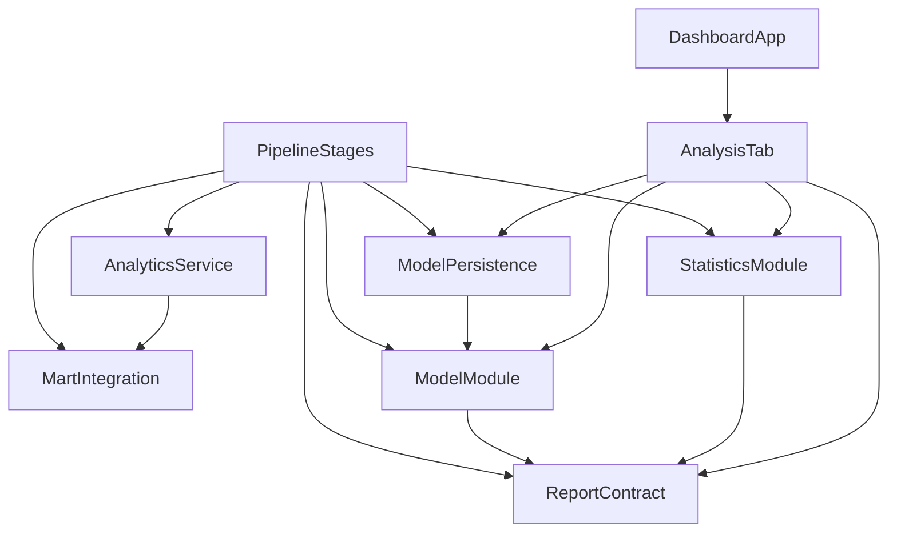

# Components — Cải thiện đặc trưng cho mô hình dự đoán đơn trễ

Nguồn: `../requirements-analysis/requirements.md`, `../user-stories/stories.md`, `../refined-mockups/{mockups,design-system-mapping}.md`, `codekb/Tich-hop-va-xu-li-du-lieu-lon/{architecture,component-inventory}.md`, `../practices-discovery/team-practices.md`.

## Part A — Component catalogue

```yaml
components:
  - name: MartIntegration
    summary: Dựng và giữ các bảng mart cùng view DuckDB mà mọi tầng phân tích đọc.
    behaviour: >
      Gộp dữ liệu đã làm sạch thành 9 bảng mart và 11 view; giữ đúng số dòng của từng
      bảng. Đợt này thêm ba cột (hai mốc thời gian vào v_fact_orders, seller_state vào
      v_fact_order_items) mà KHÔNG đổi số dòng. Mọi thay đổi hình dạng mart phải cập nhật
      StarSchemaValidator và VIEW_TABLES trong cùng thay đổi.
    responsibilities:
      - Sở hữu schema mart và số dòng hợp đồng của 9 bảng + 11 view
      - Sở hữu các cột mốc thời gian và thuộc tính người bán mà tầng mô hình cần
    depends_on: []
    dependents:
      - component: AnalyticsService
        interaction: đọc mart qua view DuckDB
      - component: PipelineStages
        interaction: chạy integrate_all để dựng lại mart (stages.py:19)
    external_dependencies:
      - name: DuckDB
        kind: database
        purpose: tệp warehouse/olist.duckdb chứa view trên Parquet
    entities:
      - name: MartOrder
        identifier: order_id
        attributes: [order_id, customer_id, date_key, is_delivered, is_late, order_approved_at, order_delivered_carrier_date]
      - name: MartOrderItem
        identifier: "order_id + order_item_id"
        attributes: [order_id, order_item_id, seller_id, price, freight_value, seller_state, item_total]

  - name: AnalyticsService
    summary: Cửa đọc duy nhất vào mart; dựng khung huấn luyện ở grain dòng hàng.
    behaviour: >
      Là nơi DUY NHẤT mở kết nối DuckDB. Đợt này thêm một truy vấn khung huấn luyện ở
      grain dòng hàng (một dòng mỗi cặp đơn × món), lọc quần thể theo trạng thái delivered
      và sự tồn tại của carrier date. Truy vấn đó **trả kèm bộ đếm** quần thể trước và sau
      khi lọc — gồm excluded_missing_carrier — vì nếu chỉ lọc thì con số FR1.2 đòi ghi sẽ
      mất; không có truy vấn thứ hai và không lọc lại ở tầng trên. Trả DataFrame thô cho
      PipelineStages, không tự dựng đặc trưng.
    responsibilities:
      - Truy vấn mart, trả DataFrame đã gộp đúng grain
      - Sở hữu phép đếm quần thể và số dòng bị loại (FR1.2)
      - Giữ chặn số dòng cho truy vấn nặng
    depends_on:
      - component: MartIntegration
        interaction: đọc view
        style: sync
    dependents:
      - component: PipelineStages
        interaction: lấy khung huấn luyện
    external_dependencies:
      - name: DuckDB
        kind: database
        purpose: chỉ đọc
    entities:
      - name: TrainingFrame
        identifier: "order_id + order_item_id"
        attributes: [order_id, order_item_id, date_key, is_delivered, is_late, seller_state, customer_state, customer_region, purchase_month, purchase_weekday, item_price_max, item_total, item_count, payment_type, payment_installments, has_items, has_payment, handling_days, approval_days]
      - name: CohortCounts
        identifier: "generated_at của lần đọc"
        attributes: [cohort_rows, cohort_orders, late_rows, excluded_missing_carrier]

  - name: StatisticsModule
    summary: Năm phép kiểm định thống kê của tầng stats, dưới dạng hàm thuần.
    behaviour: >
      Nhận DataFrame đã gộp và trả kết quả kiểm định: tỉ lệ trễ với khoảng Wilson, so sánh
      bang, tương quan giá–phí, kiểm định vùng × trễ, phân rã mùa vụ. Sau U2 khối này chỉ
      còn năm hàm thuần nhận dữ liệu đã gộp: không mở kết nối DuckDB, không đọc ghi tệp,
      không giữ trạng thái. Hai hàm không thuần hiện có — collect_stats tự gọi năm truy vấn
      (statistics.py:276-284) và build_analysis_report tự đọc/ghi báo cáo
      (statistics.py:298-313) — được tách đôi: phần lấy dữ liệu về PipelineStages, phần
      dựng/đọc/ghi báo cáo về ReportContract (ADR-008). Phép bỏ qua phải trả lý do có
      nghĩa thay vì im lặng.
    responsibilities:
      - Sở hữu ngưỡng và công thức của năm phép kiểm định
      - Sở hữu cách ghi lý do bỏ qua
    depends_on:
      - component: ReportContract
        interaction: dùng kiểu StatsBlock và các kiểu kết quả
        style: sync
    dependents:
      - component: PipelineStages
        interaction: gọi để dựng khối thống kê
      - component: AnalysisTab
        interaction: mượn hằng số MIN_STATE_ORDERS
    external_dependencies:
      - name: scipy
        kind: other
        purpose: phân phối chuẩn tắc và chi bình phương
    entities:
      - name: TestResult
        identifier: "tên phép kiểm định"
        attributes: [phep, mot_trong_nam_hinh_dang_ket_qua, ly_do_bo_qua]
        note: >
          Kiểu gom trừu tượng, KHÔNG phải một dataclass. Năm hình dạng thật nằm ở
          report.py và thuộc ReportContract: ProportionResult (successes, total, rate,
          ci_low, ci_high), ComparisonResult (first, second, difference, z, p_value,
          ci_low, ci_high, significant, excluded), CorrelationResult (r, n, ci_low,
          ci_high), GroupTestResult (test, statistic, p_value, dof, min_expected),
          SeasonalResult (revenue_definition, method, period, months, observed, trend,
          seasonal, residual). Bỏ qua thì trả SkipEntry (test, reason) thay vì hình dạng
          nào ở trên.

  - name: ModelModule
    summary: Hàm thuần dựng đặc trưng, chia tập, đo baseline, huấn luyện hai mô hình, chọn ngưỡng.
    behaviour: >
      Không đọc ghi tệp, không giữ trạng thái. Chia tập theo order_id với mốc 2018-04-01
      trên ngày đặt; đo baseline một đặc trưng customer_state trên đúng tập kiểm tra rồi
      so với mô hình triển khai (baseline_auc, beats_baseline); huấn luyện hồi quy
      logistic (triển khai) và HistGradientBoosting (chỉ báo cáo) trên cùng đặc trưng,
      cùng mốc, cùng quần thể, cùng random_state. Sinh đóng góp log-odds từ hệ số
      logistic. Từ chối mọi cột trong FORBIDDEN_COLUMNS và từ chối dùng giá trị ngày thô
      của hai cột mốc. Lối tắt train_model tự dựng AnalyticsService (model.py:338) chuyển
      ra PipelineStages, cùng lý do với StatisticsModule (ADR-008).
    responsibilities:
      - Sở hữu danh sách đặc trưng, danh sách cột cấm, quy tắc chia tập
      - Sở hữu phép đo baseline và phép so với baseline (FR1.3, FR2.7)
      - Sở hữu cách chấm điểm một dòng nhập từ trạng thái đã lưu (xác suất + đóng góp log-odds); AnalysisTab đóng gói kết quả đó thành PredictionResult
      - Nhận CohortCounts từ ngoài vào và chép nguyên excluded_missing_carrier vào counts (FR1.2) — khối này không tự đếm lại
      - Sở hữu phép tính cờ auc_below_target = auc < AUC_TARGET, theo đúng mốc mà mô hình vừa dùng; AnalysisTab chỉ đọc cờ đó từ báo cáo, không tự so lại (FR2.5, FR2.6)
      - Sở hữu cách tính chỉ số và ngưỡng
    depends_on:
      - component: ReportContract
        interaction: nhận kiểu ModelBlock để trả kết quả
        style: sync
    dependents:
      - component: PipelineStages
        interaction: gọi để huấn luyện
      - component: ModelPersistence
        interaction: lưu FittedModel
      - component: AnalysisTab
        interaction: mượn hằng số AUC_TARGET
    external_dependencies:
      - name: scikit-learn
        kind: other
        purpose: LogisticRegression, HistGradientBoosting, metrics
    entities:
      - name: FeatureSet
        identifier: "tên trường"
        attributes: [ten_truong, kieu, gia_tri_mac_dinh]
      - name: SplitPlan
        identifier: "cut_date + grain"
        attributes: [cut_date, split_column, grain, train_n, test_n]
      - name: BaselineMeasurement
        identifier: "cut_date + quần thể"
        attributes: [feature, auc, cohort_rows, same_split_as_model]
      - name: FittedModel
        identifier: "seed + feature_set"
        attributes: [estimator, categories, scaler_means, scaler_scales]

  - name: ReportContract
    summary: Hợp đồng tệp báo cáo dùng chung analysis.json, phiên bản 3.
    behaviour: >
      Định nghĩa dataclass và đọc/ghi tệp báo cáo. Đợt này nâng lên phiên bản 3, **thuần
      thêm**: giữ nguyên bảy trường đang có (target, split, auc, threshold, precision,
      recall, counts — report.py:190-200) và thêm bốn trường (unit, auc_tree, baseline_auc,
      beats_baseline), tức mười một trường. unit là nhãn đơn vị dòng hàng áp cho bốn chỉ số
      được chấm điểm (auc, precision, recall, threshold, FR2.5); các bộ đếm mang grain ngay
      trong tên — cohort_rows và late_rows đếm dòng hàng, cohort_orders và
      excluded_missing_carrier đếm đơn — và counts có đúng **chín** mục: bốn khoá cũ của v2
      (flagged, not_flagged, total, threshold_method), cộng auc_below_target do ModelModule
      tính (FR2.5, FR2.6), cộng bốn bộ đếm quần thể (FR1.2). Giữ quy tắc "báo cáo mới của
      tầng stats giữ nguyên khối model mà tầng mô hình đã ghi" — trước đây nằm trong
      build_analysis_report (statistics.py:311) — vì đó là luật của chính hợp đồng, không
      phải của người gọi. Đọc tệp phiên bản cũ trả trạng thái lỗi có thông điệp, không ném.
      Ghi nguyên tử: tệp tạm, parse lại, kiểm cấu trúc, rồi thay.
    responsibilities:
      - Sở hữu hình dạng và phiên bản tệp báo cáo
      - Dựng AnalysisReport từ các khối đã tính (stats, model) — assemble_report là entry point duy nhất
      - Sở hữu luật giữ nguyên khối model cũ khi dựng báo cáo mới
      - Sở hữu logic đọc an toàn bốn trạng thái
    depends_on: []
    dependents:
      - component: PipelineStages
        interaction: ghi báo cáo
      - component: AnalysisTab
        interaction: đọc báo cáo
      - component: StatisticsModule
        interaction: dùng kiểu StatsBlock và các kiểu kết quả
      - component: ModelModule
        interaction: dùng kiểu ModelBlock
    external_dependencies:
      - name: tệp data/reports/analysis.json
        kind: object-store
        purpose: hợp đồng giữa pipeline và dashboard
    entities:
      - name: AnalysisReport
        identifier: "version + generated_at"
        attributes: [version, generated_at, stats, model]
      - name: ModelBlock
        identifier: "generated_at của báo cáo chứa nó"
        attributes: [target, unit, split, auc, auc_tree, baseline_auc, beats_baseline, threshold, precision, recall, counts]
      - name: StatsBlock
        identifier: "generated_at"
        attributes: [late_rate, comparisons, correlation, group_test, seasonal, skipped]

  - name: ModelPersistence
    summary: Lưu và nạp mô hình kèm trạng thái tiền xử lý, bằng pickle thư viện chuẩn.
    behaviour: >
      Mọi I/O của tệp mô hình nằm ở đây, không ở ModelModule. Ghi vào data/models/ bằng
      pickle kèm JSON mô tả đặc trưng và phiên bản thư viện; đọc lại trả FittedModel đã
      khớp trên tập huấn luyện. Tệp không được commit; vắng tệp là trạng thái bình thường
      và phải trả lỗi có kiểu, không ném thô.
    responsibilities:
      - Sở hữu định dạng và đường dẫn tệp mô hình
      - Bảo đảm nạp lại cho đúng ma trận đặc trưng đã huấn luyện
    depends_on:
      - component: ModelModule
        interaction: nhận FittedModel để lưu
        style: sync
    dependents:
      - component: PipelineStages
        interaction: gọi để lưu sau khi huấn luyện
      - component: AnalysisTab
        interaction: gọi để nạp khi có yêu cầu dự đoán
    external_dependencies:
      - name: thư mục data/models/
        kind: object-store
        purpose: tệp mô hình, bị .gitignore
    entities:
      - name: ModelArtifact
        identifier: đường_dẫn_tệp
        attributes: [path, trained_at, feature_names, library_versions, estimator, preprocessing]

  - name: PipelineStages
    summary: Điểm ghép nối duy nhất của tầng stats; sở hữu thứ tự gọi và ghi tệp.
    behaviour: >
      run_stage cho tầng stats là nơi duy nhất ghép AnalyticsService, StatisticsModule,
      ModelModule, ReportContract, ModelPersistence: lấy khung huấn luyện và CohortCounts
      từ AnalyticsService, gọi năm hàm thuần của StatisticsModule, gọi ModelModule để huấn
      luyện và chấm điểm, rồi giao ReportContract.assemble_report dựng và ghi báo cáo.
      collect_stats và build_analysis_report hiện có (statistics.py:276, 298-313) được
      tách đôi theo ADR-008; PipelineStages **không** tự dựng AnalysisReport. Catalogue này
      chỉ mô hình hoá nhánh stats; các nhánh ingest/clean/integrate/quality/linkage/analyze
      đã có và không đổi trong đợt này, nên chỉ cạnh tới MartIntegration được vẽ. Giữ STAGES
      và choices đồng bộ; --stage all vẫn không chạy stats (TD-11, ngoài phạm vi).
    responsibilities:
      - Thứ tự thực thi và ghi báo cáo
      - Ghi run-summary và log sự kiện
    depends_on:
      - component: MartIntegration
        interaction: cùng mô-đun điều phối gọi integrate_all ở nhánh integrate (stages.py:19,146,230) — không phải bước chạy trước tầng stats
        style: sync
      - component: AnalyticsService
        interaction: lấy dữ liệu
        style: sync
      - component: StatisticsModule
        interaction: dựng khối thống kê
        style: sync
      - component: ModelModule
        interaction: huấn luyện
        style: sync
      - component: ReportContract
        interaction: ghi báo cáo
        style: sync
      - component: ModelPersistence
        interaction: lưu mô hình
        style: sync
    dependents: []
    external_dependencies: []
    entities: []

  - name: AnalysisTab
    summary: Tab thứ năm của dashboard; thêm mục Dự đoán với biểu mẫu và ba đóng góp.
    behaviour: >
      Đọc báo cáo đúng một lần mỗi callback. Dựng bốn mục theo thứ tự tóm tắt → thống kê
      → mô hình → dự đoán. Khối dự đoán có mười một giá trị nhập dựng bằng mười thành
      phần, sáu trạng thái, không tự đặt aria-live, không thêm token màu
      (design-system-mapping.md:15). Kết quả nêu rõ đơn vị dòng hàng và ba đóng góp
      log-odds đã gộp theo trường.
    responsibilities:
      - Sở hữu hình dạng và trạng thái của tab
      - Sở hữu cách hiển thị xác suất, ngưỡng và đóng góp
    depends_on:
      - component: ReportContract
        interaction: đọc báo cáo
        style: sync
      - component: ModelPersistence
        interaction: nạp mô hình để dự đoán
        style: sync
      - component: ModelModule
        interaction: mượn hằng số AUC_TARGET để nói mốc đang áp (analysis_tab.py:24)
        style: sync
      - component: StatisticsModule
        interaction: mượn hằng số MIN_STATE_ORDERS cho thông điệp thiếu mẫu (analysis_tab.py:25)
        style: sync
    dependents:
      - component: DashboardApp
        interaction: được gắn vào layout
    external_dependencies: []
    entities:
      - name: PredictionInput
        identifier: "phiên + thứ tự nhập"
        attributes: [seller_state, customer_state, order_date, item_price, handling_days, approval_days, item_count, payment_type, installments, has_items, has_payment]
      - name: PredictionResult
        identifier: "input_hash (băm của 11 giá trị nhập)"
        attributes: [probability, threshold, verdict_text, contributions]
      - name: PanelState
        identifier: token
        attributes: [token, notice, command_hint]

  - name: DashboardApp
    summary: Lắp ráp ứng dụng Dash và đăng ký callback của các tab.
    behaviour: >
      Dựng app, gắn năm tab, đăng ký callback của tab phân tích. Đợt này số callback tăng
      từ 9 lên 10 và số output từ 9 lên 10; các test hình dạng phải sửa cùng thay đổi.
    responsibilities:
      - Sở hữu cấu trúc ứng dụng và số tab
    depends_on:
      - component: AnalysisTab
        interaction: gắn tab và callback
        style: sync
    dependents: []
    external_dependencies:
      - name: Dash
        kind: other
        purpose: khung ứng dụng web
    entities: []
```

## Part B — Human-readable view

### Component Diagram



Luồng dữ liệu một chiều: mart → service → mô-đun thuần → hợp đồng/tệp mô hình → giao diện. Đồ thị **không vòng**. Hai cạnh thật trong repo **không** được vẽ: `src/integrate/pipeline.py:10` import thừa `AnalyticsService` (`TD-06`) — nối hai khối **có** trong catalogue nhưng là nợ cần xoá, và chính nó làm repo thật có vòng; và `src/dashboard/analysis_tab.py:27` import `src/integration/card.py` (`TD-26`) — phụ thuộc chéo giao diện↔giao diện có chủ đích, nằm ngoài catalogue này. Xem ADR-009.

### Component Summary

| Component | Purpose | Depends On | Dependents | Entities Owned |
|---|---|---|---|---|
| `MartIntegration` | dựng mart + view | — | AnalyticsService, PipelineStages | MartOrder, MartOrderItem |
| `AnalyticsService` | cửa đọc duy nhất, khung huấn luyện | MartIntegration | PipelineStages | TrainingFrame, CohortCounts |
| `StatisticsModule` | năm phép kiểm định (thuần) | ReportContract | PipelineStages, AnalysisTab | TestResult |
| `ModelModule` | đặc trưng, chia tập, baseline, huấn luyện, chấm điểm (thuần) | ReportContract | PipelineStages, ModelPersistence, AnalysisTab | FeatureSet, SplitPlan, BaselineMeasurement, FittedModel |
| `ReportContract` | hợp đồng báo cáo v3 | — | PipelineStages, AnalysisTab, StatisticsModule, ModelModule | AnalysisReport, ModelBlock, StatsBlock |
| `ModelPersistence` | lưu/nạp mô hình + tiền xử lý | ModelModule | PipelineStages, AnalysisTab | ModelArtifact |
| `PipelineStages` | ghép nối tầng stats | MartIntegration, AnalyticsService, StatisticsModule, ModelModule, ReportContract, ModelPersistence | — | — |
| `AnalysisTab` | tab thứ năm + mục Dự đoán | ReportContract, ModelPersistence, ModelModule, StatisticsModule | DashboardApp | PredictionInput, PredictionResult, PanelState |
| `DashboardApp` | lắp ráp ứng dụng | AnalysisTab | — | — |

### Entity Ownership

| Entity | Owning Component | Identifier | Attributes | References |
|---|---|---|---|---|
| `MartOrder` | MartIntegration | `order_id` | 7 cột, gồm hai mốc | — |
| `MartOrderItem` | MartIntegration | `order_id + order_item_id` | 7 cột, gồm `seller_state` | MartOrder |
| `TrainingFrame` | AnalyticsService | `order_id + order_item_id` | 19 cột: khoá, nhãn, cờ, và các đặc trưng | MartOrderItem, MartOrder |
| `CohortCounts` | AnalyticsService | `generated_at` của lần đọc | 4 bộ đếm, gồm `excluded_missing_carrier` | TrainingFrame |
| `TestResult` | StatisticsModule | tên phép kiểm định | kiểu gom: một trong năm hình dạng của `ReportContract` + `SkipEntry` | ProportionResult, ComparisonResult, CorrelationResult, GroupTestResult, SeasonalResult (đều ở `report.py`) |
| `FeatureSet` | ModelModule | tên trường | tên, kiểu, mặc định | — |
| `SplitPlan` | ModelModule | `cut_date + grain` | mốc, cột chia, cỡ mẫu | — |
| `BaselineMeasurement` | ModelModule | `cut_date + quần thể` | đặc trưng, AUC, cỡ quần thể, cùng tập kiểm tra? | — |
| `FittedModel` | ModelModule | `seed + feature_set` | estimator + trạng thái tiền xử lý | — |
| `AnalysisReport` | ReportContract | `version + generated_at` | hai khối | ModelBlock, StatsBlock |
| `ModelBlock` | ReportContract | `generated_at` của báo cáo chứa nó | 11 trường: 7 trường v2 + `unit`/`auc_tree`/`baseline_auc`/`beats_baseline`; `counts` có đúng 9 mục (`flagged`, `not_flagged`, `total`, `threshold_method`, `auc_below_target` + `cohort_rows`, `cohort_orders`, `late_rows`, `excluded_missing_carrier`) | — |
| `StatsBlock` | ReportContract | `generated_at` | 6 trường | — |
| `ModelArtifact` | ModelPersistence | đường dẫn | tệp + metadata | FittedModel |
| `PredictionInput` | AnalysisTab | phiên + thứ tự | 11 giá trị | — |
| `PredictionResult` | AnalysisTab | `input_hash` (băm của 11 giá trị) | 4 trường | ModelBlock |
| `PanelState` | AnalysisTab | token | token, notice, hint | — |

### External Dependencies

| Component | Dependency | Kind | Purpose |
|---|---|---|---|
| MartIntegration | DuckDB | database | view trên Parquet |
| AnalyticsService | DuckDB | database | chỉ đọc |
| StatisticsModule | scipy | other | phân phối chuẩn tắc và chi bình phương |
| ModelModule | scikit-learn | other | hai bộ ước lượng + metrics |
| ReportContract | `data/reports/analysis.json` | object-store | hợp đồng pipeline ↔ dashboard |
| ModelPersistence | `data/models/` | object-store | tệp mô hình, bị gitignore |
| DashboardApp | Dash | other | khung ứng dụng |

### Rationale

| Component | Vì sao là khối riêng |
|---|---|
| `MartIntegration` | **dữ liệu riêng** (schema mart) và **nhịp đổi riêng**: chỉ đổi khi nguồn hoặc hợp đồng số dòng đổi |
| `AnalyticsService` | **điểm nghẽn duy nhất** chạm DuckDB; tách ra để mô-đun trên nó là hàm thuần |
| `StatisticsModule` | **hàm thuần** với ngưỡng và công thức riêng; đổi khi cách kiểm định đổi, độc lập với mô hình |
| `ModelModule` | **hàm thuần** không I/O — điều kiện để test nhanh và để tái lập; sở hữu cả phép đo baseline |
| `ReportContract` | **hợp đồng có phiên bản**, đổi độc lập với người sản xuất và người đọc |
| `ModelPersistence` | **I/O riêng** (pickle + metadata), tách khỏi hàm thuần theo quy ước `team.md` |
| `PipelineStages` | **điểm ghép nối** duy nhất; không có nó thì thứ tự gọi nằm rải rác |
| `AnalysisTab` | **giao diện** có nhịp đổi riêng và test hình dạng riêng |
| `DashboardApp` | **lắp ráp** — không logic, chỉ cấu trúc |

**Alternatives Rejected:** gộp `ModelPersistence` vào `ModelModule` (một khối, ít tệp hơn) — bị loại vì `team.md` cấm I/O trong mô-đun suy luận, và vì test của phần lưu sẽ kéo I/O vào bộ nhanh. Gộp `ReportContract` vào `PipelineStages` — bị loại vì giao diện cũng đọc báo cáo, nên hợp đồng phải đứng độc lập với người ghi.
